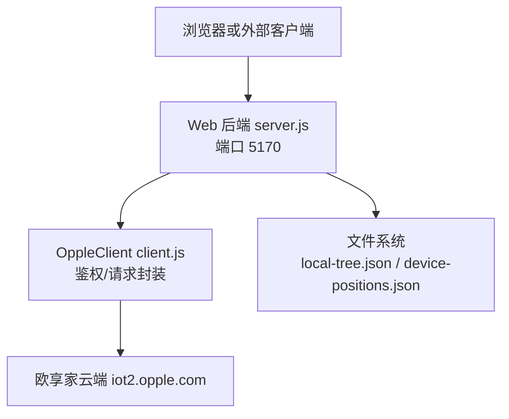
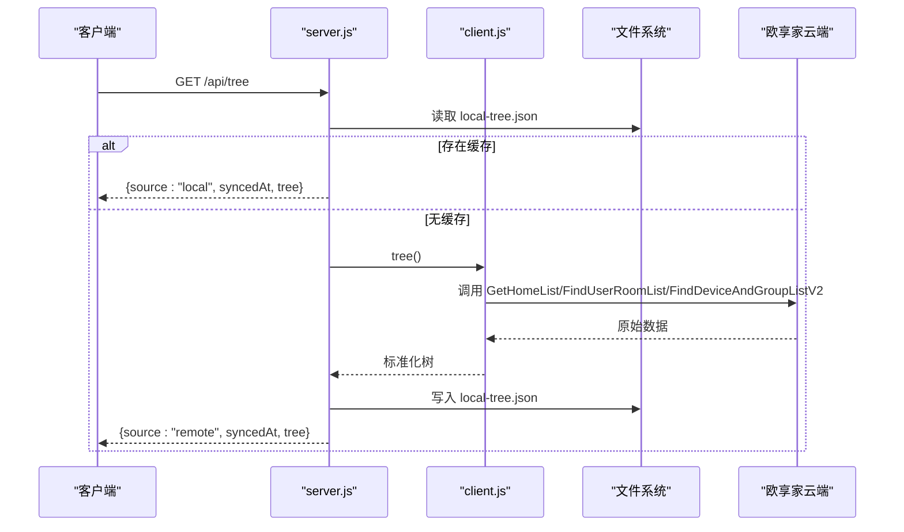
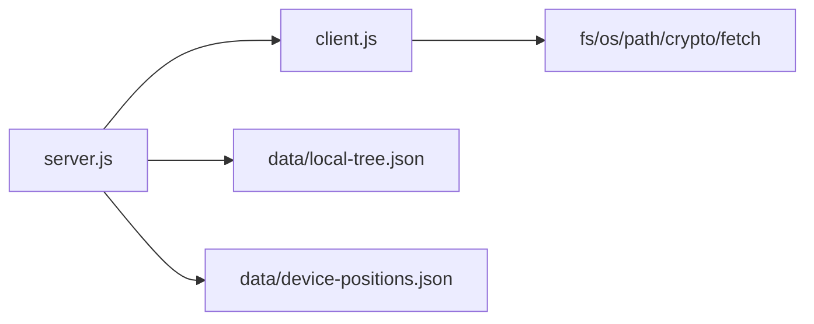

# API接口文档

<cite>
**本文引用的文件**   
- [README.md](file://README.md)
- [package.json](file://package.json)
- [server.js](file://src/opple/server.js)
- [client.js](file://src/opple/client.js)
- [api_paths.txt](file://data/api_paths.txt)
</cite>

## 目录
1. [简介](#简介)
2. [项目结构](#项目结构)
3. [核心组件](#核心组件)
4. [架构总览](#架构总览)
5. [详细接口说明](#详细接口说明)
6. [依赖关系分析](#依赖关系分析)
7. [性能与缓存策略](#性能与缓存策略)
8. [错误处理与调试](#错误处理与调试)
9. [安全、速率限制与版本兼容](#安全速率限制与版本兼容)
10. [客户端集成指南](#客户端集成指南)
11. [常见问题与排障](#常见问题与排障)
12. [结论](#结论)

## 简介
本项目通过逆向欧享家云端 API，提供欧普 INNO 生态设备的本地统一控制能力。项目包含：
- CLI 命令行工具
- Web 后端（Node http 服务）
- Web 前端（ice.js v3）
- 逆向产物与接口清单

Web 后端暴露一组 REST API，用于获取家庭/房间/设备树、同步云端数据、管理空间位置数据、查询设备动作能力等。所有对欧享家云端的调用由 OppleClient 封装，统一携带鉴权头并做错误码归一化。

本接口文档聚焦于 Web 后端的 REST API，包括 URL 模式、请求方法、认证方式、请求/响应 Schema、示例、错误码、缓存与同步机制、以及安全与兼容性注意事项。

**章节来源**
- [README.md:1-103](file://README.md#L1-L103)

## 项目结构
- bin/opple.js + src/cli.js：CLI 入口（不在本文重点）
- src/opple/client.js：OppleClient，负责鉴权、签名头构造、HTTP 请求封装、业务方法（家庭/房间/设备/动作）
- src/opple/server.js：Web 后端，路由 /api/*，托管静态前端资源
- web/：前端构建产物与源码
- data/api_paths.txt：欧享家云端已识别的接口路径清单
- data/local-tree.json：本地树快照（同步写入）
- data/device-positions.json：设备空间位置数据

**图表来源**
- [server.js:1-232](file://src/opple/server.js#L1-L232)
- [client.js:1-226](file://src/opple/client.js#L1-L226)

**章节来源**
- [README.md:6-16](file://README.md#L6-L16)
- [package.json:1-17](file://package.json#L1-L17)

## 核心组件
- OppleClient
  - 负责构造标准请求头（token/projectcode/clientid/app-version 等），统一处理 HTTP 状态与云端 StatusCode，返回 Result 字段内容。
  - 提供 homeList、tree、roomDevices、deviceSummary、actionAbility、callAction 等方法。
- Web 后端 server.js
  - 提供 /api/homes、/api/tree、/api/sync、/api/devices、/api/summary、/api/actions、/api/positions 等 REST 端点。
  - 实现本地树缓存（local-tree.json）与空间位置数据（device-positions.json）读写。
  - 为 GET /api/tree 注入设备位置与房间尺寸；POST /api/positions 更新空间布局。

**章节来源**
- [client.js:13-97](file://src/opple/client.js#L13-L97)
- [client.js:101-224](file://src/opple/client.js#L101-L224)
- [server.js:18-86](file://src/opple/server.js#L18-L86)
- [server.js:114-205](file://src/opple/server.js#L114-L205)

## 架构总览
Web 后端作为本地网关，对外暴露简洁 REST API；内部根据需求选择从本地缓存读取或回源云端拉取。空间位置数据独立存储，与树结构解耦。

**图表来源**
- [server.js:132-151](file://src/opple/server.js#L132-L151)
- [client.js:165-204](file://src/opple/client.js#L165-L204)

## 详细接口说明

### 通用约定
- 基础地址：http://localhost:5170（可通过环境变量 PORT 修改）
- 认证方式：Web 后端不直接校验 token；但回源云端时由 OppleClient 自动附加标准鉴权头（token/projectcode/clientid/app-version 等）。因此调用 /api/* 前需先完成凭据配置（CLI token save）。
- 跨域：服务端默认允许任意来源（Access-Control-Allow-Origin:*），便于开发调试。
- 响应格式：JSON；错误体通常包含 error 字段；成功体可能包含 ok、syncedAt、tree 等业务字段。

**章节来源**
- [server.js:10-11](file://src/opple/server.js#L10-L11)
- [server.js:118-122](file://src/opple/server.js#L118-L122)
- [client.js:41-58](file://src/opple/client.js#L41-L58)

---

### GET /api/homes
- 功能：获取家庭列表（实时请求云端）
- 认证：需要已配置的 token/projectcode（由 OppleClient.loadConfig 加载）
- 请求参数：无
- 响应体：
  - 成功：Array<Object> 家庭对象数组（RecordList 或根对象）
  - 失败：{ error: string }
- 示例
  - 成功：[{"projectCode":"...","projectName":"...","deviceCount":N,"onlineCount":M}, ...]
  - 失败：{"error":"未找到配置文件 ..."}

**章节来源**
- [server.js:127-131](file://src/opple/server.js#L127-L131)
- [client.js:154-158](file://src/opple/client.js#L154-L158)

---

### GET /api/tree
- 功能：获取“家庭→房间→设备”三层结构；优先返回本地缓存，无缓存则回源云端并落盘
- 认证：同上
- 请求参数：无
- 响应体：
  - source: "local" | "remote"
  - syncedAt: ISO 时间字符串
  - tree: Array<Object>，每个家庭含 rooms[]，房间含 devices[]，设备含 position/excluded 等
- 示例
  - 本地命中：{"source":"local","syncedAt":"...","tree":[...]}
  - 云端回源：{"source":"remote","syncedAt":"...","tree":[...]}

**章节来源**
- [server.js:132-144](file://src/opple/server.js#L132-L144)
- [client.js:165-204](file://src/opple/client.js#L165-L204)

---

### POST /api/sync
- 功能：一键同步，拉取云端最新结构写入本地快照，并返回最新树
- 认证：同上
- 请求体：无
- 响应体：
  - ok: true
  - syncedAt: ISO 时间字符串
  - tree: Array<Object>
- 示例
  - 成功：{"ok":true,"syncedAt":"...","tree":[...]}
  - 失败：{"error":"..."}

**章节来源**
- [server.js:145-152](file://src/opple/server.js#L145-L152)
- [client.js:165-204](file://src/opple/client.js#L165-L204)

---

### GET /api/devices
- 功能：获取设备列表；支持按房间过滤
- 认证：同上
- 查询参数：
  - gpNo: number（可选）指定房间 Gpno
- 响应体：
  - 无 gpNo：Array<Object> 设备列表
  - 有 gpNo：Array<Object> 该房间设备列表
- 示例
  - 成功：[{"vDeviceId":"...","name":"...","type":"...","protocol":"...","online":true,...}, ...]
  - 失败：{"error":"..."}

**章节来源**
- [server.js:153-158](file://src/opple/server.js#L153-L158)
- [client.js:110-125](file://src/opple/client.js#L110-L125)
- [client.js:210-224](file://src/opple/client.js#L210-L224)

---

### GET /api/summary
- 功能：设备摘要（轻量列表：名称/ID/房间/在线）
- 认证：同上
- 请求参数：无
- 响应体：Object（云端 DeviceSummaryV2 结果）
- 示例
  - 成功：{"RecordList":[...],...}
  - 失败：{"error":"..."}

**章节来源**
- [server.js:159-163](file://src/opple/server.js#L159-L163)
- [client.js:127-130](file://src/opple/client.js#L127-L130)

---

### GET /api/actions
- 功能：查询设备可用动作（能力表）
- 认证：同上
- 查询参数：
  - vDeviceId: string（必填）
- 响应体：Object（FindDeviceAbilityByVDeviceId 结果）
- 示例
  - 成功：{"Values":[{"KeyId":1,"Name":"...","Range":"..."},...]}
  - 失败：{"error":"vDeviceId required"} 或 {"error":"..."}

**章节来源**
- [server.js:164-170](file://src/opple/server.js#L164-L170)
- [client.js:132-135](file://src/opple/client.js#L132-L135)

---

### POST /api/positions
- 功能：保存房间布局（shape/positions/excluded）
- 认证：无需云端鉴权（仅写本地文件）
- 请求体：
  - projectCode: string（必填）
  - gpno: number|string（必填）
  - shape?: Object（可选）{w:number, h:number, depth:number}
  - positions?: Object（可选）{vDeviceId: position}
  - excluded?: string[]（可选）手动排除出空间模型的设备 id 列表
- 响应体：
  - ok: boolean
  - saved: number（本次保存的设备位置数量）
- 示例
  - 成功：{"ok":true,"saved":3}
  - 失败：{"error":"projectCode, gpno required"}

**章节来源**
- [server.js:171-191](file://src/opple/server.js#L171-L191)

---

### GET /api/positions
- 功能：导出空间数据（供 AI 空间推理）
- 认证：无需云端鉴权（仅读本地文件）
- 查询参数：
  - projectCode: string（可选）若提供则只导出该家庭的空间数据
- 响应体：
  - 无 projectCode：Object<projectCode, Object<gpno, {shape, devices}>>
  - 有 projectCode：Object<gpno, {shape, devices}>
  - 其中 devices 仅包含参与空间模型的灯/灯带（剔除 point 类与 excluded）
- 示例
  - 成功：{"123456":{"101":{"shape":{"w":100,"h":45,"depth":100},"devices":{"d1":{"kind":"circle","x":50,"y":50,"r":10,"elev":90}}}}}

**章节来源**
- [server.js:192-200](file://src/opple/server.js#L192-L200)

---

### 其他静态资源
- 当访问非 /api/* 路径时，服务端尝试从 web/build 目录提供静态文件；若未构建，返回提示 JSON。

**章节来源**
- [server.js:207-225](file://src/opple/server.js#L207-L225)

## 依赖关系分析
- server.js 依赖 client.js 提供的 OppleClient 进行云端交互
- client.js 依赖 Node fs/os/path/crypto 模块与 fetch API
- 数据持久化：
  - data/local-tree.json：家庭/房间/设备树快照
  - data/device-positions.json：设备空间位置数据

**图表来源**
- [server.js:1-16](file://src/opple/server.js#L1-L16)
- [client.js:1-6](file://src/opple/client.js#L1-L6)

**章节来源**
- [server.js:1-16](file://src/opple/server.js#L1-L16)
- [client.js:1-6](file://src/opple/client.js#L1-L6)

## 性能与缓存策略
- 本地树缓存
  - GET /api/tree 优先读取 data/local-tree.json，避免每次请求云端，提升响应速度。
  - POST /api/sync 强制回源并覆盖本地缓存。
- 空间位置数据
  - device-positions.json 独立存储，GET /api/tree 会实时合并位置信息，不受缓存影响。
  - POST /api/positions 即时写盘，保证编辑器与 3D 预览一致性。
- 分页与批量
  - 设备列表在 client.js 中采用分页循环拉取，确保全量数据。

**章节来源**
- [server.js:18-30](file://src/opple/server.js#L18-L30)
- [server.js:57-72](file://src/opple/server.js#L57-L72)
- [server.js:132-151](file://src/opple/server.js#L132-L151)
- [client.js:110-125](file://src/opple/client.js#L110-L125)

## 错误处理与调试
- 统一错误包装
  - server.js 对 /api/* 路由使用 try/catch，捕获异常并以 502 返回 {error: message}。
  - client.js 对 HTTP 状态与云端 StatusCode 进行统一判断，抛出 Error。
- 常见错误
  - 未配置凭据：{"error":"未找到配置文件 ..."}
  - 参数缺失：{"error":"vDeviceId required"} 或 {"error":"projectCode, gpno required"}
  - 云端异常：{"error":"[错误码] 消息 (path)"}
- 调试建议
  - 使用 CLI raw 命令直接调试任意云端接口
  - 检查请求头是否全小写（token/projectcode/clientid…），混用大小写会触发 12004/11009 错误

**章节来源**
- [server.js:201-204](file://src/opple/server.js#L201-L204)
- [client.js:76-94](file://src/opple/client.js#L76-L94)
- [README.md:41-46](file://README.md#L41-L46)

## 安全、速率限制与版本兼容
- 安全
  - token/projectcode 属于敏感凭据，请妥善保管；不要将 .opple-cli.json 提交到仓库。
  - Web 后端默认开启 CORS *，生产环境应限制允许的 Origin。
- 速率限制
  - 当前实现未内置速率限制；如需限流，可在 server.js 入口处增加中间件。
- 版本兼容
  - client.js 固定 app-version 与 clientid，保持与 App 一致；若云端升级，可能需要调整版本号或新增兼容逻辑。
  - 部分云端接口返回 StatusCode 为字符串 '0'，client.js 已做兼容处理。

**章节来源**
- [client.js:41-58](file://src/opple/client.js#L41-L58)
- [client.js:87-93](file://src/opple/client.js#L87-L93)
- [server.js:118-122](file://src/opple/server.js#L118-L122)

## 客户端集成指南
- 前置条件
  - 安装 Node >= 22
  - 运行 Web 后端：node src/opple/server.js
  - 使用 CLI 保存凭据：opple token save <32位token> <projectCode>
- 基本流程
  - 调用 GET /api/tree 获取本地缓存或回源云端
  - 调用 GET /api/actions?vDeviceId=... 获取设备动作能力
  - 调用 POST /api/positions 保存房间布局
  - 调用 GET /api/positions?projectCode=... 导出空间数据
- 示例
  - 获取家庭列表：curl http://localhost:5170/api/homes
  - 同步云端：curl -X POST http://localhost:5170/api/sync
  - 查询动作能力：curl "http://localhost:5170/api/actions?vDeviceId=2122050"
  - 保存布局：curl -X POST http://localhost:5170/api/positions -H "Content-Type: application/json" -d '{"projectCode":"356748","gpno":101,"shape":{"w":100,"h":45,"depth":100},"positions":{"2122050":{"kind":"circle","x":50,"y":50,"r":10,"elev":90}}}'

**章节来源**
- [README.md:18-39](file://README.md#L18-L39)
- [README.md:60-69](file://README.md#L60-L69)
- [server.js:127-200](file://src/opple/server.js#L127-L200)

## 常见问题与排障
- 为什么 /api/tree 返回空或报错？
  - 检查是否已执行 opple token save；确认 .opple-cli.json 存在且有效。
- 为什么某些云端接口报 12004/11009？
  - 检查请求头是否全小写；参考 README 中的注意事项。
- 如何查看完整云端接口清单？
  - 参考 data/api_paths.txt，包含 553 条已识别的云端接口路径。
- 如何调试任意云端接口？
  - 使用 CLI raw 命令：opple raw GET /api/Project/GetHomeList

**章节来源**
- [README.md:41-46](file://README.md#L41-L46)
- [README.md:58-59](file://README.md#L58-L59)
- [api_paths.txt:1-553](file://data/api_paths.txt#L1-L553)

## 结论
本项目的 Web 后端以简洁的 REST API 暴露家庭/房间/设备管理能力，并通过本地缓存与空间位置数据优化性能与体验。OppleClient 统一封装了云端鉴权与错误处理，降低上层集成复杂度。建议在集成时遵循本文档的认证、参数与错误处理约定，并在生产环境中加强 CORS 与安全策略。