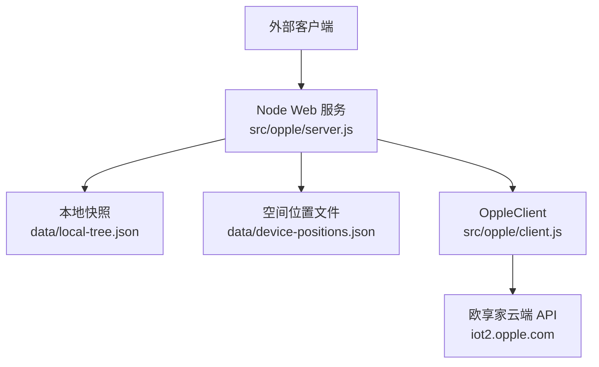
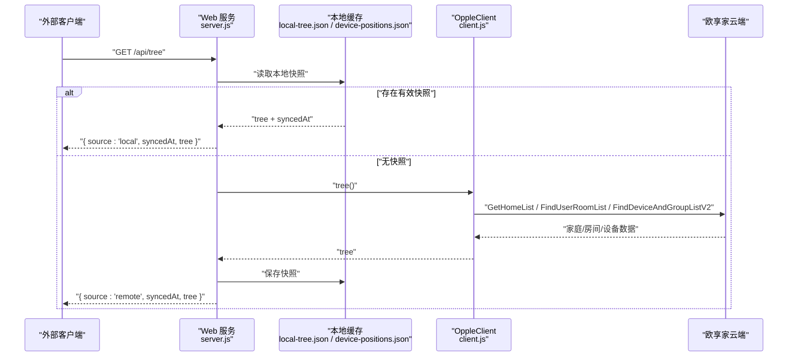
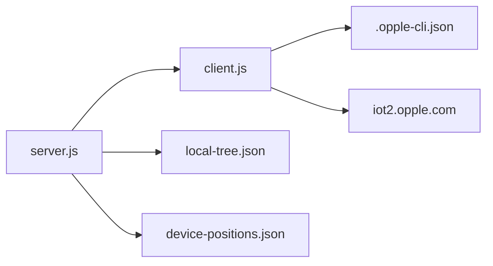

# REST API端点

<cite>
**本文引用的文件**   
- [README.md](file://README.md)
- [server.js](file://src/opple/server.js)
- [client.js](file://src/opple/client.js)
- [api_paths.txt](file://data/api_paths.txt)
</cite>

## 目录
1. [简介](#简介)
2. [项目结构](#项目结构)
3. [核心组件](#核心组件)
4. [架构总览](#架构总览)
5. [接口规范](#接口规范)
6. [依赖关系分析](#依赖关系分析)
7. [性能与缓存策略](#性能与缓存策略)
8. [错误处理与故障排查](#错误处理与故障排查)
9. [客户端集成指南](#客户端集成指南)
10. [结论](#结论)

## 简介
本仓库提供欧普 INNO（欧享家）设备的本地统一控制能力，通过逆向云端协议封装为 Node 服务，对外暴露一组 REST API。Web 后端基于零依赖 Node http 服务，复用 OppleClient 访问欧享家云端；同时维护本地快照与空间位置数据，实现“本地优先”的树结构与设备布局编辑、导出能力。

需要重点说明的是：
- 本项目的对外 REST API 由 `src/opple/server.js` 提供，路径以 `/api/` 开头。
- 这些对外 API 内部会调用欧享家云端接口（例如 `/api/Project/GetHomeList`、`/businessapi/Room/FindUserRoomList`、`/api/device/FindDeviceAndGroupListV2` 等），但对外文档只描述本项目暴露的 `/api/homes`、`/api/tree`、`/api/sync`、`/api/devices`、`/api/summary`、`/api/actions`、`/api/positions`。
- 认证凭据（token、projectCode）保存在用户目录下配置文件，服务端每次请求前加载配置并附加到对云端的请求头中。

**章节来源**
- [README.md:1-16](file://README.md#L1-L16)
- [README.md:60-69](file://README.md#L60-L69)

## 项目结构
与本 REST API 直接相关的代码位于 `src/opple/server.js` 和 `src/opple/client.js`：
- `server.js`：Node http 服务，负责路由 `/api/*`、CORS、JSON 响应、本地快照读写、空间位置读写、静态前端托管。
- `client.js`：OppleClient，负责读取配置、构造鉴权请求头、发起欧享家云端 HTTP 请求、封装家庭/房间/设备/动作等业务方法。
- `data/api_paths.txt`：欧享家云端接口清单，用于理解服务端调用的下游接口范围。
- `README.md`：Web API 概览、Token 获取方式、同步机制说明。



**图表来源**
- [server.js:1-16](file://src/opple/server.js#L1-L16)
- [server.js:18-38](file://src/opple/server.js#L18-L38)
- [client.js:1-11](file://src/opple/client.js#L1-L11)
- [client.js:67-94](file://src/opple/client.js#L67-L94)

**章节来源**
- [server.js:1-16](file://src/opple/server.js#L1-L16)
- [client.js:1-11](file://src/opple/client.js#L1-L11)
- [api_paths.txt:1-553](file://data/api_paths.txt#L1-L553)

## 核心组件
- **Web 服务层**：解析 URL、匹配 `/api/` 路由、返回 JSON、处理 CORS、读取/写入本地文件。
- **本地缓存层**：
  - 家庭/房间/设备树快照：`data/local-tree.json`，包含 `syncedAt` 与 `tree`。
  - 空间位置数据：`data/device-positions.json`，按 `projectCode -> gpno -> { shape, devices, excluded }` 组织。
- **云端客户端层**：OppleClient 负责鉴权、分页拉取、聚合三层树、查询设备动作能力、调用设备动作。

关键职责边界：
- `/api/homes`、`/api/devices`、`/api/summary`、`/api/actions` 通常实时请求云端。
- `/api/tree` 优先返回本地快照，无快照时回源云端并落盘。
- `/api/sync` 强制拉取云端最新结构并更新本地快照。
- `/api/positions` 读写空间布局，不经过树快照。

**章节来源**
- [server.js:18-38](file://src/opple/server.js#L18-L38)
- [server.js:57-86](file://src/opple/server.js#L57-L86)
- [client.js:101-224](file://src/opple/client.js#L101-L224)

## 架构总览
下图展示一次典型请求从外部客户端到欧享家云端的完整链路，以及本地缓存与空间数据的参与方式。



**图表来源**
- [server.js:132-151](file://src/opple/server.js#L132-L151)
- [client.js:154-204](file://src/opple/client.js#L154-L204)

## 接口规范

### 通用约定
- 基础地址：`http://localhost:5170`（可通过环境变量 `PORT` 修改）。
- 响应格式：JSON，Content-Type 为 `application/json; charset=utf-8`。
- 跨域：服务端已设置允许任意来源与常用方法，便于浏览器调试。
- 认证方式：
  - 对本项目 REST API：无需额外鉴权头。
  - 对欧享家云端：由 OppleClient 自动附加小写请求头，包括 `token`、`projectcode`、`clientid`、`app-version`、`user-agent`、`tid` 等。
  - Token 与 projectCode 需提前通过 CLI 保存到用户目录配置文件。

**章节来源**
- [server.js:10-11](file://src/opple/server.js#L10-L11)
- [server.js:118-122](file://src/opple/server.js#L118-L122)
- [client.js:41-58](file://src/opple/client.js#L41-L58)
- [client.js:24-39](file://src/opple/client.js#L24-L39)
- [README.md:41-45](file://README.md#L41-L45)

---

### GET /api/homes
- **用途**：获取家庭列表。
- **认证**：使用 OppleClient 配置的 token/projectCode。
- **请求参数**：无。
- **成功响应**：数组或对象，表示家庭列表。
- **失败情况**：
  - 未配置 token/projectCode：HTTP 500，body 含 error。
  - 云端异常：HTTP 502，body 含 error。

示例响应（简化）：
```json
[
  {
    "ProjectCode": "...",
    "ProjectName": "...",
    "DeviceCount": 10,
    "OnlineCount": 8
  }
]
```

**章节来源**
- [server.js:127-131](file://src/opple/server.js#L127-L131)
- [client.js:154-158](file://src/opple/client.js#L154-L158)

---

### GET /api/tree
- **用途**：获取家庭→房间→设备三层结构，并合并房间 shape 与设备 position。
- **认证**：使用 OppleClient 配置的 token/projectCode。
- **请求参数**：无。
- **成功响应**：
  - `source`：`local` 或 `remote`。
  - `syncedAt`：本地快照时间戳。
  - `tree`：家庭数组，每个家庭包含 rooms，每个 room 包含 shape 与 devices。
- **失败情况**：
  - 未配置 token/projectCode：HTTP 500。
  - 云端异常：HTTP 502。

示例响应（简化）：
```json
{
  "source": "local",
  "syncedAt": "2025-01-01T12:00:00.000Z",
  "tree": [
    {
      "projectCode": "356748",
      "name": "我的家",
      "deviceCount": 10,
      "onlineCount": 8,
      "rooms": [
        {
          "gpno": 123,
          "name": "客厅",
          "deviceCount": 5,
          "shape": { "w": 100, "h": 45, "depth": 100 },
          "devices": [
            {
              "vDeviceId": "2122050",
              "name": "吸顶灯",
              "type": "灯具",
              "protocol": "蓝牙Mesh",
              "online": true,
              "parent": null,
              "position": {
                "kind": "circle",
                "x": 50,
                "y": 50,
                "r": 10,
                "elev": 95
              },
              "excluded": false
            }
          ]
        }
      ]
    }
  ]
}
```

**章节来源**
- [server.js:132-144](file://src/opple/server.js#L132-L144)
- [server.js:57-72](file://src/opple/server.js#L57-L72)
- [client.js:160-204](file://src/opple/client.js#L160-L204)

---

### POST /api/sync
- **用途**：一键同步，拉取欧享家云端最新家庭/房间/设备结构，写入本地快照，并返回最新树。
- **认证**：使用 OppleClient 配置的 token/projectCode。
- **请求体**：无必需字段。
- **成功响应**：
  - `ok`：true。
  - `syncedAt`：最新快照时间戳。
  - `tree`：最新三层结构。
- **失败情况**：
  - 未配置 token/projectCode：HTTP 500。
  - 云端异常：HTTP 502。

示例响应（简化）：
```json
{
  "ok": true,
  "syncedAt": "2025-01-01T12:05:00.000Z",
  "tree": [...]
}
```

**章节来源**
- [server.js:145-152](file://src/opple/server.js#L145-L152)
- [client.js:160-204](file://src/opple/client.js#L160-L204)

---

### GET /api/devices
- **用途**：获取设备列表。
- **认证**：使用 OppleClient 配置的 token/projectCode。
- **请求参数**：
  - `gpNo`：可选。指定房间 Gpno 时返回该房间设备；不传则返回全量设备。
- **成功响应**：设备数组。
- **失败情况**：
  - 未配置 token/projectCode：HTTP 500。
  - 云端异常：HTTP 502。

示例响应（简化）：
```json
[
  {
    "VDeviceId": "2122050",
    "DeviceName": "吸顶灯",
    "ClassSkuName": "灯具",
    "ProtocolTypeName": "蓝牙Mesh",
    "IsOnline": true,
    "ParentVDeviceId": null
  }
]
```

**章节来源**
- [server.js:153-158](file://src/opple/server.js#L153-L158)
- [client.js:110-125](file://src/opple/client.js#L110-L125)

---

### GET /api/summary
- **用途**：获取设备摘要（轻量列表，包含名称/ID/房间/在线状态等）。
- **认证**：使用 OppleClient 配置的 token/projectCode。
- **请求参数**：无。
- **成功响应**：设备摘要数据。
- **失败情况**：
  - 未配置 token/projectCode：HTTP 500。
  - 云端异常：HTTP 502。

示例响应（简化）：
```json
[
  {
    "vDeviceId": "2122050",
    "name": "吸顶灯",
    "room": "客厅",
    "online": true
  }
]
```

**章节来源**
- [server.js:159-163](file://src/opple/server.js#L159-L163)
- [client.js:127-130](file://src/opple/client.js#L127-L130)

---

### GET /api/actions
- **用途**：查询某设备的可用动作能力。
- **认证**：使用 OppleClient 配置的 token/projectCode。
- **请求参数**：
  - `vDeviceId`：必填。设备虚拟 ID。
- **成功响应**：设备动作能力列表。
- **失败情况**：
  - 缺少 vDeviceId：HTTP 400，body 含 error。
  - 未配置 token/projectCode：HTTP 500。
  - 云端异常：HTTP 502。

示例响应（简化）：
```json
[
  {
    "KeyId": 1,
    "Name": "开关",
    "Values": ["on", "off"]
  },
  {
    "KeyId": 2,
    "Name": "色温",
    "Min": 1800,
    "Max": 12000
  }
]
```

**章节来源**
- [server.js:164-170](file://src/opple/server.js#L164-L170)
- [client.js:132-135](file://src/opple/client.js#L132-L135)

---

### POST /api/positions
- **用途**：保存房间布局，支持更新房间尺寸、设备位置、手动排除设备。
- **认证**：无需额外认证，但操作影响后续 `/api/tree` 与 `/api/positions` 导出。
- **请求体**：
  - `projectCode`：必填。项目编码。
  - `gpno`：必填。房间编号。
  - `shape`：可选。房间尺寸 `{ w, h, depth }`。
  - `positions`：可选。设备位置映射 `{ vDeviceId: position }`。
  - `excluded`：可选。手动排除出空间模型的设备 id 列表。
- **成功响应**：
  - `ok`：true。
  - `saved`：本次保存的位置数量（仅当传入 positions 时统计）。
- **失败情况**：
  - 缺少 projectCode 或 gpno：HTTP 400，body 含 error。

示例请求体（简化）：
```json
{
  "projectCode": "356748",
  "gpno": 123,
  "shape": { "w": 100, "h": 45, "depth": 100 },
  "positions": {
    "2122050": {
      "kind": "circle",
      "x": 50,
      "y": 50,
      "r": 10,
      "elev": 95
    }
  },
  "excluded": []
}
```

示例响应（简化）：
```json
{
  "ok": true,
  "saved": 1
}
```

**章节来源**
- [server.js:171-191](file://src/opple/server.js#L171-L191)
- [server.js:40-55](file://src/opple/server.js#L40-L55)

---

### GET /api/positions
- **用途**：导出空间数据，供 AI 空间推理使用。
- **认证**：无需额外认证。
- **请求参数**：
  - `projectCode`：可选。指定项目时仅导出该项目；不传则导出所有项目。
- **成功响应**：
  - 指定 projectCode：该项目下房间的结构化位置数据。
  - 不指定 projectCode：所有项目的结构化位置数据。
  - 数据结构中剔除不参与空间模型的 point 类历史残留与手动排除设备。

示例响应（简化）：
```json
{
  "356748": {
    "123": {
      "shape": { "w": 100, "h": 45, "depth": 100 },
      "devices": {
        "2122050": {
          "kind": "circle",
          "x": 50,
          "y": 50,
          "r": 10,
          "elev": 95
        }
      }
    }
  }
}
```

**章节来源**
- [server.js:192-200](file://src/opple/server.js#L192-L200)
- [server.js:74-86](file://src/opple/server.js#L74-L86)

## 依赖关系分析
- Web 服务依赖 OppleClient 访问云端。
- OppleClient 依赖用户目录配置文件中的 token/projectCode。
- Web 服务依赖两个本地文件：
  - `data/local-tree.json`：家庭/房间/设备树快照。
  - `data/device-positions.json`：空间位置数据。
- 云端接口清单来自 `data/api_paths.txt`，体现欧享家侧大量接口，但本项目仅封装其中一部分。



**图表来源**
- [server.js:1-16](file://src/opple/server.js#L1-L16)
- [client.js:1-11](file://src/opple/client.js#L1-L11)
- [client.js:24-39](file://src/opple/client.js#L24-L39)
- [api_paths.txt:1-553](file://data/api_paths.txt#L1-L553)

**章节来源**
- [server.js:1-16](file://src/opple/server.js#L1-L16)
- [client.js:24-39](file://src/opple/client.js#L24-L39)
- [api_paths.txt:1-553](file://data/api_paths.txt#L1-L553)

## 性能与缓存策略
- `/api/tree` 采用本地快照优先策略：
  - 首次或无快照时回源云端，拉取后写入 `data/local-tree.json`。
  - 后续请求直接返回本地快照，避免频繁云端调用。
  - 位置数据始终实时合并，不受快照影响。
- `/api/sync` 强制刷新本地快照，适合在家庭/房间/设备变更后进行。
- `/api/positions` 实时写盘，不经过树快照，保证编辑器与导出一致性。
- 默认端口为 5170，可通过环境变量覆盖。

优化建议：
- 高频读取场景优先使用 `/api/tree`，减少云端压力。
- 批量更新布局后调用 `/api/sync` 刷新树快照。
- 对 `/api/positions` 的写入应合并多次编辑结果，减少磁盘 I/O。

**章节来源**
- [server.js:132-151](file://src/opple/server.js#L132-L151)
- [server.js:171-200](file://src/opple/server.js#L171-L200)
- [server.js:10](file://src/opple/server.js#L10)

## 错误处理与故障排查

### 常见错误码与含义
- **HTTP 400**：请求参数缺失或非法。
  - 例如 `/api/actions` 缺少 `vDeviceId`。
  - 例如 `/api/positions` 缺少 `projectCode` 或 `gpno`。
- **HTTP 500**：服务端初始化失败，通常是 OppleClient 配置缺失。
  - 未找到 `.opple-cli.json`。
- **HTTP 502**：调用欧享家云端失败。
  - 网络异常、云端返回非 JSON、StatusCode 非 0。
- **HTTP 404**：路由不存在或静态资源未构建。

### 认证相关错误
- 请求头必须全小写（token/projectcode/clientid…），混用大小写可能触发云端校验异常。
- Token 与 projectCode 需通过 CLI 保存后再启动服务。

### 排查步骤
1. 确认已通过 CLI 保存 token 与 projectCode。
2. 检查用户目录配置文件是否存在且内容正确。
3. 若 `/api/tree` 返回 remote，说明无本地快照，可先调用 `/api/sync`。
4. 若 `/api/positions` 保存失败，检查 projectCode/gpno 是否匹配。
5. 若云端报错，查看 README 中逆向报告与抓包样本，确认接口结构与请求头。

**章节来源**
- [server.js:164-170](file://src/opple/server.js#L164-L170)
- [server.js:174-191](file://src/opple/server.js#L174-L191)
- [server.js:201-204](file://src/opple/server.js#L201-L204)
- [client.js:24-39](file://src/opple/client.js#L24-L39)
- [client.js:67-94](file://src/opple/client.js#L67-L94)
- [README.md:41-45](file://README.md#L41-L45)

## 客户端集成指南

### 前置准备
- 安装 Node 环境。
- 通过 CLI 保存 token 与 projectCode：
  - `opple token save <32位token> <projectCode>`
- 启动 Web 服务：
  - `node src/opple/server.js`
  - 默认访问 `http://localhost:5170`

### 推荐调用顺序
1. 首次运行：调用 `POST /api/sync` 拉取云端最新结构并落盘。
2. 常规读取：调用 `GET /api/tree` 获取本地优先的三层结构。
3. 设备控制前：调用 `GET /api/actions?vDeviceId=...` 获取设备动作能力。
4. 布局编辑：调用 `POST /api/positions` 保存房间尺寸、设备位置、排除列表。
5. 导出空间数据：调用 `GET /api/positions?projectCode=...` 供 AI 推理。

### 成功与失败样例
- 成功：
  - `/api/sync` 返回 `{ ok: true, syncedAt, tree }`。
  - `/api/tree` 返回 `{ source: 'local'|'remote', syncedAt, tree }`。
  - `/api/positions` 返回 `{ ok: true, saved: N }`。
- 失败：
  - `/api/actions` 缺少 vDeviceId：返回 `{ error: 'vDeviceId required' }`。
  - `/api/positions` 缺少 projectCode/gpno：返回 `{ error: 'projectCode, gpno required' }`。
  - 配置缺失：返回 `{ error: '...' }`。

### 注意事项
- 所有对外 API 均返回 JSON，注意 Content-Type。
- 浏览器调用时注意 CORS，服务端已放行常用方法与头部。
- 空间位置数据中的 elev 为离地百分比，UI 显示常转换为距顶米数。

**章节来源**
- [README.md:18-39](file://README.md#L18-L39)
- [README.md:60-69](file://README.md#L60-L69)
- [server.js:124-200](file://src/opple/server.js#L124-L200)
- [client.js:41-58](file://src/opple/client.js#L41-L58)

## 结论
本项目的 REST API 围绕欧享家云端的家庭/房间/设备模型展开，通过本地快照与空间位置文件提升读取性能与编辑体验。对外接口简洁明确，适合二次开发与自动化集成。使用时应优先关注认证配置、同步策略与空间数据语义，并结合错误码快速定位问题。