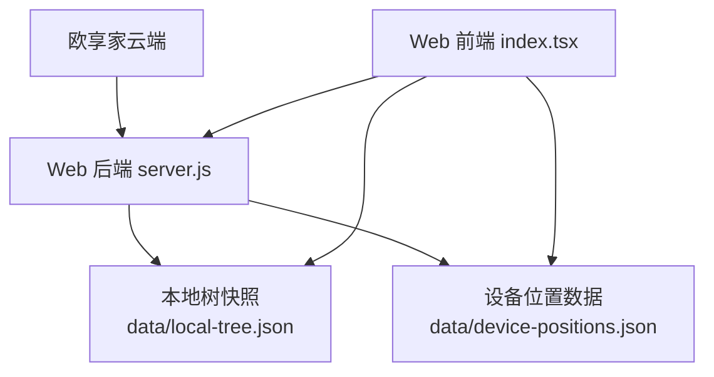
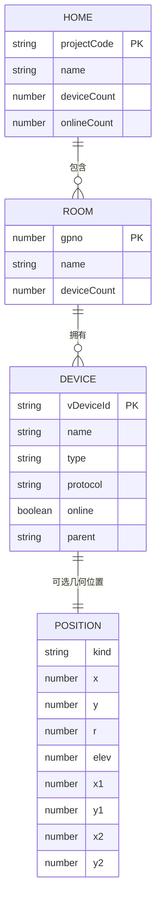
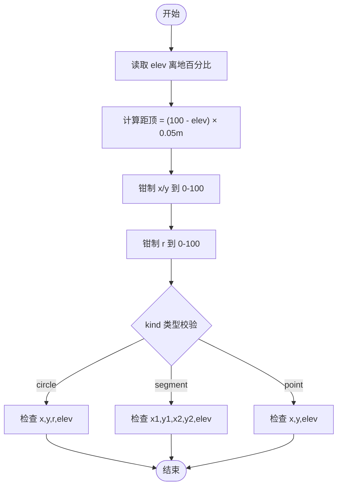
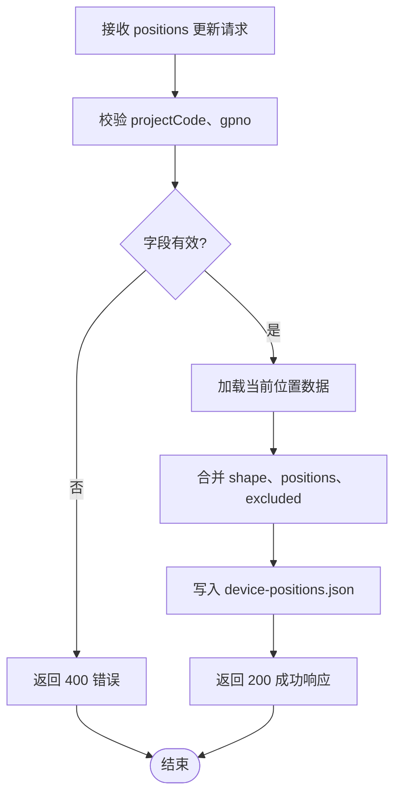
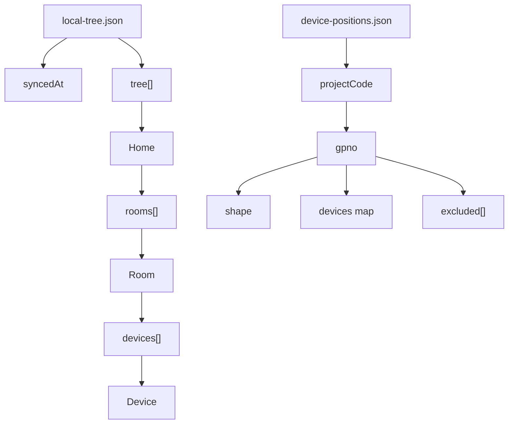
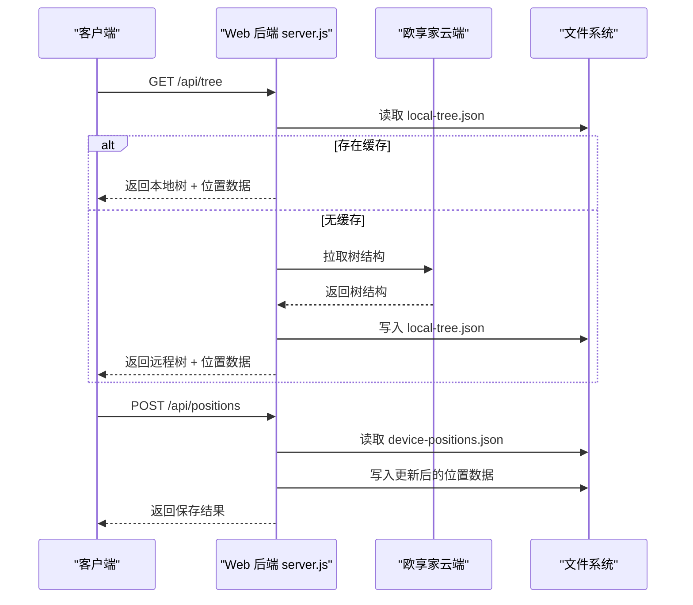

# 数据模型

<cite>
**本文引用的文件**   
- [README.md](file://README.md)
- [server.js](file://src/opple/server.js)
- [index.tsx](file://web/src/pages/index.tsx)
- [local-tree.json](file://data/local-tree.json)
- [device-positions.json](file://data/device-positions.json)
</cite>

## 目录
1. [引言](#引言)
2. [项目结构与数据来源](#项目结构与数据来源)
3. [核心实体定义](#核心实体定义)
4. [家庭-房间-设备三层空间建模关系](#家庭-房间-设备三层空间建模关系)
5. [设备位置坐标系统与房间尺寸格式](#设备位置坐标系统与房间尺寸格式)
6. [数据验证规则、约束与业务逻辑](#数据验证规则约束与业务逻辑)
7. [JSON Schema 定义与示例数据](#json-schema-定义与示例数据)
8. [数据持久化格式与本地缓存结构](#数据持久化格式与本地缓存结构)
9. [依赖关系与数据流分析](#依赖关系与数据流分析)
10. [性能与扩展建议](#性能与扩展建议)
11. [故障排查指南](#故障排查指南)
12. [结论](#结论)

## 引言
本数据模型文档聚焦欧享家（欧普 INNO 生态）本地控制项目的空间建模数据，明确 Home、Room、Device、Position 等核心实体的字段结构、数据类型、业务规则与约束。项目通过逆向云端 API，提供 CLI 与 Web 控制台，并在 Web 端实现家庭/房间/设备管理与 3D 空间建模；同时维护本地快照与设备位置数据，用于离线展示、布局编辑与 AI 空间推理。

## 项目结构与数据来源
本项目在数据层面主要涉及三类来源：
- 云端树结构：家庭、房间、设备列表，由云端接口返回，经 Web 后端拉取后写入本地快照。
- 本地树快照：`data/local-tree.json`，保存 `syncedAt` 与 `tree`，避免每次请求云端。
- 设备位置数据：`data/device-positions.json`，保存房间形状、设备几何位置与排除列表。



**图表来源**
- [server.js:12-16](file://src/opple/server.js#L12-L16)
- [server.js:18-30](file://src/opple/server.js#L18-L30)
- [server.js:32-38](file://src/opple/server.js#L32-L38)
- [index.tsx:8-18](file://web/src/pages/index.tsx#L8-L18)

**章节来源**
- [README.md:6-16](file://README.md#L6-L16)
- [server.js:12-16](file://src/opple/server.js#L12-L16)
- [server.js:18-30](file://src/opple/server.js#L18-L30)
- [server.js:32-38](file://src/opple/server.js#L32-L38)

## 核心实体定义
本节定义 Home、Room、Device、Position 的核心字段、类型与业务含义。

### Home（家庭）
- projectCode：字符串，家庭唯一标识。
- name：字符串，家庭名称。
- deviceCount：数字，家庭设备总数。
- onlineCount：数字或空，在线设备数（部分快照中为空）。
- rooms：数组，包含多个 Room。

### Room（房间）
- gpno：数字，房间唯一标识。
- name：字符串，房间名称。
- deviceCount：数字或空，房间设备数。
- devices：数组，包含多个 Device。
- shape：对象，房间三维尺寸，见“房间尺寸格式”。

### Device（设备）
- vDeviceId：字符串，设备唯一标识。
- name：字符串，设备名称。
- type：字符串或空，设备类型。
- protocol：字符串或空，通信协议。
- online：布尔值，是否在线。
- parent：字符串或空，父设备标识。
- position：Position 或空，设备几何位置（仅灯与灯带参与空间模型）。
- excluded：布尔值，是否被手动排除出空间模型。

### Position（设备位置）
Position 是联合类型，支持三种形态：
- circle：吸顶灯圆盘。
  - kind：固定为 "circle"。
  - x：平面横坐标百分比，范围 0-100。
  - y：平面纵坐标百分比，范围 0-100。
  - r：半径百分比，范围 0-100。
  - elev：离地高度百分比，范围 0-100（0=地面，100=天花）。
  - name：可选显示名。
- segment：灯带线段。
  - kind：固定为 "segment"。
  - x1, y1：起点平面坐标百分比。
  - x2, y2：终点平面坐标百分比。
  - elev：安装高度百分比。
  - name：可选显示名。
- point：网关/插座等点位设备。
  - kind：固定为 "point"。
  - x, y：平面坐标百分比。
  - elev：安装高度百分比。
  - name：可选显示名。

注意：point 类设备不参与空间模型编辑与导出，仅作为历史残留或参考点。

**章节来源**
- [index.tsx:8-18](file://web/src/pages/index.tsx#L8-L18)
- [index.tsx:22-31](file://web/src/pages/index.tsx#L22-L31)
- [index.tsx:33-47](file://web/src/pages/index.tsx#L33-L47)
- [server.js:57-72](file://src/opple/server.js#L57-L72)

## 家庭-房间-设备三层空间建模关系
三层结构以家庭为根，房间为子节点，设备为叶子节点。每个房间可拥有多个设备，设备可具备几何位置信息。位置数据独立存储于 `device-positions.json`，并通过后端注入到树结构中返回给前端。



**图表来源**
- [local-tree.json:3-17](file://data/local-tree.json#L3-L17)
- [local-tree.json:18-174](file://data/local-tree.json#L18-L174)
- [device-positions.json:2-52](file://data/device-positions.json#L2-L52)

**章节来源**
- [local-tree.json:3-17](file://data/local-tree.json#L3-L17)
- [local-tree.json:18-174](file://data/local-tree.json#L18-L174)
- [device-positions.json:2-52](file://data/device-positions.json#L2-L52)

## 设备位置坐标系统与房间尺寸格式
坐标系统采用房间平面百分比与高度百分比：
- 平面坐标：x、y、x1、y2 均为 0-100 的百分比，表示设备在房间平面上的相对位置。
- 高度坐标：elev 为离地百分比，0=地面，100=天花；UI 常以“距顶”米数呈现，换算公式为距顶 = (100 - elev) × 0.05m。
- 单位换算：每百分比单位对应 0.05 米，即 100 单位 = 5 米。

房间尺寸格式：
- shape.w：房间宽度百分比。
- shape.h：房间高度百分比（决定盒子比例）。
- shape.depth：房间深度百分比。
- 默认值：当未设置时，使用 `{ w: 100, h: 45, depth: 100 }`。



**图表来源**
- [index.tsx:8-18](file://web/src/pages/index.tsx#L8-L18)
- [index.tsx:49-53](file://web/src/pages/index.tsx#L49-L53)
- [server.js:57-72](file://src/opple/server.js#L57-L72)

**章节来源**
- [README.md:71-83](file://README.md#L71-L83)
- [index.tsx:8-18](file://web/src/pages/index.tsx#L8-L18)
- [index.tsx:49-53](file://web/src/pages/index.tsx#L49-L53)
- [server.js:57-72](file://src/opple/server.js#L57-L72)

## 数据验证规则、约束与业务逻辑
- 必填字段：
  - Home：projectCode、name、rooms。
  - Room：gpno、name、devices。
  - Device：vDeviceId、name、type、protocol、online、parent。
  - Position：kind 必须为 "circle"、"segment" 或 "point"；对应字段需满足几何约束。
- 取值范围：
  - 所有平面坐标与 elev 必须在 0-100 范围内。
  - circle.r 必须在 0-100 范围内。
- 业务规则：
  - point 类设备不参与空间模型编辑与导出。
  - excluded 列表中的设备不参与位置编辑、3D 渲染与 `/api/positions` 导出。
  - 若设备无 position，则视为不参与空间模型。
  - 房间 shape 缺失时使用默认值 `{ w: 100, h: 45, depth: 100 }`。
- 错误处理：
  - 缺少 projectCode 或 gpno 时返回 400。
  - JSON 解析失败时返回 502。
  - 前端保存失败时弹出提示并保留脏状态。



**图表来源**
- [server.js:171-190](file://src/opple/server.js#L171-L190)

**章节来源**
- [server.js:171-190](file://src/opple/server.js#L171-L190)
- [server.js:201-204](file://src/opple/server.js#L201-L204)
- [index.tsx:502-518](file://web/src/pages/index.tsx#L502-L518)

## JSON Schema 定义与示例数据
以下给出各实体的 JSON Schema 定义与示例数据路径，便于外部工具进行数据校验与生成。

### Home Schema
```json
{
  "$schema": "http://json-schema.org/draft-07/schema#",
  "type": "object",
  "required": ["projectCode", "name", "rooms"],
  "properties": {
    "projectCode": { "type": "string" },
    "name": { "type": "string" },
    "deviceCount": { "type": "number" },
    "onlineCount": { "type": ["number", "null"] },
    "rooms": {
      "type": "array",
      "items": { "$ref": "#/definitions/Room" }
    }
  },
  "definitions": {
    "Room": {
      "type": "object",
      "required": ["gpno", "name", "devices"],
      "properties": {
        "gpno": { "type": "number" },
        "name": { "type": "string" },
        "deviceCount": { "type": ["number", "null"] },
        "devices": {
          "type": "array",
          "items": { "$ref": "#/definitions/Device" }
        },
        "shape": { "$ref": "#/definitions/RoomShape" }
      }
    },
    "Device": {
      "type": "object",
      "required": ["vDeviceId", "name", "type", "protocol", "online", "parent"],
      "properties": {
        "vDeviceId": { "type": "string" },
        "name": { "type": "string" },
        "type": { "type": ["string", "null"] },
        "protocol": { "type": ["string", "null"] },
        "online": { "type": "boolean" },
        "parent": { "type": ["string", "null"] },
        "position": { "$ref": "#/definitions/Position" },
        "excluded": { "type": "boolean" }
      }
    },
    "RoomShape": {
      "type": "object",
      "required": ["w", "h", "depth"],
      "properties": {
        "w": { "type": "number", "minimum": 0, "maximum": 100 },
        "h": { "type": "number", "minimum": 0, "maximum": 100 },
        "depth": { "type": "number", "minimum": 0, "maximum": 100 }
      }
    },
    "Position": {
      "oneOf": [
        {
          "type": "object",
          "required": ["kind", "x", "y", "r", "elev"],
          "properties": {
            "kind": { "const": "circle" },
            "x": { "type": "number", "minimum": 0, "maximum": 100 },
            "y": { "type": "number", "minimum": 0, "maximum": 100 },
            "r": { "type": "number", "minimum": 0, "maximum": 100 },
            "elev": { "type": "number", "minimum": 0, "maximum": 100 }
          }
        },
        {
          "type": "object",
          "required": ["kind", "x1", "y1", "x2", "y2", "elev"],
          "properties": {
            "kind": { "const": "segment" },
            "x1": { "type": "number", "minimum": 0, "maximum": 100 },
            "y1": { "type": "number", "minimum": 0, "maximum": 100 },
            "x2": { "type": "number", "minimum": 0, "maximum": 100 },
            "y2": { "type": "number", "minimum": 0, "maximum": 100 },
            "elev": { "type": "number", "minimum": 0, "maximum": 100 }
          }
        },
        {
          "type": "object",
          "required": ["kind", "x", "y", "elev"],
          "properties": {
            "kind": { "const": "point" },
            "x": { "type": "number", "minimum": 0, "maximum": 100 },
            "y": { "type": "number", "minimum": 0, "maximum": 100 },
            "elev": { "type": "number", "minimum": 0, "maximum": 100 }
          }
        }
      ]
    }
  }
}
```

### 示例数据
- 本地树快照示例：[local-tree.json](file://data/local-tree.json)
- 设备位置数据示例：[device-positions.json](file://data/device-positions.json)

**章节来源**
- [local-tree.json:1-175](file://data/local-tree.json#L1-L175)
- [device-positions.json:1-53](file://data/device-positions.json#L1-L53)

## 数据持久化格式与本地缓存结构
- 本地树快照 `data/local-tree.json`：
  - syncedAt：ISO 时间戳，记录同步时间。
  - tree：Home 数组，结构同云端返回。
- 设备位置数据 `data/device-positions.json`：
  - 顶层键为 projectCode。
  - 次层键为 gpno（字符串化）。
  - 每个房间包含 shape、devices、excluded。
  - devices 为 vDeviceId 到 Position 的映射。



**图表来源**
- [server.js:18-30](file://src/opple/server.js#L18-L30)
- [server.js:32-55](file://src/opple/server.js#L32-L55)
- [local-tree.json:1-175](file://data/local-tree.json#L1-L175)
- [device-positions.json:1-53](file://data/device-positions.json#L1-L53)

**章节来源**
- [server.js:18-30](file://src/opple/server.js#L18-L30)
- [server.js:32-55](file://src/opple/server.js#L32-L55)
- [local-tree.json:1-175](file://data/local-tree.json#L1-L175)
- [device-positions.json:1-53](file://data/device-positions.json#L1-L53)

## 依赖关系与数据流分析
Web 后端提供 REST API，负责：
- 从云端拉取家庭/房间/设备树结构。
- 将树结构写入本地快照。
- 读取并合并设备位置数据。
- 暴露 `/api/tree`、`/api/sync`、`/api/positions` 等接口。

前端通过 API 获取数据并进行 3D 预览与布局编辑。



**图表来源**
- [server.js:124-152](file://src/opple/server.js#L124-L152)
- [server.js:171-190](file://src/opple/server.js#L171-L190)

**章节来源**
- [server.js:124-152](file://src/opple/server.js#L124-L152)
- [server.js:171-190](file://src/opple/server.js#L171-L190)

## 性能与扩展建议
- 性能优化：
  - 优先使用本地快照减少云端请求。
  - 设备位置数据按需合并，避免全量重算。
  - 对大体积 JSON 文件考虑分片或增量更新。
- 扩展建议：
  - 增加设备能力元数据（如动作枚举、参数范围）。
  - 支持多语言房间名与设备名。
  - 引入版本控制以便迁移旧格式。

## 故障排查指南
- 常见问题：
  - 缺少 projectCode 或 gpno：检查请求体字段完整性。
  - JSON 解析失败：检查文件格式与编码。
  - 前端保存失败：查看网络响应与浏览器控制台错误。
- 调试步骤：
  - 使用 `/api/actions?vDeviceId=` 查询设备能力。
  - 使用 `/api/summary`、`/api/homes`、`/api/devices` 获取实时数据。
  - 检查 `data/local-tree.json` 与 `data/device-positions.json` 内容一致性。

**章节来源**
- [server.js:164-170](file://src/opple/server.js#L164-L170)
- [server.js:171-190](file://src/opple/server.js#L171-L190)
- [server.js:201-204](file://src/opple/server.js#L201-L204)

## 结论
本数据模型明确了欧享家本地控制项目的核心实体与空间建模规则，定义了 Home、Room、Device、Position 的结构与约束，并提供了 JSON Schema 与示例数据。通过本地快照与设备位置数据的分离设计，项目在性能与可扩展性上取得平衡，适合进一步集成 AI 空间推理与自动化控制场景。