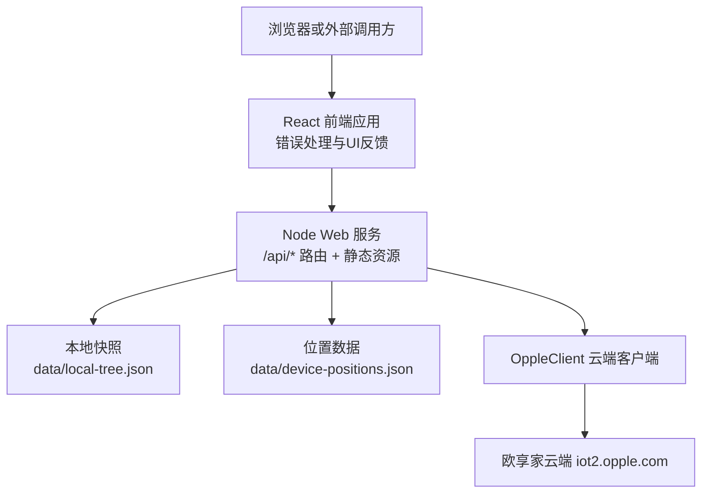
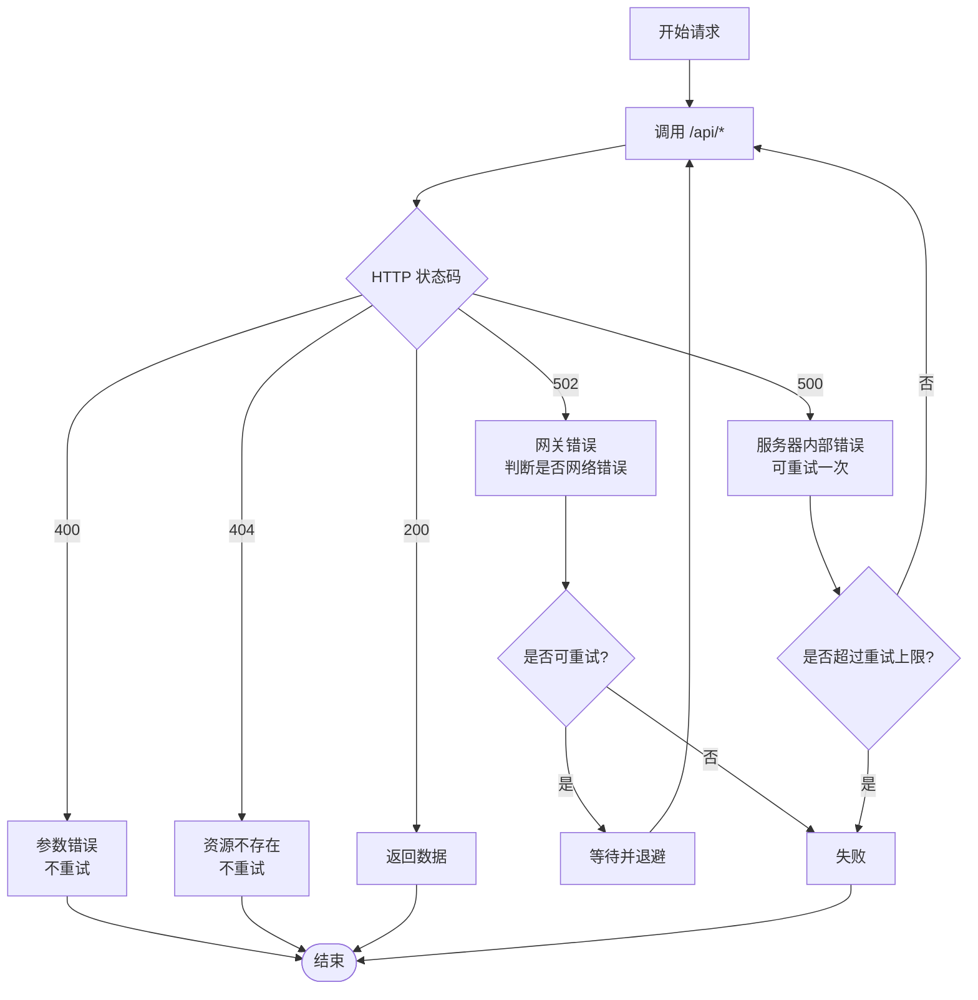
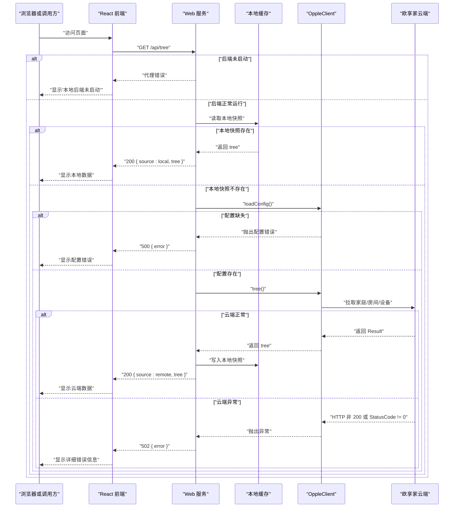

# 错误处理

<cite>
**本文引用的文件**   
- [src/opple/server.js](file://src/opple/server.js)
- [src/opple/client.js](file://src/opple/client.js)
- [web/src/pages/index.tsx](file://web/src/pages/index.tsx)
- [web/src/pages/index.module.css](file://web/src/pages/index.module.css)
- [README.md](file://README.md)
</cite>

## 更新摘要
**变更内容**   
- 增强了前端错误处理，特别是 token 过期场景的描述性错误消息
- 改进了 JSON 解析错误处理，当后端未运行时提供具体反馈
- 优化了同步操作的 UI 反馈机制
- 更新了客户端错误处理最佳实践以反映新的错误分类策略

## 目录
1. [引言](#引言)
2. [项目结构与错误处理边界](#项目结构与错误处理边界)
3. [HTTP 状态码定义](#http-状态码定义)
4. [统一错误响应格式](#统一错误响应格式)
5. [常见错误场景与处理方式](#常见错误场景与处理方式)
6. [错误诊断方法与调试技巧](#错误诊断方法与调试技巧)
7. [客户端错误处理最佳实践](#客户端错误处理最佳实践)
8. [重试机制建议](#重试机制建议)
9. [架构总览与错误流](#架构总览与错误流)
10. [结论](#结论)

## 引言
本文件面向调用方、前端开发者与运维人员，系统化说明本项目的错误处理约定。内容覆盖：
- HTTP 状态码含义与触发条件
- 统一的错误响应结构
- 配置缺失、网络超时、数据解析失败等典型场景的处理方式
- 错误诊断方法、日志定位与调试技巧
- 客户端错误处理最佳实践与重试策略

本项目包含三个关键错误来源：
- Web 前端应用：负责用户交互、错误展示和用户体验优化
- Web 后端服务：对外暴露 REST API，负责路由、参数校验、本地缓存读写、以及调用云端设备控制能力
- 欧享家云端客户端：封装鉴权头、请求构造、云端接口调用与业务状态码转换

## 项目结构与错误处理边界

**图示来源**
- [web/src/pages/index.tsx:88-106](file://web/src/pages/index.tsx#L88-L106)
- [src/opple/server.js:114-226](file://src/opple/server.js#L114-L226)
- [src/opple/client.js:67-94](file://src/opple/client.js#L67-L94)

**章节来源**
- [web/src/pages/index.tsx:88-106](file://web/src/pages/index.tsx#L88-L106)
- [src/opple/server.js:114-226](file://src/opple/server.js#L114-L226)
- [src/opple/client.js:67-94](file://src/opple/client.js#L67-L94)

## HTTP 状态码定义
本节列出当前实现中实际使用的 HTTP 状态码及其语义。

| 状态码 | 含义 | 触发条件与说明 |
|---|---|---|
| 200 | 成功 | 正常返回 JSON 数据；CORS 预检 OPTIONS 返回 204，但其他成功路径统一使用 200。 |
| 400 | 参数错误 | 必填参数缺失或非法，例如缺少 `vDeviceId`、`projectCode`、`gpno`。 |
| 404 | 资源不存在 | 未匹配到 `/api/*` 路由，或未找到对应静态资源时返回。 |
| 500 | 服务器内部错误 | 加载配置失败、读取/写入本地文件异常、或业务逻辑抛出未捕获异常。 |
| 502 | 网关错误 | 上层 try/catch 捕获到异常后返回，表示"网关层无法完成请求"。 |

补充说明：
- 服务端对 `/api/*` 的请求统一通过 `json(res, code, data)` 返回 JSON。
- 非 `/api/*` 的 GET 请求用于托管静态资源；若前端未构建，会返回 200 并附带提示信息。
- CORS 预检请求（OPTIONS）直接返回 204，不进入业务错误分支。

**章节来源**
- [src/opple/server.js:100-104](file://src/opple/server.js#L100-L104)
- [src/opple/server.js:118-122](file://src/opple/server.js#L118-L122)
- [src/opple/server.js:164-178](file://src/opple/server.js#L164-L178)
- [src/opple/server.js:201-225](file://src/opple/server.js#L201-L225)

## 统一错误响应格式
所有错误响应均为 JSON，且遵循以下结构：

| 字段 | 类型 | 含义 |
|---|---|---|
| error | string | 人类可读的错误消息，通常来自异常信息或参数校验提示。 |

示例语义：
- 参数缺失：`{ "error": "vDeviceId required" }`
- 配置缺失：`{ "error": "未找到配置文件 ... 先用 ... 保存" }`
- 云端异常：`{ "error": "HTTP 4xx/5xx ..." }`
- 数据解析失败：`{ "error": "响应非 JSON: ..." }`

注意：
- 成功响应不一定包含 `error` 字段，而是根据接口返回具体业务数据。
- 部分成功响应包含辅助字段，例如 `ok`、`source`、`syncedAt`、`saved` 等，但这些不属于错误字段。

**章节来源**
- [src/opple/server.js:100-104](file://src/opple/server.js#L100-L104)
- [src/opple/server.js:164-178](file://src/opple/server.js#L164-L178)
- [src/opple/server.js:201-204](file://src/opple/server.js#L201-L204)

## 常见错误场景与处理方式

### 配置缺失
**触发原因**  
用户未执行 CLI 保存 token 和 projectCode，导致配置文件不存在。

**表现**  
- 调用 `/api/homes`、`/api/tree`、`/api/sync`、`/api/devices`、`/api/summary`、`/api/actions` 等需要配置的接口时，可能返回 500。
- 错误消息会提示配置文件路径及保存命令。

**处理建议**  
- 先运行 CLI 保存凭据。
- 检查配置文件是否存在且可被 Node 进程读取。
- 确认 token 与 projectCode 有效。

**章节来源**
- [src/opple/client.js:24-30](file://src/opple/client.js#L24-L30)
- [src/opple/server.js:127-130](file://src/opple/server.js#L127-L130)
- [src/opple/server.js:139-141](file://src/opple/server.js#L139-L141)
- [src/opple/server.js:146-149](file://src/opple/server.js#L146-L149)
- [src/opple/server.js:153-157](file://src/opple/server.js#L153-L157)
- [src/opple/server.js:159-162](file://src/opple/server.js#L159-L162)
- [src/opple/server.js:164-167](file://src/opple/server.js#L164-L167)

### 参数错误
**触发原因**  
调用接口时缺少必填参数，例如查询设备动作能力时未传 `vDeviceId`。

**表现**  
- 返回 400。
- 错误消息明确提示缺失字段。

**处理建议**  
- 在调用前校验必填参数。
- 将错误消息展示给用户，并引导补全参数。

**章节来源**
- [src/opple/server.js:164-169](file://src/opple/server.js#L164-L169)
- [src/opple/server.js:174-178](file://src/opple/server.js#L174-L178)

### 网络超时或云端不可达
**触发原因**  
- 欧享家云端域名不可达。
- 网络超时。
- 云端返回非 200 的 HTTP 状态。

**表现**  
- 客户端发起 fetch 请求时抛出异常。
- 服务端 catch 后返回 502，错误消息中包含 HTTP 状态码与方法路径。

**处理建议**  
- 客户端识别 502，判断为临时网络问题时可重试。
- 记录完整错误消息，便于排查是 DNS、代理、防火墙还是云端服务问题。
- 避免无限重试，结合退避策略。

**章节来源**
- [src/opple/client.js:76-83](file://src/opple/client.js#L76-L83)
- [src/opple/server.js:202-204](file://src/opple/server.js#L202-L204)

### 数据解析失败
**触发原因**  
- 云端返回非 JSON 文本。
- 响应体损坏或截断。

**表现**  
- 客户端抛出"响应非 JSON"错误。
- 服务端最终返回 502，错误消息包含原始响应片段。

**处理建议**  
- 客户端记录响应长度与首段内容。
- 对非预期响应做降级处理，例如提示"云端返回异常，请稍后再试"。

**章节来源**
- [src/opple/client.js:84-86](file://src/opple/client.js#L84-L86)
- [src/opple/server.js:202-204](file://src/opple/server.js#L202-L204)

### 业务状态码异常
**触发原因**  
- 欧享家云端返回 `StatusCode !== 0`。
- 鉴权失败、权限不足、设备离线、参数非法等业务错误。

**表现**  
- 客户端抛出带业务状态码的消息，例如 `[12004] 未知错误 (/api/...)`。
- 服务端返回 502。

**处理建议**  
- 客户端根据业务状态码分类处理：
  - 鉴权类错误：引导重新登录或刷新 token。
  - 设备类错误：提示设备离线或不可控。
  - 参数类错误：修正请求参数。
- 不要把所有业务错误都当作网络错误重试。

**章节来源**
- [src/opple/client.js:87-93](file://src/opple/client.js#L87-L93)
- [README.md:41-45](file://README.md#L41-L45)

### 本地缓存或文件写入失败
**触发原因**  
- 本地快照文件损坏。
- 磁盘无写权限。
- 路径不存在或权限不足。

**表现**  
- 同步或保存位置数据时可能抛出异常。
- 服务端返回 500 或 502。

**处理建议**  
- 检查 `data/local-tree.json` 与 `data/device-positions.json` 的权限。
- 删除损坏的本地快照后重试同步。
- 确保 Node 进程有写入目标目录的权限。

**章节来源**
- [src/opple/server.js:18-30](file://src/opple/server.js#L18-L30)
- [src/opple/server.js:32-38](file://src/opple/server.js#L32-L38)
- [src/opple/server.js:174-190](file://src/opple/server.js#L174-L190)

### 前端开发环境后端未启动
**触发原因**  
- 开发模式下，前端通过 http-proxy 转发到 5170 端口
- 后端服务未启动或端口占用

**表现**  
- 前端显示"本地后端未启动（端口 5170）：请在仓库根目录先运行 npm run web，再刷新页面"
- 这是最常见的开发环境问题

**处理建议**  
- 确保后端服务已启动：`npm run web`
- 检查 5170 端口是否被占用
- 验证代理配置是否正确

**章节来源**
- [web/src/pages/index.tsx:98-101](file://web/src/pages/index.tsx#L98-L101)

## 错误诊断方法与调试技巧

### 快速定位错误来源
1. 先看 HTTP 状态码：
   - 400：优先检查请求参数。
   - 404：检查 URL 是否拼写正确。
   - 500：检查本地配置、文件权限、业务逻辑。
   - 502：重点检查网络、云端可达性与云端返回。
2. 再看错误消息中的路径与方法：
   - 如果包含 `/api/...`，说明是服务端路由或业务逻辑问题。
   - 如果包含 `HTTP 4xx/5xx`，说明是底层网络或云端问题。
3. 最后看业务状态码：
   - 如果包含 `[12004]`、`[11009]` 等，通常是鉴权或请求头大小写问题。

### 常用调试步骤
- 使用 CLI 的 raw 命令直接调用云端接口，验证 token 与 projectCode 是否有效。
- 检查是否使用了小写请求头；混用大小写会触发云端校验异常。
- 查看本地快照是否可用：
  - 存在时，`/api/tree` 优先返回本地数据。
  - 不存在或损坏时，会回源云端并落盘。
- 检查前端是否已构建：
  - 未构建时，根路径仍返回 200，但会提示构建命令。

**章节来源**
- [README.md:41-45](file://README.md#L41-L45)
- [README.md:60-69](file://README.md#L60-L69)
- [src/opple/server.js:132-144](file://src/opple/server.js#L132-L144)
- [src/opple/server.js:207-223](file://src/opple/server.js#L207-L223)

## 客户端错误处理最佳实践

### 错误分类
建议客户端按以下维度分类处理：
- 参数错误：400
- 资源不存在：404
- 配置或权限错误：500 或 502，且错误消息包含鉴权相关关键词
- 网络错误：502，且错误消息包含 HTTP 状态码
- 业务错误：502，且错误消息包含业务状态码
- 开发环境问题：特定错误消息如"本地后端未启动"

### 用户提示策略
- 400：直接提示缺参或参数非法，并提供表单校验反馈。
- 404：提示接口地址错误或资源已被移除。
- 500：提示"服务内部错误"，可引导用户稍后重试或联系管理员。
- 502：区分网络错误与业务错误：
  - 网络错误：提示"网络不稳定，请稍后再试"。
  - 业务错误：根据业务状态码给出具体提示，如"请先登录""设备离线"。
- 开发环境问题：提供明确的解决步骤，如"请启动后端服务"。

### 前端错误处理增强
**Token 过期处理**  
- 同步操作是唯一依赖云端 token 的操作，token 失效时会显示专门的错误消息
- 错误消息包含"token 可能失效，请重新抓包更新"的提示
- 用户需要重新获取有效的 token 才能继续同步

**JSON 解析错误处理**  
- 检测非 JSON 响应，最常见的是开发代理返回的错误页面
- 针对"Error occurred while trying to proxy"错误提供具体的解决方案
- 对于其他非 JSON 响应，显示完整的 HTTP 状态码和响应片段

**同步操作 UI 反馈**  
- 同步按钮显示"同步中..."状态，防止重复点击
- 成功后显示"已同步"状态，2秒后自动恢复
- 使用旋转动画图标提供视觉反馈
- 错误时显示红色错误横幅，包含详细错误信息

### 日志记录
建议记录：
- 请求方法、URL、时间戳
- HTTP 状态码
- 错误消息原文
- 是否包含业务状态码
- 是否可重试
- 是否为开发环境问题

### 幂等性考虑
- GET 请求天然幂等，适合重试。
- POST 请求需谨慎重试，尤其是控制设备动作的场景。
- 对于"查询树""获取设备列表"等只读操作，可安全重试。
- 对于"保存布局""同步数据"等操作，应结合去重或幂等键。

**章节来源**
- [web/src/pages/index.tsx:98-106](file://web/src/pages/index.tsx#L98-L106)
- [web/src/pages/index.tsx:1018-1032](file://web/src/pages/index.tsx#L1018-L1032)
- [web/src/pages/index.tsx:1126-1135](file://web/src/pages/index.tsx#L1126-L1135)
- [src/opple/server.js:124-204](file://src/opple/server.js#L124-L204)
- [src/opple/client.js:67-94](file://src/opple/client.js#L67-L94)

## 重试机制建议

### 何时重试
建议仅对以下情况启用重试：
- 网络超时或连接失败
- 云端返回临时性 5xx
- 查询类接口出现短暂 502

不建议重试：
- 400 参数错误
- 404 资源不存在
- 明确的鉴权失败（应先引导重新登录）
- 设备控制类 POST 请求（除非业务保证幂等）
- 开发环境问题（如后端未启动）

### 重试策略
- 最大重试次数：建议 2~3 次。
- 初始延迟：建议 1~2 秒。
- 指数退避：每次重试延迟翻倍。
- 抖动：加入随机抖动，避免雪崩。
- 取消重试：收到 400、404、明确鉴权错误时立即停止重试。

### 前端实现建议
- 使用 Promise 包装重试逻辑。
- 对每个接口设置独立的重试上限。
- 对高频接口增加全局限流。
- 对用户可见的错误提供"重试"按钮。
- 对开发环境问题提供直接的解决方案而非重试。

**图示来源**
- [src/opple/server.js:124-204](file://src/opple/server.js#L124-L204)
- [src/opple/client.js:76-93](file://src/opple/client.js#L76-L93)

## 架构总览与错误流

**图示来源**
- [web/src/pages/index.tsx:88-106](file://web/src/pages/index.tsx#L88-L106)
- [web/src/pages/index.tsx:1005-1016](file://web/src/pages/index.tsx#L1005-L1016)
- [src/opple/server.js:132-144](file://src/opple/server.js#L132-L144)
- [src/opple/client.js:24-30](file://src/opple/client.js#L24-L30)
- [src/opple/client.js:67-94](file://src/opple/client.js#L67-L94)

## 结论
本项目的错误处理以"清晰的状态码 + 统一的 JSON 错误结构"为基础，并通过 OppleClient 将云端业务状态码转换为 JavaScript 异常，再由 Web 服务统一捕获并返回 502。前端应用进一步增强了用户体验，提供了更详细的错误信息和操作反馈。调用方应：
- 严格区分参数错误、资源不存在、网络错误与业务错误。
- 对只读接口启用有限重试，对写操作谨慎重试。
- 结合业务状态码进行精细化提示，而不是简单显示"服务器错误"。
- 通过 CLI 与本地快照机制辅助定位配置、网络与数据一致性问题。
- 利用前端提供的详细错误信息进行快速故障排除。
- 特别注意开发环境下的后端服务启动问题。