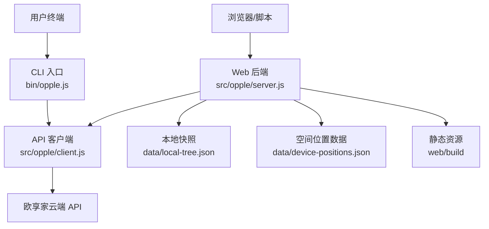
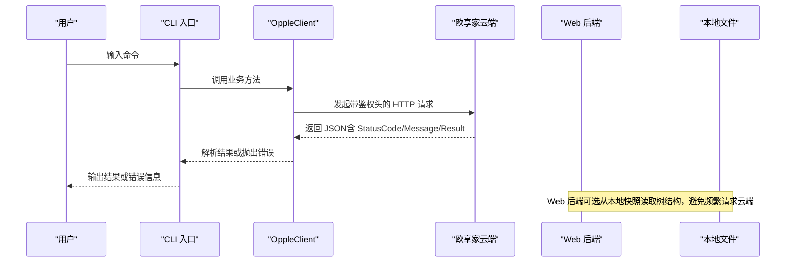
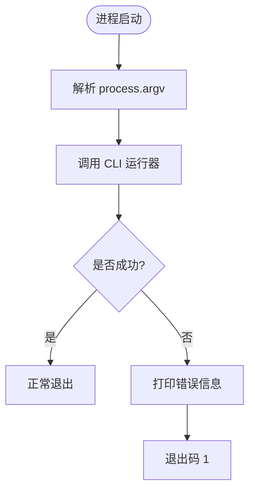
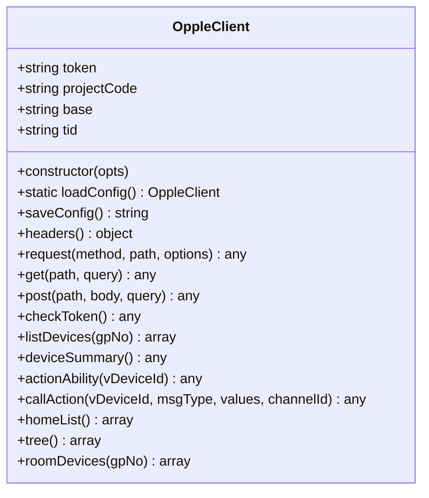
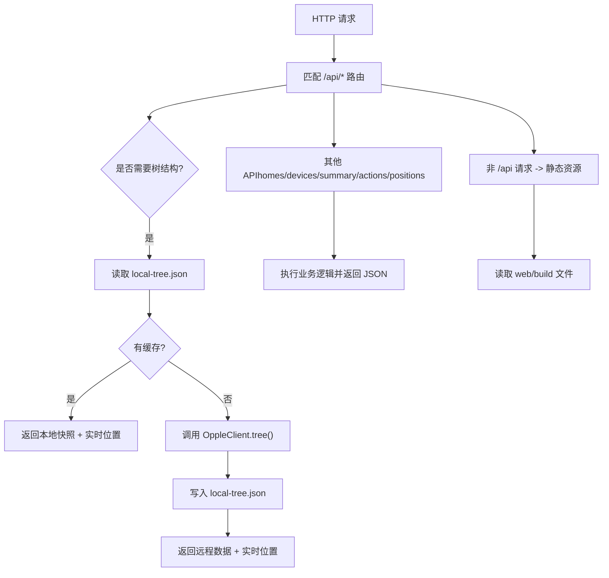
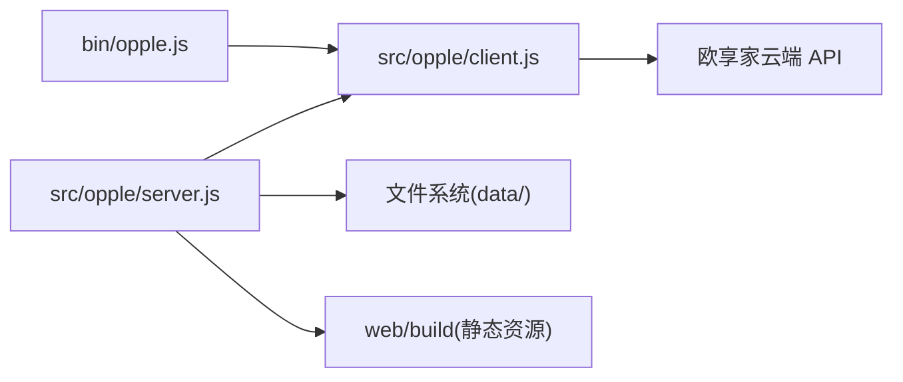

# CLI工具

<cite>
**本文引用的文件**   
- [bin/opple.js](file://bin/opple.js)
- [src/opple/client.js](file://src/opple/client.js)
- [src/opple/server.js](file://src/opple/server.js)
- [package.json](file://package.json)
- [README.md](file://README.md)
</cite>

## 目录
1. [简介](#简介)
2. [项目结构](#项目结构)
3. [核心组件](#核心组件)
4. [架构总览](#架构总览)
5. [详细组件分析](#详细组件分析)
6. [依赖关系分析](#依赖关系分析)
7. [性能与优化建议](#性能与优化建议)
8. [故障排查指南](#故障排查指南)
9. [结论](#结论)
10. [附录：命令速查与示例](#附录命令速查与示例)

## 简介
本仓库提供欧享家（欧普 INNO 生态）设备的本地控制能力，包含命令行工具与 Web 控制台。CLI 通过逆向云端 API 实现设备查询、动作调用等；Web 后端在 Node 中提供 REST API，并托管前端构建产物，支持家庭/房间/设备树、位置编辑与 3D 预览。

本项目要求 Node.js 22+，采用 ES Module，CLI 入口为 `bin/opple.js`，并通过 `package.json` 的 `bin` 字段暴露可执行命令 `opple`。

**章节来源**
- [README.md:1-17](file://README.md#L1-L17)
- [package.json:1-17](file://package.json#L1-L17)

## 项目结构
- `bin/opple.js`：CLI 可执行入口，负责接收进程参数并调用 CLI 运行逻辑。
- `src/opple/client.js`：OppleClient，封装鉴权头、HTTP 请求、业务接口（token、设备列表、动作、家庭/房间/设备树等）。
- `src/opple/server.js`：Node HTTP 服务，提供 `/api/*` REST 接口，复用 OppleClient，并管理本地快照与空间数据。
- `web/`：ice.js v3 前端工程（由 server 托管静态资源）。
- `data/`：逆向产物、接口清单、设备位置与本地树快照等。

**图表来源**
- [bin/opple.js:1-9](file://bin/opple.js#L1-L9)
- [src/opple/client.js:1-226](file://src/opple/client.js#L1-L226)
- [src/opple/server.js:1-232](file://src/opple/server.js#L1-L232)

**章节来源**
- [README.md:6-16](file://README.md#L6-L16)
- [package.json:1-17](file://package.json#L1-L17)

## 核心组件
- CLI 入口：接收参数并启动 CLI 流程。
- OppleClient：统一封装鉴权头、HTTP 请求、错误处理与业务方法（token、设备、动作、家庭/房间/设备树）。
- Web 后端：REST 路由、CORS、JSON 响应、本地缓存与空间数据读写、静态资源托管。

**章节来源**
- [bin/opple.js:1-9](file://bin/opple.js#L1-L9)
- [src/opple/client.js:13-97](file://src/opple/client.js#L13-L97)
- [src/opple/server.js:100-232](file://src/opple/server.js#L100-L232)

## 架构总览
CLI 与 Web 后端共享同一套 OppleClient，保证对云端的请求头、鉴权与错误语义一致。Web 后端在读取家庭/房间/设备树时优先使用本地快照，减少云端压力；位置数据始终实时合并，确保 UI 展示最新布局。

**图表来源**
- [bin/opple.js:1-9](file://bin/opple.js#L1-L9)
- [src/opple/client.js:67-97](file://src/opple/client.js#L67-L97)
- [src/opple/server.js:124-204](file://src/opple/server.js#L124-L204)

## 详细组件分析

### CLI 入口与参数处理
- 入口文件以 Node 可执行脚本形式存在，接收 `process.argv` 并调用 CLI 运行函数。
- 当前仓库未包含 `src/cli.js` 的具体实现，但入口已明确将除前两个参数外的所有参数传递给 CLI 运行器，并在异常时打印错误消息后退出码 1。
- 安装后可通过 `npm link` 全局使用 `opple` 命令，或通过 `npm run opple` 直接运行。

**图表来源**
- [bin/opple.js:1-9](file://bin/opple.js#L1-L9)

**章节来源**
- [bin/opple.js:1-9](file://bin/opple.js#L1-L9)
- [package.json:6-11](file://package.json#L6-L11)
- [README.md:20-30](file://README.md#L20-L30)

### OppleClient：鉴权、请求与业务接口
- 配置与持久化
  - 配置文件路径为用户主目录下的 `.opple-cli.json`。
  - 提供 `loadConfig()` 与 `saveConfig()` 用于加载和保存 token、projectCode、base URL。
- 请求头与鉴权
  - 统一设置语言、时区、客户端标识、系统类型、项目代码、token、tid、时间戳与 User-Agent 等头。
  - 强调头名必须全小写，否则可能触发云端校验异常。
- HTTP 请求
  - 通用 `request(method, path, {query, body})` 构造 URL、拼接 query、发送 GET/POST。
  - 统一错误处理：非 2xx 抛错；响应体需为 JSON；StatusCode 非 0 视为失败。
- 业务接口
  - token：校验/刷新。
  - 设备：分页拉取设备列表、轻量摘要、按房间拉取设备。
  - 动作：查询设备可用动作、调用动作（msgType + values 逗号拼接）。
  - 家庭/房间/设备树：获取家庭列表、房间列表、房间设备，组装三层结构。

**图表来源**
- [src/opple/client.js:13-225](file://src/opple/client.js#L13-L225)

**章节来源**
- [src/opple/client.js:1-226](file://src/opple/client.js#L1-226)

### Web 后端：REST API、缓存与静态资源
- 端口与静态资源
  - 默认端口 5170，托管 `web/build` 下的构建产物。
- CORS
  - 允许跨域请求，OPTIONS 预检直接返回 204。
- JSON 响应与请求体
  - 统一 `json(res, code, data)` 返回 JSON。
  - `readBody(req)` 安全解析 POST 请求体。
- API 路由
  - `/api/homes`：家庭列表。
  - `/api/tree`：三层结构，优先本地快照，无快照则回源云端并落盘。
  - `/api/sync`：一键同步云端最新结构到本地快照。
  - `/api/devices`：设备列表，可按房间过滤。
  - `/api/summary`：设备摘要。
  - `/api/actions?vDeviceId=`：设备动作能力。
  - `/api/positions`：保存或导出空间位置数据。
- 本地缓存
  - `data/local-tree.json`：家庭/房间/设备结构快照。
  - `data/device-positions.json`：房间尺寸与设备 3D 几何位置。
- 错误处理
  - 路由层捕获异常并返回 502 与错误信息。

**图表来源**
- [src/opple/server.js:100-232](file://src/opple/server.js#L100-L232)

**章节来源**
- [src/opple/server.js:1-232](file://src/opple/server.js#L1-232)

## 依赖关系分析
- CLI 入口依赖 OppleClient（通过导入），但当前仓库未包含 `src/cli.js`，因此 CLI 具体命令解析与执行逻辑不在本仓库可见范围内。
- Web 后端依赖 OppleClient 进行云端交互，同时依赖 Node 内置模块（http、fs、path、url）提供服务。
- 外部依赖：仅依赖 Node.js 运行时与欧享家云端 API。

**图表来源**
- [bin/opple.js:1-9](file://bin/opple.js#L1-L9)
- [src/opple/client.js:1-226](file://src/opple/client.js#L1-226)
- [src/opple/server.js:1-232](file://src/opple/server.js#L1-L232)

**章节来源**
- [package.json:1-17](file://package.json#L1-L17)
- [README.md:6-16](file://README.md#L6-L16)

## 性能与优化建议
- 使用本地快照
  - 首次同步后，`/api/tree` 优先返回本地快照，显著降低云端请求次数与延迟。
- 批量与分页
  - 设备列表采用分页拉取，避免单次过大响应；合理设置 PageSize。
- 头部一致性
  - 保持请求头全小写，避免因服务端校验失败导致重试与额外开销。
- 连接与并发
  - 使用 Node 原生 fetch，避免引入额外 HTTP 库；在高并发场景下注意连接池与超时配置。
- 缓存策略
  - 对不频繁变化的数据（如家庭/房间结构）使用本地缓存；对位置数据保持实时合并，兼顾准确性与性能。

[本节为通用指导，不涉及具体文件分析]

## 故障排查指南
- Token 与凭据问题
  - 若未保存配置文件，加载配置会报错；请先使用 CLI 保存 token 与 projectCode。
  - 检查 token/projectcode 是否为 32 位 hex，并确保来自真实抓包。
- 请求头大小写
  - 头名必须全小写，混用大小写会触发云端校验异常（如 12004/11009）。
- HTTP 状态码与业务错误
  - 非 2xx 直接抛错；StatusCode 非 0 视为业务失败，错误消息包含 Message 与接口路径。
- Web 后端错误
  - 路由层捕获异常返回 502；检查本地快照与位置数据文件权限与格式。
- 前端未构建
  - 若未构建前端，访问根路径会返回提示；请进入 `web` 目录执行构建。

**章节来源**
- [src/opple/client.js:24-30](file://src/opple/client.js#L24-L30)
- [src/opple/client.js:41-58](file://src/opple/client.js#L41-L58)
- [src/opple/client.js:76-93](file://src/opple/client.js#L76-L93)
- [src/opple/server.js:202-204](file://src/opple/server.js#L202-L204)
- [src/opple/server.js:217-223](file://src/opple/server.js#L217-L223)
- [README.md:41-46](file://README.md#L41-L46)

## 结论
本项目的 CLI 与 Web 后端围绕 OppleClient 构建，统一了对欧享家云端的鉴权与请求语义。CLI 适合快速调试与自动化控制；Web 后端提供可视化界面与本地缓存，提升交互体验与性能。通过合理的缓存策略、严格的请求头规范与完善的错误处理，可在保证稳定性的前提下高效完成设备管理与控制任务。

[本节为总结性内容，不涉及具体文件分析]

## 附录：命令速查与示例
以下为 README 中列出的常用 CLI 命令与说明（具体实现位于未展示的 `src/cli.js`）：

- 凭据管理
  - `opple token save <token> <projectCode>`：保存凭据。
  - `opple token check`：校验凭据。
- 设备与结构
  - `opple tree`：家庭→房间→设备 三层结构。
  - `opple devices [房间]`：设备列表（可按房间名/Gpno 过滤）。
  - `opple actions <id>`：查询设备全部动作（msgType/参数范围/枚举）。
- 设备控制
  - `opple light <id> <op> <值>`：on/off/bright/cct/duv/color/daylight。
  - `opple scene <id> <效果> [k=v]`：灯效（流水/跑马/呼吸/律动/渐变）。
  - `opple call <id> <msgType> <v1,v2…>`：底层命令调用。
- 调试
  - `opple raw <METHOD> <path> [json]`：任意接口调试。

使用示例（来自 README）：
- 保存凭据：`opple token save <32位token> <projectCode>`
- 查看树：`opple tree`
- 按房间过滤：`opple devices 客厅`
- 查询动作：`opple actions 2122050`
- 色温控制：`opple light 2122050 cct 4000`
- RGB 颜色：`opple light 2122050 color "#FF8000"`
- 灯效：`opple scene 2122018 跑马 speed=70 direction=reverse`
- 调试接口：`opple raw GET /api/Project/GetHomeList`

**章节来源**
- [README.md:20-30](file://README.md#L20-L30)
- [README.md:47-58](file://README.md#L47-L58)