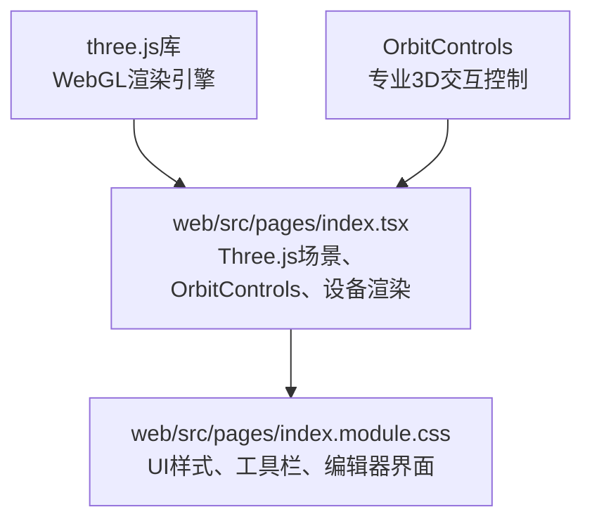
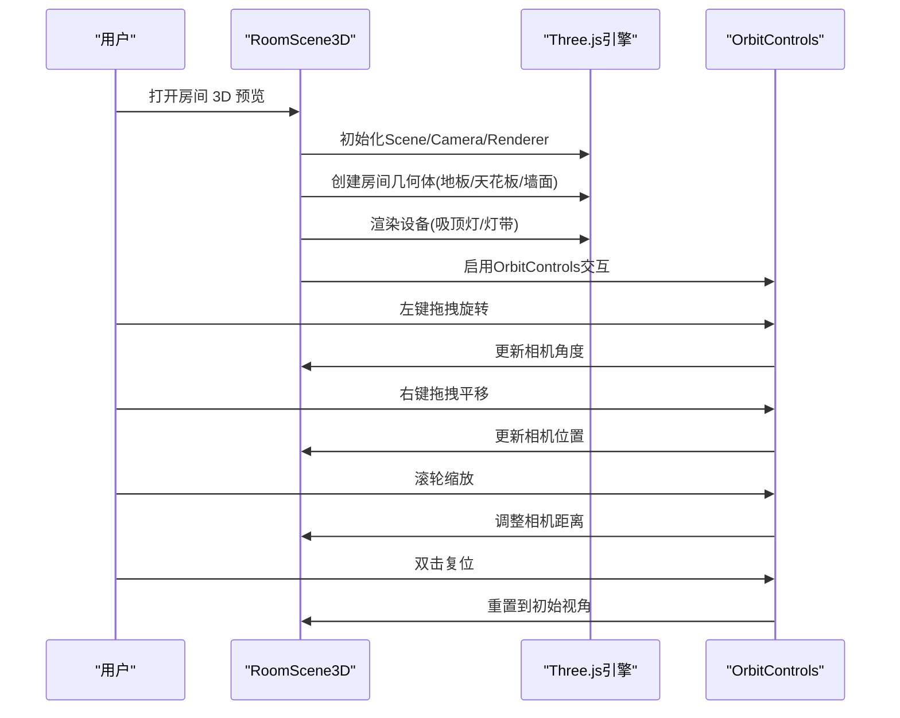
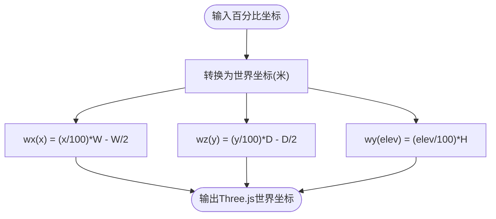
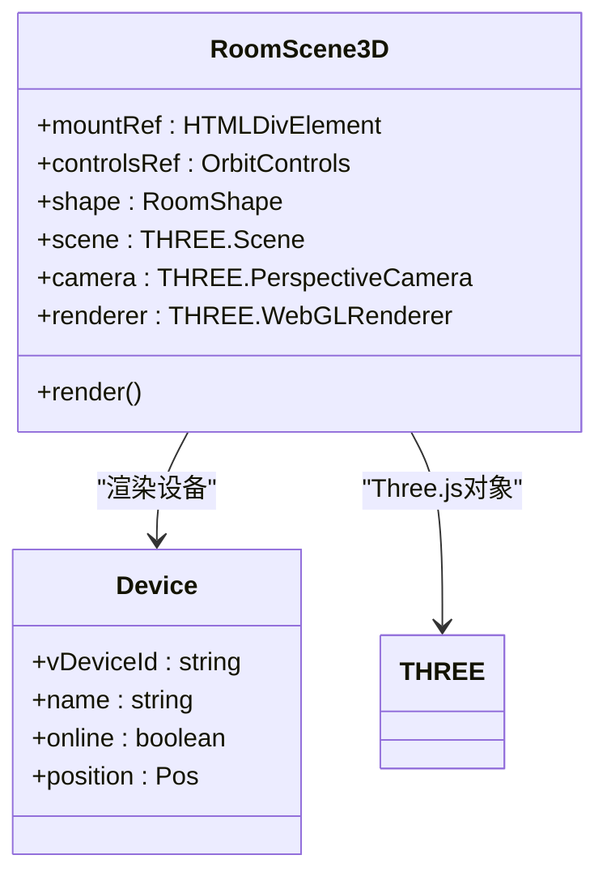
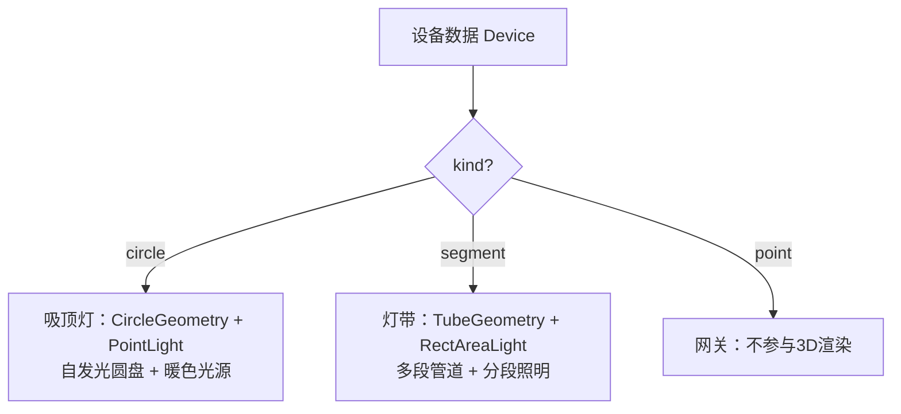
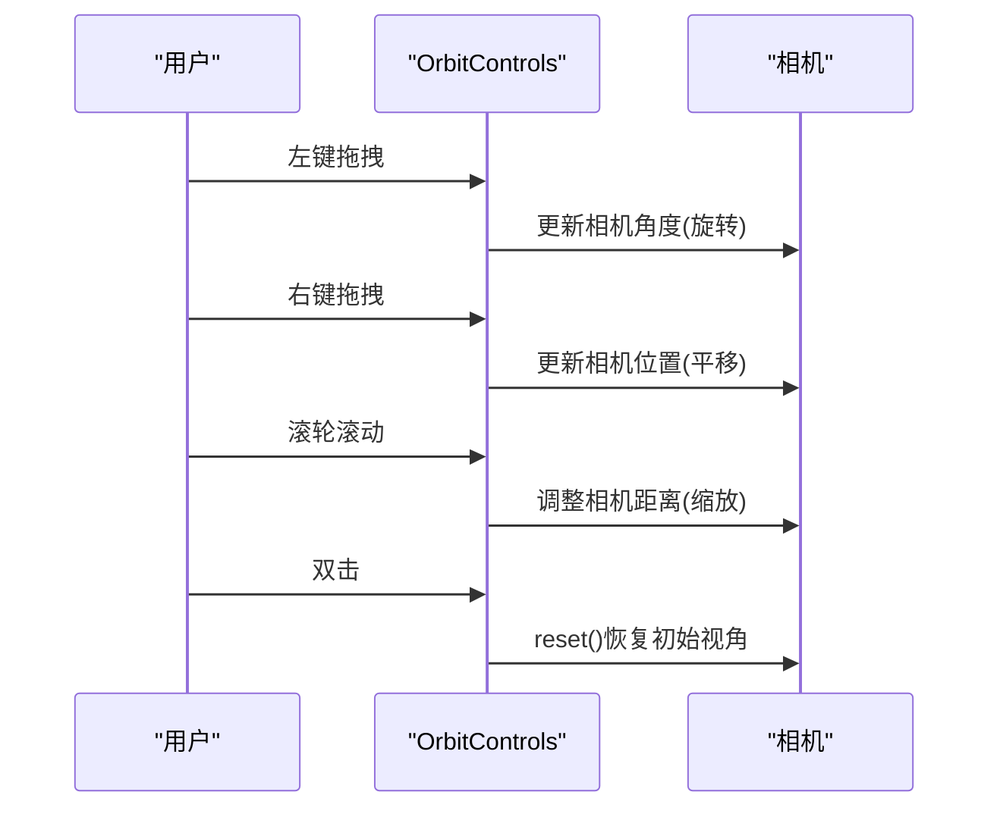
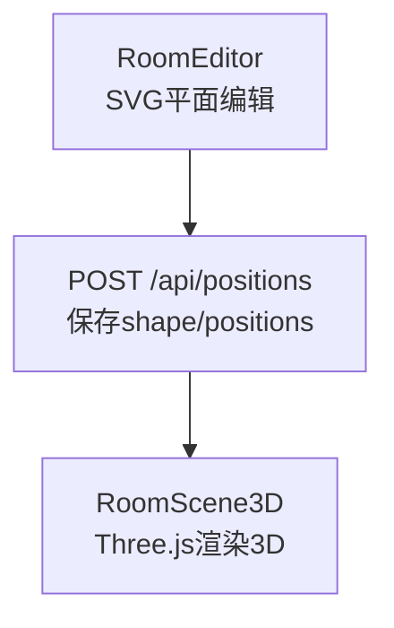
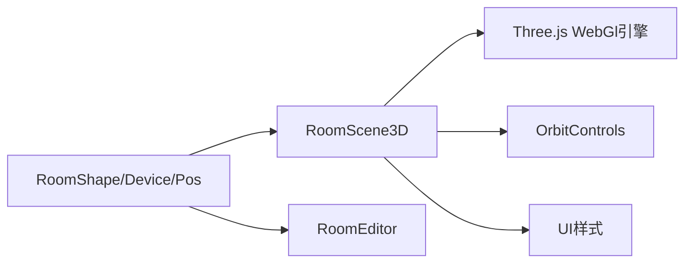

# 3D空间建模

<cite>
**本文引用的文件**   
- [index.tsx](file://web/src/pages/index.tsx)
- [index.module.css](file://web/src/pages/index.module.css)
</cite>

## 更新摘要
**变更内容**   
- **架构重构**：从CSS 3D变换完全迁移到Three.js WebGL真实光照渲染
- **交互增强**：集成OrbitControls提供专业级3D导航（左键旋转、右键平移、滚轮缩放、双击复位）
- **视觉效果提升**：实现真实光源、阴影映射、材质系统和环境光遮蔽
- **设备渲染改进**：吸顶灯使用自发光圆盘+点光源，灯带使用TubeGeometry多段管道渲染
- **工具栏完善**：添加交互提示、房间尺寸显示和视角复位按钮
- **性能优化**：支持抗锯齿、像素比自适应、内存管理和资源清理

## 目录
1. [引言](#引言)
2. [项目结构](#项目结构)
3. [核心组件](#核心组件)
4. [架构总览](#架构总览)
5. [详细组件分析](#详细组件分析)
6. [依赖关系分析](#依赖关系分析)
7. [性能与兼容性](#性能与兼容性)
8. [故障排查指南](#故障排查指南)
9. [结论](#结论)

## 引言
本技术文档聚焦于"欧享家·家庭设备管理台"中的 3D 空间建模能力。**最新版本已完全重构为基于Three.js的专业3D渲染系统**，替代了原有的CSS 3D变换方案。该功能通过WebGL构建真实的三维房间场景，支持丰富的交互操作：**左键拖拽旋转、右键拖拽平移、滚轮缩放、双击复位**。三种设备类型在 3D 中分别表示为：
- 吸顶灯：圆形面光源 + 暖色点光源
- 灯带：多段折线管道 + 紫色点光源阵列
- 网关/点位：不参与3D渲染的点状标记

文档将系统解释Three.js场景构建、OrbitControls交互控制、真实光照系统和坐标转换机制，并给出性能优化与浏览器兼容性建议。

## 项目结构
3D 空间建模相关代码位于前端页面模块中：
- 页面逻辑与 Three.js 3D 渲染实现：`web/src/pages/index.tsx`
- 样式与界面视觉：`web/src/pages/index.module.css`

**图表来源**
- [index.tsx:1-5](file://web/src/pages/index.tsx#L1-L5)
- [index.tsx:331-585](file://web/src/pages/index.tsx#L331-L585)

## 核心组件
- **几何模型接口**：定义房间尺寸与设备位置（吸顶灯 circle、灯带 segment、网关 point），所有平面坐标以百分比 0-100 表示，高度 elev 为离地百分比。
- **Three.js 3D 场景 RoomScene3D**：负责WebGL渲染、光源设置、材质配置、OrbitControls交互和设备3D布局。
- **二维编辑器 RoomEditor**：用于编辑房间尺寸与设备平面位置及安装高度。
- **样式模块 index.module.css**：提供UI容器、工具栏、编辑器界面等样式。

关键职责划分：
- 数据层：RoomShape、Device、Pos 等接口与默认布局生成 defaultPos。
- 渲染层：RoomScene3D 使用 Three.js Scene、Camera、Renderer 构建真实3D场景。
- **交互层**：OrbitControls 处理**左键旋转/右键平移/滚轮缩放**；DoubleClick 事件处理复位。
- 样式层：scene、sceneToolbar、viewResetBtn 等类名组织视觉表现。

**章节来源**
- [index.tsx:11-37](file://web/src/pages/index.tsx#L11-L37)
- [index.tsx:331-585](file://web/src/pages/index.tsx#L331-L585)
- [index.tsx:619-1050](file://web/src/pages/index.tsx#L619-L1050)
- [index.module.css:562-621](file://web/src/pages/index.module.css#L562-L621)

## 架构总览
3D 空间建模的整体流程如下：
- 用户进入房间页后，RoomView 根据模式选择展示 RoomScene3D 或 RoomEditor。
- RoomScene3D 初始化 Three.js 场景、相机、渲染器，创建房间地板、天花板、墙面。
- 设备通过不同的几何体渲染：吸顶灯使用 CircleGeometry + PointLight，灯带使用 TubeGeometry + 多个RectAreaLight。
- OrbitControls 提供专业级3D导航，支持阻尼效果和距离限制。
- 最终由 WebGL 实时渲染，支持抗锯齿、阴影映射和色调映射。

**图表来源**
- [index.tsx:331-585](file://web/src/pages/index.tsx#L331-L585)

## 详细组件分析

### 坐标系与单位换算
- **世界单位制**：Three.js使用米作为基本单位，房间尺寸直接转换为米。
- 房间尺寸转换：W = shape.w × UNIT, D = shape.depth × UNIT, H = shape.h × UNIT（UNIT = 0.05m）。
- 百分比到世界坐标的转换：
  - wx(x) = (x / 100) × W - W / 2
  - wz(y) = (y / 100) × D - D / 2  
  - wy(elev) = (elev / 100) × H
- elev 存储为离地百分比（0=地面，100=天花），UI 显示"距顶米数" = (100 - elev) × 0.05m。

**图表来源**
- [index.tsx:343-349](file://web/src/pages/index.tsx#L343-L349)
- [index.tsx:888-889](file://web/src/pages/index.tsx#L888-L889)

**章节来源**
- [index.tsx:343-349](file://web/src/pages/index.tsx#L343-L349)
- [index.tsx:888-889](file://web/src/pages/index.tsx#L888-L889)

### Three.js场景构建
- **场景初始化**：创建 THREE.Scene、PerspectiveCamera、WebGLRenderer。
- **相机设置**：FOV 50度，近裁剪面0.05，远裁剪面80，初始位置设置在房间斜上方。
- **渲染器配置**：启用抗锯齿、阴影映射、ACES色调映射，像素比自适应设备分辨率。
- **环境光**：使用 HemisphereLight 提供基础照明，确保暗部轮廓可见。
- **房间几何体**：
  - 地板：PlaneGeometry + MeshStandardMaterial，接收阴影
  - 天花板：半透明 PlaneGeometry，DoubleSide材质
  - 墙面：四面墙使用不同旋转和定位的 PlaneGeometry

**图表来源**
- [index.tsx:331-358](file://web/src/pages/index.tsx#L331-L358)

**章节来源**
- [index.tsx:331-358](file://web/src/pages/index.tsx#L331-L358)

### 设备类型的 3D 表示
- **吸顶灯（circle）**：
  - 半径 r 转换为世界单位 rm = max(0.08, (r / 100) × W)
  - 使用 CircleGeometry 创建圆盘，MeshStandardMaterial 配置自发光颜色
  - 在线状态影响 emissive 颜色和强度，离线时灰显无光源
  - 附加 PointLight 模拟真实光照效果
  - Canvas纹理标签显示设备名称
  
- **灯带（segment）**：
  - **多段管道渲染**：将 points 数组转换为 THREE.Vector3 路径，使用 LineCurve3 连接各段
  - TubeGeometry 创建管道几何体，半径0.022，分段数根据顶点数量动态计算
  - 沿管道均匀分布 RectAreaLight，模拟灯带的分段照明效果
  - 标签显示在最长的线段中点位置
  
- **网关/点位（point）**：
  - 不参与 3D 渲染（inSpace 过滤），仅参与二维编辑器与导出

**图表来源**
- [index.tsx:427-508](file://web/src/pages/index.tsx#L427-L508)

**章节来源**
- [index.tsx:427-508](file://web/src/pages/index.tsx#L427-L508)

### 增强的3D交互操作
**更新** 集成了专业的OrbitControls交互控制系统

- **OrbitControls 配置**：
  - enableDamping = true：启用阻尼效果，提供平滑的惯性运动
  - dampingFactor = 0.08：阻尼系数，控制运动衰减速度
  - minDistance = 0.8：最小观察距离，防止相机进入物体内部
  - maxDistance = 25：最大观察距离，限制视野范围
  - target.set(0, hm * 0.5, 0)：设置观察目标点为房间中心高度的一半
  
- **鼠标操作**：
  - **左键拖拽**：旋转视角，围绕目标点做球形运动
  - **右键拖拽**：平移视角，水平移动相机位置
  - **滚轮缩放**：调整相机距离，实现远近缩放
  - **双击复位**：调用 controls.reset() 恢复到初始视角
  
- **事件处理**：
  - dblclick 事件：阻止默认行为并调用复位
  - contextmenu 事件：阻止右键菜单，避免干扰平移操作

**图表来源**
- [index.tsx:510-527](file://web/src/pages/index.tsx#L510-L527)

**章节来源**
- [index.tsx:510-527](file://web/src/pages/index.tsx#L510-L527)

### 工具栏与交互提示
**新增** 工具栏提供了交互指导和视图控制功能

- **交互提示**：显示"左键拖拽旋转 · 右键拖动平移 · 滚轮缩放 · 双击复位"
- **房间尺寸显示**：实时显示当前房间的三维尺寸（宽×深×高）
- **复位按钮**：一键恢复默认视角（调用 controls.reset()）
- **样式设计**：底部渐变背景，不拦截鼠标事件，按钮可独立点击

**章节来源**
- [index.tsx:569-585](file://web/src/pages/index.tsx#L569-L585)
- [index.module.css:584-621](file://web/src/pages/index.module.css#L584-L621)

### 二维编辑器与 3D 预览联动
- 二维编辑器 RoomEditor 负责：
  - 绘制 SVG 平面，支持拖动吸顶灯圆盘与灯带线段
  - 调整房间尺寸（w/depth/h）与设备安装高度（elev）
  - 保存 positions 与 shape 到后端
- 3D 预览 RoomScene3D 读取相同数据模型进行渲染，保证所见即所得

**图表来源**
- [index.tsx:619-1050](file://web/src/pages/index.tsx#L619-L1050)

**章节来源**
- [index.tsx:619-1050](file://web/src/pages/index.tsx#L619-L1050)

## 依赖关系分析
- **组件耦合**：
  - RoomScene3D 依赖 RoomShape 与 Device.position 数据
  - RoomEditor 与 RoomScene3D 共享 inSpace 过滤逻辑与 defaultPos 默认布局
- **外部依赖**：
  - **Three.js库**：WebGL渲染引擎、几何体、材质、光源系统
  - **OrbitControls**：专业级3D交互控制，支持旋转、平移、缩放
  - **ResizeObserver API**：监听容器尺寸变化，自动调整渲染分辨率
  - **Canvas API**：生成设备名称标签的纹理
- **浏览器API**：
  - WebGL：硬件加速3D渲染
  - Pointer Events：统一的指针事件处理
  - requestAnimationFrame：高性能动画循环

**图表来源**
- [index.tsx:1-5](file://web/src/pages/index.tsx#L1-L5)
- [index.tsx:331-585](file://web/src/pages/index.tsx#L331-L585)
- [index.tsx:619-1050](file://web/src/pages/index.tsx#L619-L1050)

**章节来源**
- [index.tsx:1-5](file://web/src/pages/index.tsx#L1-L5)
- [index.tsx:331-585](file://web/src/pages/index.tsx#L331-L585)
- [index.tsx:619-1050](file://web/src/pages/index.tsx#L619-L1050)

## 性能与兼容性
- **性能优化技巧**：
  - **WebGL硬件加速**：利用GPU进行3D渲染，性能远超CSS 3D变换
  - **抗锯齿**：启用 antialias 提升画面质量
  - **像素比自适应**：Math.min(2, window.devicePixelRatio || 1) 平衡清晰度与性能
  - **阴影优化**：PCFSoftShadowMap 提供柔和阴影，1024×1024 阴影贴图
  - **内存管理**：组件卸载时正确释放几何体、材质、纹理和渲染器资源
  - **按需渲染**：只渲染参与空间模型的灯具，网关等设备不参与3D
  - **光源优化**：灯带使用RectAreaLight，避免过多光源影响性能
  
- **浏览器兼容性**：
  - **WebGL**：现代浏览器广泛支持，移动端也具备良好兼容性
  - **Three.js**：跨平台兼容，支持桌面和移动设备
  - **OrbitControls**：基于Pointer Events，支持触摸和鼠标操作
  - **Canvas纹理**：支持中文文本渲染，跨平台一致
  - **旧版浏览器**：不支持WebGL的设备将无法使用3D功能，需降级方案

## 故障排查指南
- **3D场景不可见**：
  - 检查 WebGL 上下文是否成功创建
  - 确认 Three.js 库是否正确加载
  - 验证 renderer.domElement 是否正确添加到DOM
  
- **设备渲染异常**：
  - 校验坐标转换函数 wx/wz/wy 是否正确
  - 确认设备 position 数据格式符合预期
  - 检查材质配置和光源参数
  
- **交互无响应**：
  - 检查 OrbitControls 是否正确初始化
  - 确认 renderer.domElement 事件监听器绑定成功
  - **验证双击复位**：检查 dblclick 事件处理器
  - **验证右键平移**：检查 contextmenu 事件阻止
  
- **性能问题**：
  - 检查是否启用了不必要的阴影或高精度材质
  - 确认光源数量合理，避免过多PointLight
  - 监控内存泄漏，确保组件卸载时正确清理资源
  
- **标签显示问题**：
  - 检查 Canvas 纹理生成是否正常
  - 确认中文字体支持，必要时引入自定义字体
  - 验证 Sprite 位置和缩放参数

**章节来源**
- [index.tsx:331-585](file://web/src/pages/index.tsx#L331-L585)
- [index.tsx:427-508](file://web/src/pages/index.tsx#L427-L508)

## 结论
本项目的 3D 空间建模经过**完全重构**，从简单的CSS 3D变换升级为基于Three.js的专业WebGL渲染系统。**最新的版本提供了完整的3D交互体验**：通过OrbitControls实现了专业的左键旋转、右键平移、滚轮缩放和双击复位功能，为用户提供了更加自然和直观的3D导航体验。**设备渲染效果大幅提升**：吸顶灯使用自发光圆盘配合真实点光源，灯带采用多段管道几何体并配备分段照明系统。三种设备类型以逼真的3D形态呈现，结合专业的交互控制和丰富的光照效果，提供了沉浸式的用户体验。坐标系设计保持以百分比为基础，便于跨分辨率适配；elev 存储与 UI 显示分离提升了易用性。新的架构具有良好的扩展性，未来可以轻松添加更多设备类型、更复杂的场景效果和高级渲染特性，同时保持对现代浏览器的良好兼容性与优异的性能表现。