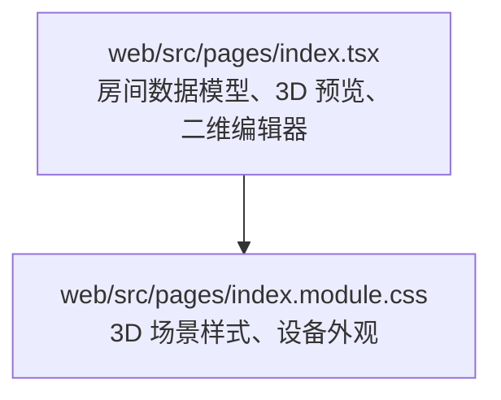
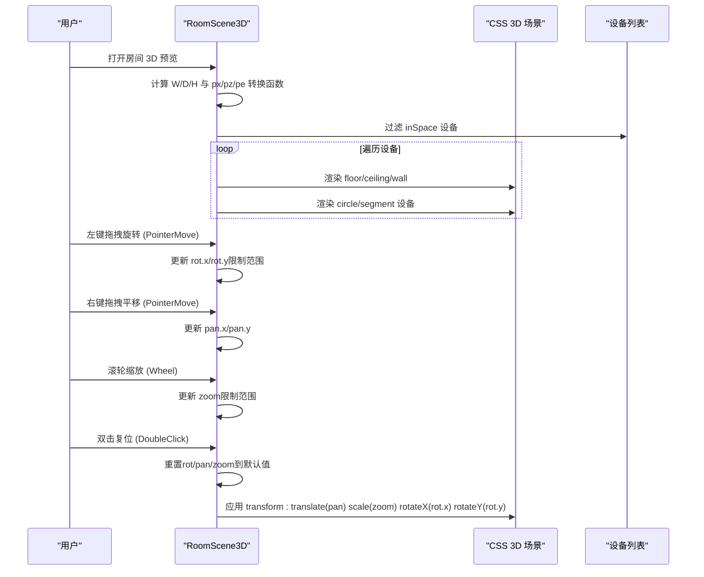
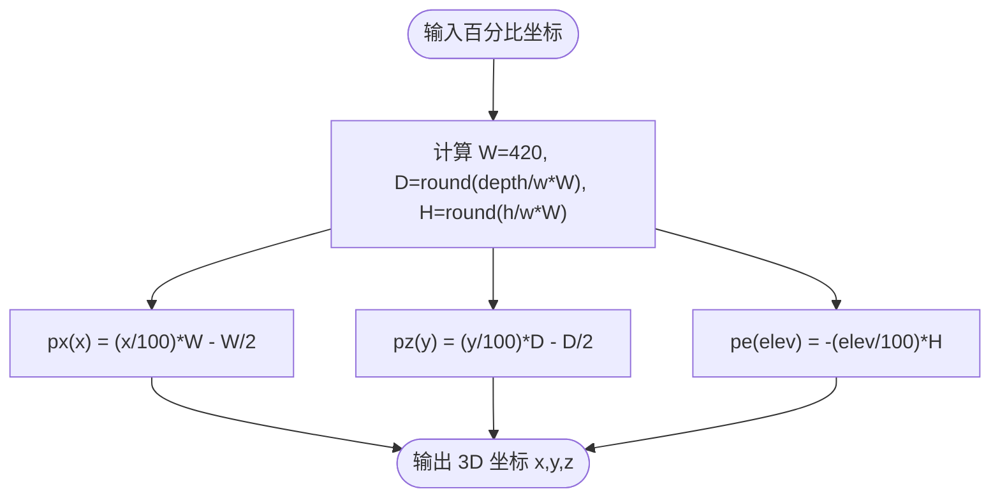
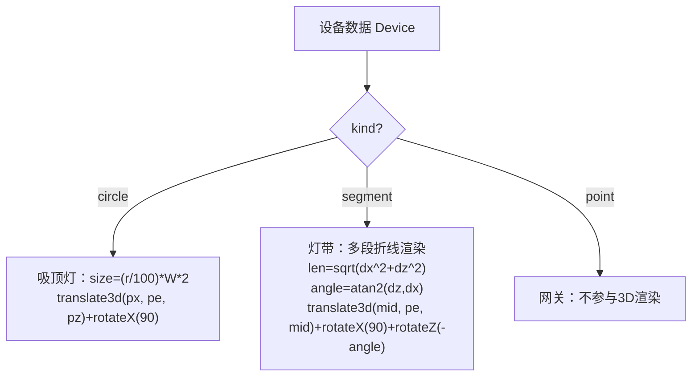
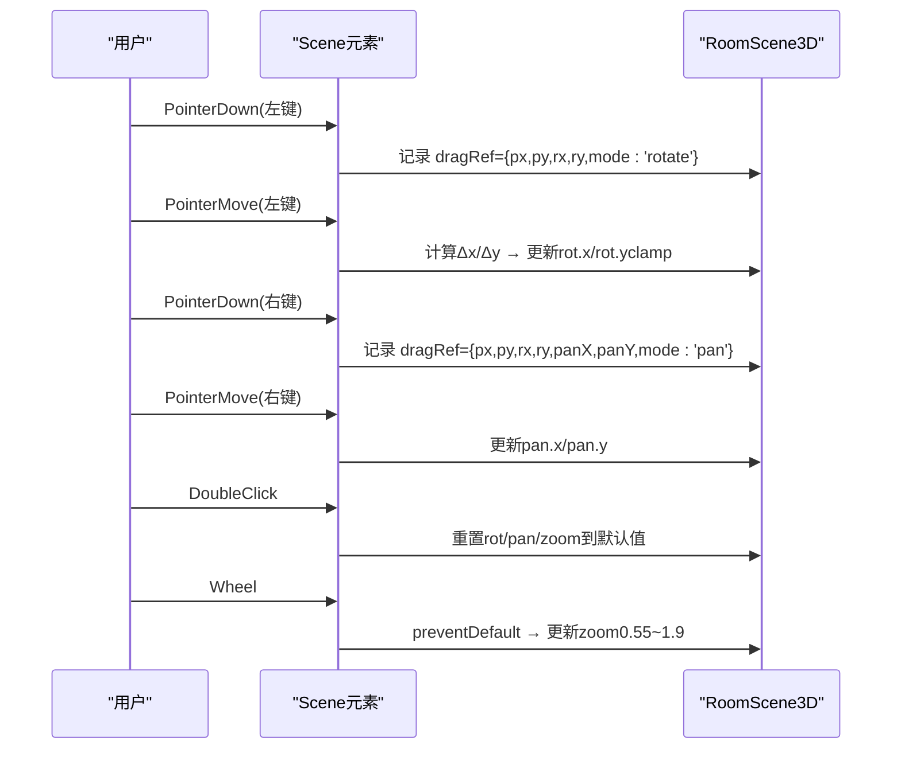
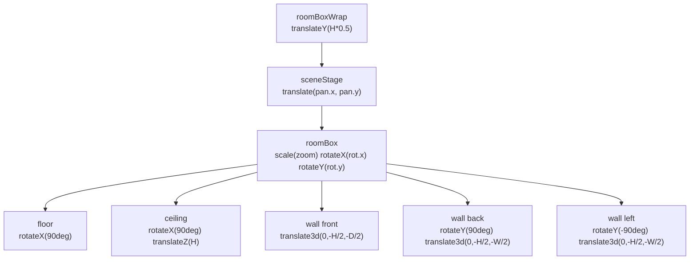
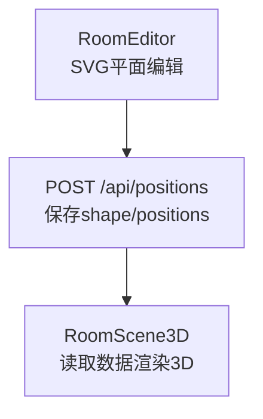
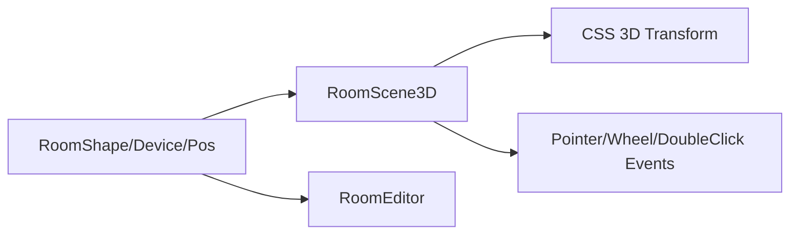

# 3D空间建模

<cite>
**本文引用的文件**   
- [index.tsx](file://web/src/pages/index.tsx)
- [index.module.css](file://web/src/pages/index.module.css)
</cite>

## 更新摘要
**变更内容**   
- 增强了3D视口交互控制：新增右键平移、左键旋转、滚轮缩放、双击复位功能
- 改进了多段LED灯带的3D渲染效果
- 添加了视角平移状态管理和工具栏控制界面
- 优化了设备标签显示和交互反馈

## 目录
1. [引言](#引言)
2. [项目结构](#项目结构)
3. [核心组件](#核心组件)
4. [架构总览](#架构总览)
5. [详细组件分析](#详细组件分析)
6. [依赖关系分析](#依赖关系分析)
7. [性能与兼容性](#性能与兼容性)
8. [故障排查指南](#故障排查指南)
9. [结论](#结论)

## 引言
本技术文档聚焦于"欧享家·家庭设备管理台"中的 3D 空间建模能力。该功能通过 CSS 3D 变换构建房间盒子，并以百分比坐标描述设备三维位置，支持丰富的交互操作：**左键拖拽旋转、右键拖拽平移、滚轮缩放、双击复位**。三种设备类型在 3D 中分别表示为：
- 吸顶灯：圆形面光源
- 灯带：长条形状（支持多段折线）
- 网关/点位：点状标记

文档将系统解释透视设置、旋转矩阵与坐标转换，说明增强的交互事件处理流程，并给出性能优化与浏览器兼容性建议。

## 项目结构
3D 空间建模相关代码位于前端页面模块中：
- 页面逻辑与 3D 渲染实现：`web/src/pages/index.tsx`
- 样式与 3D 场景视觉：`web/src/pages/index.module.css`



**图表来源**
- [index.tsx:325-477](file://web/src/pages/index.tsx#L325-L477)
- [index.module.css:562-709](file://web/src/pages/index.module.css#L562-L709)

## 核心组件
- 几何模型接口：定义房间尺寸与设备位置（吸顶灯 circle、灯带 segment、网关 point），所有平面坐标以百分比 0-100 表示，高度 elev 为离地百分比。
- 3D 预览组件 RoomScene3D：负责透视、旋转、缩放、**视角平移**、设备 3D 布局与标签显示。
- 二维编辑器 RoomEditor：用于编辑房间尺寸与设备平面位置及安装高度。
- 样式模块 index.module.css：提供 3D 场景容器、地板/天花板/墙面、设备外观与标签样式。

关键职责划分：
- 数据层：RoomShape、Device、Pos 等接口与默认布局生成 defaultPos。
- 渲染层：RoomScene3D 使用 CSS transform 组合 scale、rotateX/Y、translate3d 构建房间盒子与设备。
- **交互层**：Pointer 事件处理**左键旋转/右键平移**；Wheel 事件处理缩放；DoubleClick 事件处理复位。
- 样式层：scene、roomBoxWrap、roomBox、face、obj3d、lamp3D、strip3D 等类名组织视觉表现。

**章节来源**
- [index.tsx:8-31](file://web/src/pages/index.tsx#L8-L31)
- [index.tsx:325-477](file://web/src/pages/index.tsx#L325-L477)
- [index.tsx:479-777](file://web/src/pages/index.tsx#L479-L777)
- [index.module.css:562-709](file://web/src/pages/index.module.css#L562-L709)

## 架构总览
3D 空间建模的整体流程如下：
- 用户进入房间页后，RoomView 根据模式选择展示 RoomScene3D 或 RoomEditor。
- RoomScene3D 计算房间像素尺寸 W/D/H，基于百分比坐标将设备映射到 3D 空间。
- 用户通过**左键拖拽**改变 rot.x/rot.y，**右键拖拽**改变 pan.x/pan.y，通过 Wheel 事件改变 zoom。
- 最终由 CSS transform 链式应用 translate(pan)、scale(zoom)、rotateX、rotateY 完成渲染。



**图表来源**
- [index.tsx:325-477](file://web/src/pages/index.tsx#L325-L477)
- [index.module.css:562-709](file://web/src/pages/index.module.css#L562-L709)

## 详细组件分析

### 坐标系与单位换算
- 房间尺寸百分比：shape.w、shape.depth、shape.h 表示宽/深/高（单位是百分比）。
- 固定基准宽度：W = 420px；深度 D = round((depth / w) * W)；高度 H = round((h / w) * W)。
- 百分比到像素的转换：
  - px(x) = (x / 100) * W - W / 2
  - pz(y) = (y / 100) * D - D / 2
  - pe(elev) = -(elev / 100) * H
- elev 存储为离地百分比（0=地面，100=天花），UI 显示"距顶米数" = (100 - elev) × 0.05m。



**图表来源**
- [index.tsx:349-356](file://web/src/pages/index.tsx#L349-L356)
- [index.tsx:630-631](file://web/src/pages/index.tsx#L630-L631)

**章节来源**
- [index.tsx:349-356](file://web/src/pages/index.tsx#L349-L356)
- [index.tsx:630-631](file://web/src/pages/index.tsx#L630-L631)

### 透视与旋转矩阵
- 透视设置：sceneStage 的 style.perspective = 1500，决定近大远小的透视强度。
- **变换顺序**：sceneStage 应用 translate(pan.x, pan.y) 进行视角平移，roomBox 的 transform 链为 scale(zoom) → rotateX(rot.x) → rotateY(rot.y)。
- 设备定位：每个设备使用 translate3d(px, pe, pz) + rotateX(90deg)（使圆面/长条水平贴地），灯带额外 rotateZ(-angle) 对齐方向。
- 房间盒子的六个面：
  - 地板：rotateX(90deg)
  - 天花板：rotateX(90deg) + translateZ(H)
  - 四面墙：translate3d(0, -H/2, -D/2) 或 rotateY(±90deg) + translate3d(...)

```mermaid
classDiagram
class RoomScene3D {
+rot : {x : number, y : number}
+pan : {x : number, y : number}
+zoom : number
+W : number
+D : number
+H : number
+px(x) : number
+pz(y) : number
+pe(elev) : number
+render()
}
class Device {
+vDeviceId : string
+name : string
+online : boolean
+position : Pos
}
class Pos {
<<union>>
kind : "circle" | "segment" | "point"
}
RoomScene3D --> Device : "渲染"
RoomScene3D --> Pos : "坐标转换"
```

**图表来源**
- [index.tsx:325-477](file://web/src/pages/index.tsx#L325-L477)

**章节来源**
- [index.tsx:325-477](file://web/src/pages/index.tsx#L325-L477)

### 设备类型的 3D 表示
- 吸顶灯（circle）：
  - 半径 r 转换为像素尺寸 size = (r / 100) * W * 2
  - 位置：translate3d(px(x), pe(elev), pz(y)) + rotateX(90deg)
  - 在线状态影响样式 lamp3D 或 objOff
- **灯带（segment）**：
  - **多段折线渲染**：将 points 数组拆分为多个线段，每段独立渲染为发光长条
  - 端点 p1(x1,y1)、p2(x2,y2) 转换为像素 dx/dz，长度 len = sqrt(dx^2 + dz^2)
  - 角度 angle = atan2(dz, dx) * (180/π)
  - 中心 midX/midZ，transform：translate3d(midX, pe(elev), midZ) + rotateX(90deg) + rotateZ(-angle)
  - **设备标签叠在最长段上**，文字跟随段方向
- 网关/点位（point）：
  - 不参与 3D 渲染（inSpace 过滤），仅参与二维编辑器与导出



**图表来源**
- [index.tsx:406-459](file://web/src/pages/index.tsx#L406-L459)

**章节来源**
- [index.tsx:406-459](file://web/src/pages/index.tsx#L406-L459)

### 增强的3D交互操作
**更新** 新增了完整的鼠标交互控制系统

- **左键拖拽旋转（Pointer 事件）**：
  - onPointerDown：记录初始鼠标坐标与当前 rot，调用 setPointerCapture 捕获指针
  - onPointerMove：根据鼠标位移 delta 更新 rot.x/rot.y，使用 clamp 限制范围（x: -88~88，y: 无限制）
  - onPointerUp/onPointerLeave：清空 dragRef
- **右键拖拽平移（Pointer 事件）**：
  - 通过 e.button === 2 或 Ctrl/Cmd+左键检测平移模式
  - 更新 pan.x/pan.y 实现视角平移
- **滚轮缩放（Wheel 事件）**：
  - preventDefault 阻止默认滚动
  - zoom *= deltaY > 0 ? 0.93 : 1.075，限制范围 0.55-1.9
- **双击复位（DoubleClick 事件）**：
  - 重置 rot 到 DEFAULT_ROT，pan 到 {x:0, y:0}，zoom 到 1
- **视角控制算法**：
  - 垂直移动映射到俯仰角 rot.x，水平移动映射到偏航角 rot.y
  - 系数 0.22/0.28 控制灵敏度



**图表来源**
- [index.tsx:362-384](file://web/src/pages/index.tsx#L362-L384)

**章节来源**
- [index.tsx:362-384](file://web/src/pages/index.tsx#L362-L384)

### 房间盒子与面的构建
- roomBoxWrap：作为垂直定位层，translateY(H*0.5) 将盒子整体下移回视野中心
- sceneStage：应用 translate(pan.x, pan.y) 进行视角平移
- roomBox：应用 scale(zoom) + rotateX(rot.x) + rotateY(rot.y)
- 面：
  - floor：width=W, height=D, rotateX(90deg)
  - ceiling：width=W, height=D, rotateX(90deg) + translateZ(H)
  - wall（前后左右）：width/height 对应 W×H 或 D×H，配合 rotateY(±90deg) 与 translate3d 定位



**图表来源**
- [index.tsx:386-405](file://web/src/pages/index.tsx#L386-L405)

**章节来源**
- [index.tsx:386-405](file://web/src/pages/index.tsx#L386-L405)

### 工具栏与交互提示
**新增** 工具栏提供了交互指导和视图控制功能

- 交互提示：显示"左键拖拽旋转 · 右键拖动平移 · 滚轮缩放 · 双击复位"
- 房间尺寸显示：实时显示当前房间的三维尺寸
- 复位按钮：一键恢复默认视角（旋转、平移、缩放）

**章节来源**
- [index.tsx:463-474](file://web/src/pages/index.tsx#L463-L474)

### 二维编辑器与 3D 预览联动
- 二维编辑器 RoomEditor 负责：
  - 绘制 SVG 平面，支持拖动吸顶灯圆盘与灯带线段
  - 调整房间尺寸（w/depth/h）与设备安装高度（elev）
  - 保存 positions 与 shape 到后端
- 3D 预览 RoomScene3D 读取相同数据模型进行渲染，保证所见即所得



**图表来源**
- [index.tsx:479-777](file://web/src/pages/index.tsx#L479-L777)

**章节来源**
- [index.tsx:479-777](file://web/src/pages/index.tsx#L479-L777)

## 依赖关系分析
- 组件耦合：
  - RoomScene3D 依赖 RoomShape 与 Device.position 数据
  - RoomEditor 与 RoomScene3D 共享 inSpace 过滤逻辑与 defaultPos 默认布局
- 外部依赖：
  - CSS 3D 特性：perspective、transform-style、rotateX/Y/Z、translate3d
  - Pointer Events API：setPointerCapture、onPointerDown/Move/Up/Leave
  - Wheel Event：deltaY 控制缩放
  - **新增**：ContextMenu 事件阻止默认菜单，DoubleClick 事件处理复位



**图表来源**
- [index.tsx:8-31](file://web/src/pages/index.tsx#L8-L31)
- [index.tsx:325-477](file://web/src/pages/index.tsx#L325-L477)
- [index.tsx:479-777](file://web/src/pages/index.tsx#L479-L777)

**章节来源**
- [index.tsx:8-31](file://web/src/pages/index.tsx#L8-L31)
- [index.tsx:325-477](file://web/src/pages/index.tsx#L325-L477)
- [index.tsx:479-777](file://web/src/pages/index.tsx#L479-L777)

## 性能与兼容性
- 性能优化技巧：
  - 使用 CSS transform 而非 JS 动画，减少重排重绘
  - 限制旋转与缩放范围，避免极端视角导致渲染压力
  - 设备数量较多时，可考虑虚拟列表或按需渲染
  - 使用 will-change 或硬件加速提示（谨慎使用）
  - **多段灯带渲染优化**：只渲染相邻顶点间的线段，避免重复计算
- 浏览器兼容性：
  - perspective、transform-style、rotateX/Y/Z、translate3d 在现代浏览器广泛支持
  - Pointer Events API 在移动端与桌面端均受支持
  - **新增**：ContextMenu 事件阻止默认菜单提升用户体验
  - 旧版 IE 不支持 CSS 3D 与 Pointer Events，需降级方案

## 故障排查指南
- 3D 场景不可见：
  - 检查 sceneStage 是否设置了 perspective
  - 确认 roomBoxWrap 与 roomBox 是否启用 transform-style: preserve-3d
- 设备位置异常：
  - 校验 px/pz/pe 转换函数是否正确
  - 确认 elev 为离地百分比，UI 显示"距顶米数"计算正确
- **交互无响应**：
  - 检查 Pointer 事件监听器是否绑定到 scene 元素
  - 确认 setPointerCapture 调用成功
  - **验证右键平移**：检查 e.button === 2 条件判断
  - **验证双击复位**：检查 onDoubleClick 事件处理器
- **平移功能异常**：
  - 检查 pan.x/pan.y 状态是否正确更新
  - 确认 sceneStage 的 transform 包含 translate(pan.x, pan.y)
- 缩放异常：
  - 检查 wheel 事件是否 preventDefault
  - 确认 zoom 范围限制 0.55-1.9
- **多段灯带渲染问题**：
  - 检查 points 数组是否为空或只有一个点
  - 确认线段计算逻辑正确处理边界情况

**章节来源**
- [index.tsx:362-384](file://web/src/pages/index.tsx#L362-L384)
- [index.tsx:349-356](file://web/src/pages/index.tsx#L349-L356)
- [index.tsx:406-459](file://web/src/pages/index.tsx#L406-L459)
- [index.module.css:562-709](file://web/src/pages/index.module.css#L562-L709)

## 结论
本项目的 3D 空间建模通过 CSS 3D 变换实现了轻量级、高性能的房间盒子渲染。**最新的增强版本提供了完整的鼠标交互控制**：左键旋转、右键平移、滚轮缩放、双击复位，为用户提供了更加自然和直观的3D导航体验。**多段LED灯带的改进渲染**使得复杂的灯带路径能够准确地在3D空间中呈现。三种设备类型以直观的几何形态呈现，结合增强的交互事件提供了流畅的用户体验。坐标系设计以百分比为基础，便于跨分辨率适配；elev 存储与 UI 显示分离提升了易用性。未来可扩展更多设备类型与更复杂的场景效果，同时保持对现代浏览器的良好兼容性与性能表现。