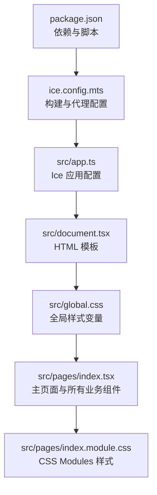
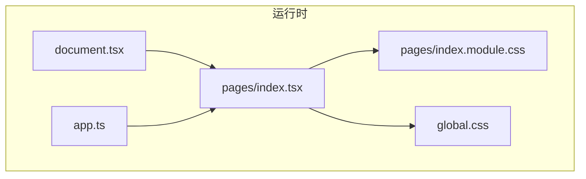
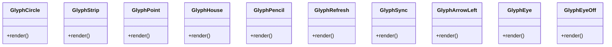
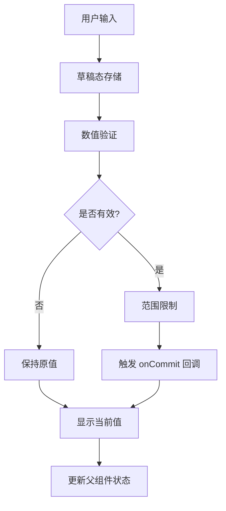
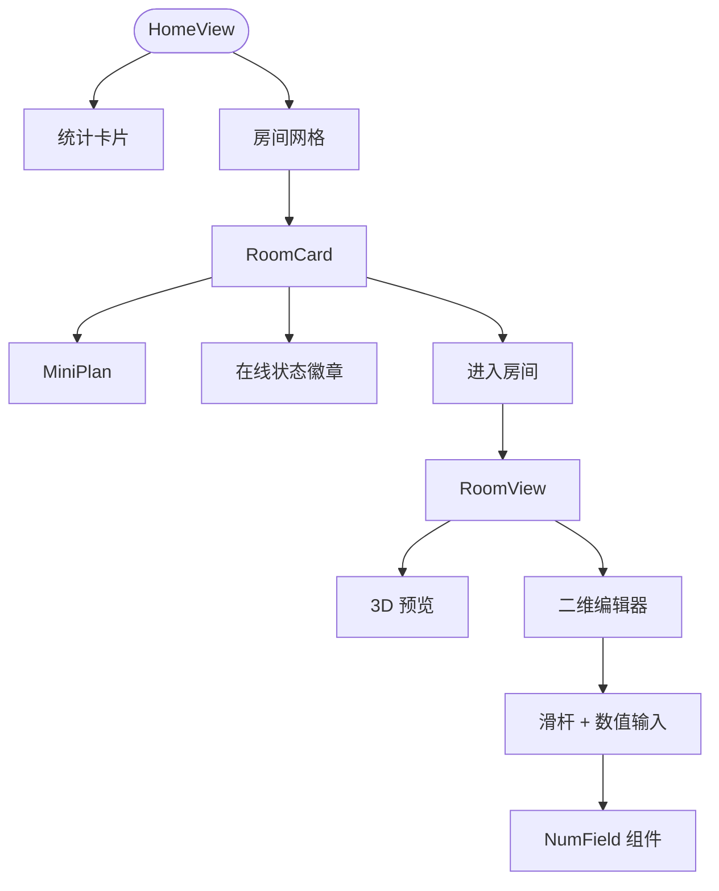
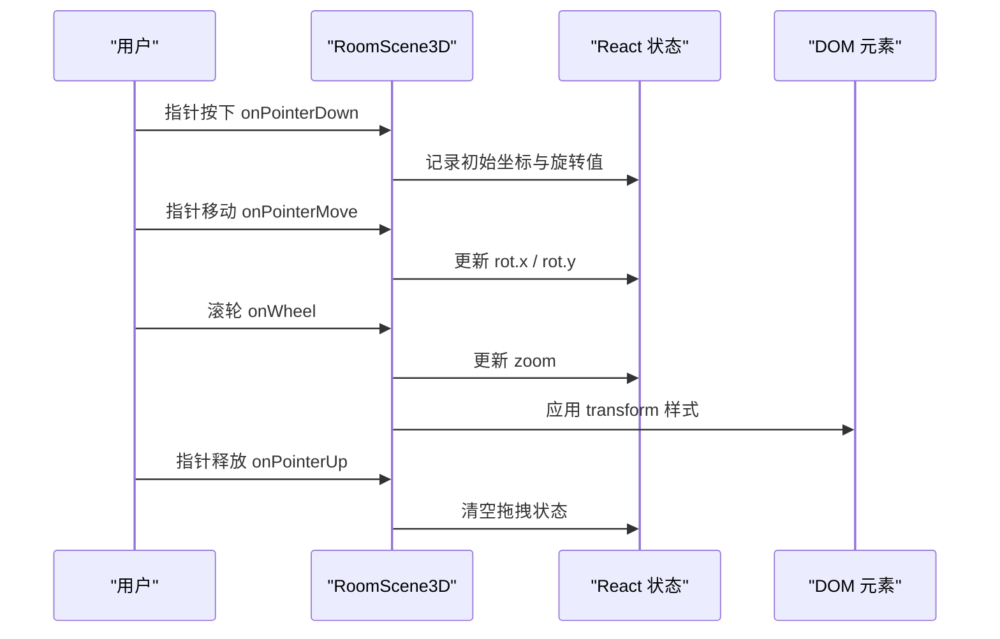
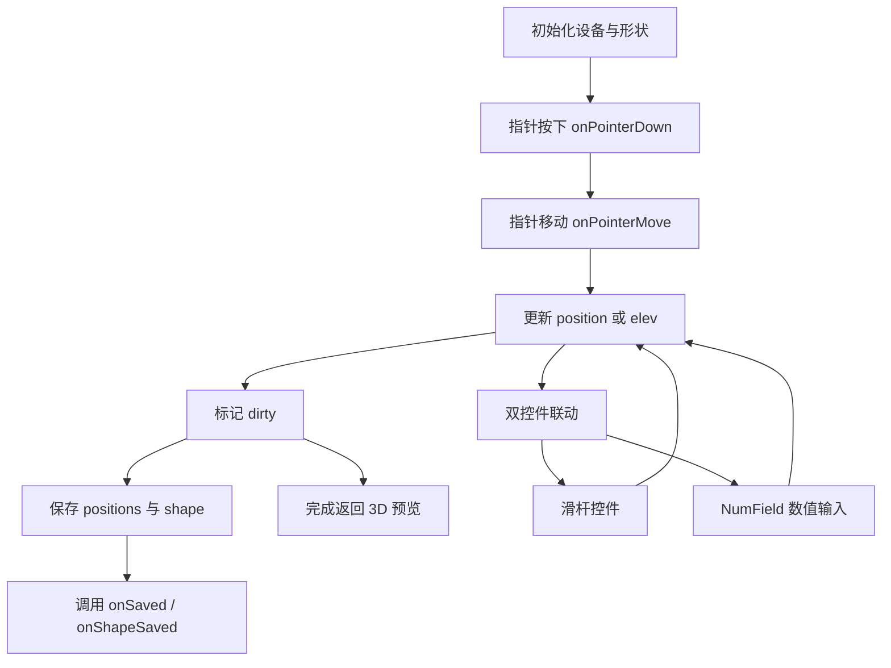
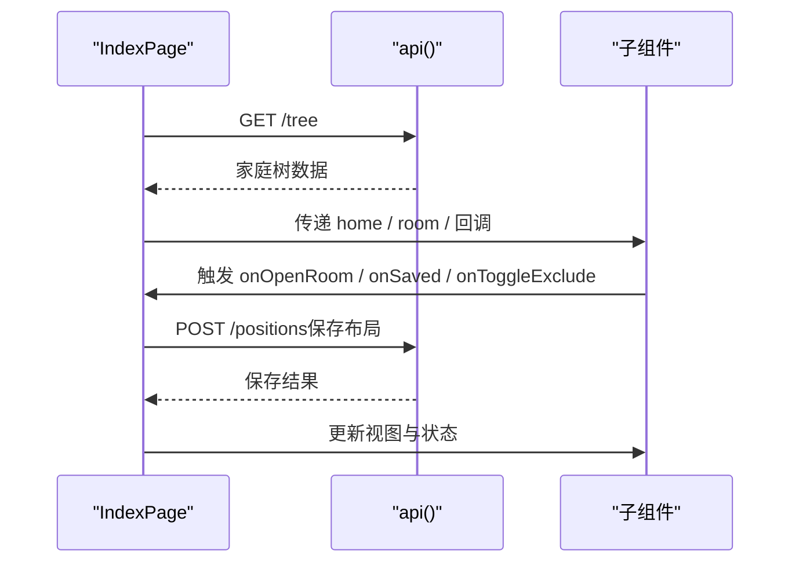
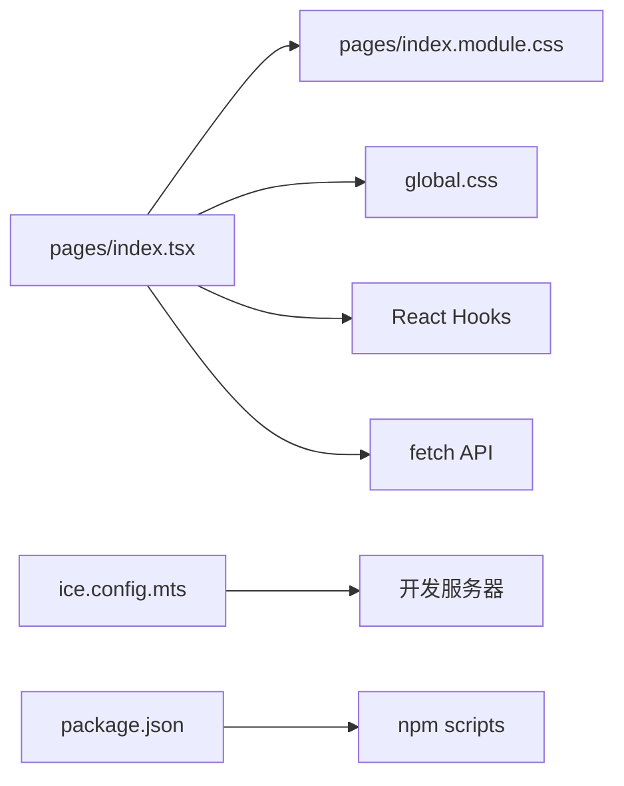

# UI组件架构

<cite>
**本文引用的文件**   
- [web/src/pages/index.tsx](file://web/src/pages/index.tsx)
- [web/src/pages/index.module.css](file://web/src/pages/index.module.css)
- [web/src/global.css](file://web/src/global.css)
- [web/src/app.ts](file://web/src/app.ts)
- [web/src/document.tsx](file://web/src/document.tsx)
- [web/ice.config.mts](file://web/ice.config.mts)
- [web/package.json](file://web/package.json)
</cite>

## 更新摘要
**变更内容**   
- 新增 NumField 数值输入组件，提供精确的设备配置能力
- 在二维编辑器中集成滑杆与数值输入的双模式控制
- 更新了设备配置交互模式，支持粗调与精调的双重操作方式

## 目录
1. [简介](#简介)
2. [项目结构](#项目结构)
3. [核心组件](#核心组件)
4. [架构总览](#架构总览)
5. [详细组件分析](#详细组件分析)
6. [依赖关系分析](#依赖关系分析)
7. [性能与可维护性](#性能与可维护性)
8. [可访问性与国际化](#可访问性与国际化)
9. [故障排查](#故障排查)
10. [结论](#结论)

## 简介
本技术文档面向 Web 控制台的前端组件架构，基于 React + Ice 框架。重点说明：
- 页面组件、工具组件与样式组织方式
- 自定义 SVG 图标组件的设计模式（GlyphCircle、GlyphStrip、GlyphPoint 等）
- **新增的 NumField 数值输入组件**，提供精确的设备配置能力
- 响应式布局与 CSS Modules 的使用
- 状态管理：useState、useEffect、useRef 的组合使用
- 组件间通信机制、事件处理最佳实践与性能优化策略
- 可访问性（a11y）实现与国际化支持方案

该应用是一个家庭设备管理台，提供家庭概览、房间列表、3D 预览与二维布局编辑能力，并通过 API 同步本地与远端数据。**新增的数值输入组件为设备配置提供了更精确的控制方式**。

## 项目结构
Web 前端位于 web 目录，采用 Ice 工程模板，入口与路由由 ice 自动生成；业务代码集中在 src 下。

**图表来源**
- [web/package.json:1-31](file://web/package.json#L1-L31)
- [web/ice.config.mts:1-19](file://web/ice.config.mts#L1-L19)
- [web/src/app.ts:1-5](file://web/src/app.ts#L1-L5)
- [web/src/document.tsx:1-26](file://web/src/document.tsx#L1-L26)
- [web/src/global.css:1-39](file://web/src/global.css#L1-L39)
- [web/src/pages/index.tsx:1-20](file://web/src/pages/index.tsx#L1-L20)
- [web/src/pages/index.module.css:1-40](file://web/src/pages/index.module.css#L1-L40)

**章节来源**
- [web/package.json:1-31](file://web/package.json#L1-L31)
- [web/ice.config.mts:1-19](file://web/ice.config.mts#L1-L19)
- [web/src/app.ts:1-5](file://web/src/app.ts#L1-L5)
- [web/src/document.tsx:1-26](file://web/src/document.tsx#L1-L26)
- [web/src/global.css:1-39](file://web/src/global.css#L1-L39)
- [web/src/pages/index.tsx:1-20](file://web/src/pages/index.tsx#L1-L20)
- [web/src/pages/index.module.css:1-40](file://web/src/pages/index.module.css#L1-L40)

## 核心组件
主页面 index.tsx 内聚了全部业务组件，包括：
- 页面级容器 IndexPage
- 家庭页 HomeView
- 房间卡片 RoomCard 与迷你平面图 MiniPlan
- 3D 场景 RoomScene3D
- 二维编辑器 RoomEditor
- **新增的 NumField 数值输入组件**，用于精确配置设备参数
- 设备清单 DeviceList
- 房间视图 RoomView（组合 3D 预览与编辑器）
- 多个小型工具函数与类型定义（几何模型、API 封装、格式化等）

这些组件通过 props 传递数据与回调，形成"父组件持有状态，子组件纯展示"的单向数据流。**NumField 组件作为新的输入控件，与现有的滑杆控件配合使用，提供更丰富的用户交互体验**。

**章节来源**
- [web/src/pages/index.tsx:1-50](file://web/src/pages/index.tsx#L1-L50)
- [web/src/pages/index.tsx:208-298](file://web/src/pages/index.tsx#L208-L298)
- [web/src/pages/index.tsx:300-412](file://web/src/pages/index.tsx#L300-L412)
- [web/src/pages/index.tsx:414-661](file://web/src/pages/index.tsx#L414-L661)
- [web/src/pages/index.tsx:663-767](file://web/src/pages/index.tsx#L663-L767)
- [web/src/pages/index.tsx:769-800](file://web/src/pages/index.tsx#L769-L800)

## 架构总览
整体架构遵循 Ice 默认约定：
- document.tsx 提供 HTML 模板，注入 Meta、Title、Links、Main、Scripts
- global.css 定义全局主题变量与基础样式
- app.ts 暴露 Ice 应用配置
- pages/index.tsx 作为主页面，承载所有业务逻辑与 UI
- index.module.css 以 CSS Modules 形式为页面组件提供局部样式

**图表来源**
- [web/src/document.tsx:1-26](file://web/src/document.tsx#L1-L26)
- [web/src/app.ts:1-5](file://web/src/app.ts#L1-L5)
- [web/src/pages/index.tsx:1-20](file://web/src/pages/index.tsx#L1-L20)
- [web/src/pages/index.module.css:1-40](file://web/src/pages/index.module.css#L1-L40)
- [web/src/global.css:1-39](file://web/src/global.css#L1-L39)

## 详细组件分析

### 自定义 SVG 图标组件设计模式
项目中定义了多个轻量级 SVG 图标组件，如 GlyphCircle、GlyphStrip、GlyphPoint、GlyphHouse、GlyphPencil、GlyphRefresh、GlyphSync、GlyphArrowLeft、GlyphEye、GlyphEyeOff。它们共同遵循以下设计模式：
- 使用 viewBox 与固定宽高，保证缩放一致性
- 使用 currentColor 填充或描边，使图标颜色随上下文变化
- 使用 aria-hidden 避免辅助技术重复朗读装饰性图标
- 组件无状态、无副作用，便于复用与测试

**图表来源**
- [web/src/pages/index.tsx:130-206](file://web/src/pages/index.tsx#L130-L206)

**章节来源**
- [web/src/pages/index.tsx:130-206](file://web/src/pages/index.tsx#L130-L206)

### 新增的 NumField 数值输入组件
**NumField 组件**是本次更新的核心新增功能，专门用于精确的设备参数配置。该组件提供了以下特性：

- **草稿态编辑**：内部维护 draft 状态，允许自由编辑而不立即影响受控值
- **实时验证**：输入时即时验证数值有效性，支持中间状态（如空值、小数点）
- **范围限制**：严格遵循 min/max 边界约束
- **双模式联动**：与滑杆控件配合，实现粗调（滑杆）与精调（数值输入）的统一
- **失焦提交**：失去焦点或回车时提交最终值，确保数据一致性

**图表来源**
- [web/src/pages/index.tsx:587-617](file://web/src/pages/index.tsx#L587-L617)

**章节来源**
- [web/src/pages/index.tsx:587-617](file://web/src/pages/index.tsx#L587-L617)

### 页面与布局组件
- HomeView：展示家庭统计与房间网格，使用 CSS Grid 实现响应式布局
- RoomCard：封装房间卡片，包含迷你平面图、在线状态徽章与进入按钮
- MiniPlan：静态 SVG 平面示意，根据房间尺寸比例渲染设备位置
- RoomView：组合 3D 预览与二维编辑器，并提供面包屑导航与操作按钮

**图表来源**
- [web/src/pages/index.tsx:208-298](file://web/src/pages/index.tsx#L208-L298)
- [web/src/pages/index.tsx:710-767](file://web/src/pages/index.tsx#L710-L767)
- [web/src/pages/index.tsx:891-928](file://web/src/pages/index.tsx#L891-L928)

**章节来源**
- [web/src/pages/index.tsx:208-298](file://web/src/pages/index.tsx#L208-L298)
- [web/src/pages/index.tsx:710-767](file://web/src/pages/index.tsx#L710-L767)

### 3D 场景组件 RoomScene3D
RoomScene3D 使用 CSS 3D transform 构建房间盒子，支持拖拽旋转与滚轮缩放：
- 使用 useState 管理旋转角度 rot 与缩放 zoom
- 使用 useRef 保存拖拽初始坐标与 DOM 引用
- 使用 useEffect 注册 wheel 事件监听并清理
- 通过 pointer 事件统一处理拖拽交互，提升移动端体验
- 将设备按 kind 分类渲染为圆盘（吸顶灯）或长条（灯带），并根据 elev 计算垂直高度

**图表来源**
- [web/src/pages/index.tsx:300-412](file://web/src/pages/index.tsx#L300-L412)

**章节来源**
- [web/src/pages/index.tsx:300-412](file://web/src/pages/index.tsx#L300-L412)

### 二维编辑器组件 RoomEditor
RoomEditor 负责设备的二维布局编辑，包括：
- 初始化设备位置与房间形状
- 拖拽设备主体、端点与手柄进行移动、调整方向与半径
- **双输入框联动：滑杆粗调、数值精调** - 这是本次更新的核心改进
- 安装高度 elev 的 UI 映射：UI 显示"距顶"，存储为"离地百分比"
- 保存时提交 positions 与 shape，并触发父组件回调

**更新** 新增了与 NumField 组件的深度集成，实现了更精确的参数调节体验：

**图表来源**
- [web/src/pages/index.tsx:414-661](file://web/src/pages/index.tsx#L414-L661)
- [web/src/pages/index.tsx:891-928](file://web/src/pages/index.tsx#L891-L928)

**章节来源**
- [web/src/pages/index.tsx:414-661](file://web/src/pages/index.tsx#L414-L661)

### 设备清单组件 DeviceList
DeviceList 展示房间内设备列表，支持：
- 根据设备类型渲染对应 Glyph 图标
- 显示设备名称、品类、安装高度与排除状态
- 提供"从空间布局中排除/恢复"的操作按钮

**章节来源**
- [web/src/pages/index.tsx:663-708](file://web/src/pages/index.tsx#L663-L708)

### 页面容器 IndexPage
IndexPage 是顶层状态容器，负责：
- 加载家庭树数据（本地快照优先）
- 切换活跃家庭与视图（home / room）
- 同步本地与远端数据，并反馈同步状态
- 向子组件传递回调（打开房间、保存布局、切换排除状态等）

**图表来源**
- [web/src/pages/index.tsx:769-800](file://web/src/pages/index.tsx#L769-L800)
- [web/src/pages/index.tsx:85-93](file://web/src/pages/index.tsx#L85-L93)
- [web/src/pages/index.tsx:502-518](file://web/src/pages/index.tsx#L502-L518)

**章节来源**
- [web/src/pages/index.tsx:769-800](file://web/src/pages/index.tsx#L769-L800)
- [web/src/pages/index.tsx:85-93](file://web/src/pages/index.tsx#L85-L93)
- [web/src/pages/index.tsx:502-518](file://web/src/pages/index.tsx#L502-L518)

## 依赖关系分析
- 组件耦合度低：各组件职责清晰，通过 props 与回调解耦
- 直接依赖：index.tsx 依赖 index.module.css 与 global.css
- 外部依赖：React Hooks（useState、useEffect、useRef、useCallback）、fetch API
- 构建与运行：Ice 提供开发服务器、按需编译与 ESM 输出；代理 /api 到本地后端

**图表来源**
- [web/src/pages/index.tsx:1-20](file://web/src/pages/index.tsx#L1-L20)
- [web/src/pages/index.module.css:1-40](file://web/src/pages/index.module.css#L1-L40)
- [web/src/global.css:1-39](file://web/src/global.css#L1-L39)
- [web/ice.config.mts:1-19](file://web/ice.config.mts#L1-L19)
- [web/package.json:1-31](file://web/package.json#L1-L31)

**章节来源**
- [web/src/pages/index.tsx:1-20](file://web/src/pages/index.tsx#L1-L20)
- [web/src/pages/index.module.css:1-40](file://web/src/pages/index.module.css#L1-L40)
- [web/src/global.css:1-39](file://web/src/global.css#L1-L39)
- [web/ice.config.mts:1-19](file://web/ice.config.mts#L1-L19)
- [web/package.json:1-31](file://web/package.json#L1-L31)

## 性能与可维护性
- 状态管理
  - 使用 useState 管理 UI 状态（旋转、缩放、模式、设备列表、形状、dirty 标志等）
  - 使用 useEffect 订阅外部事件（wheel、pointer）并在卸载时清理
  - 使用 useRef 保存非渲染状态（拖拽上下文、DOM 引用）
  - 使用 useCallback 包裹异步加载函数，避免不必要的重渲染
- **新增的 NumField 组件优化**
  - 使用内部草稿态避免频繁的状态更新
  - 实时验证减少无效数据的传播
  - 与滑杆控件的双向绑定确保数据一致性
- 事件处理
  - 统一使用 Pointer Events 处理拖拽，兼容鼠标与触摸
  - 使用 setPointerCapture 确保拖拽稳定
  - 对滚动事件使用 passive: false 以允许 preventDefault
- 样式组织
  - 使用 CSS Modules 隔离样式，避免全局污染
  - 使用 CSS 变量定义主题色与线条色，便于扩展
  - 使用 Grid 与 Flexbox 实现响应式布局
  - **新增 .numInput 样式类**，提供统一的数值输入框外观
- 可维护性
  - 组件职责单一，props 接口明确
  - 工具函数与类型定义集中，便于复用与测试
  - 错误提示使用 alert，建议后续替换为更友好的 UI 通知

**章节来源**
- [web/src/pages/index.tsx:300-412](file://web/src/pages/index.tsx#L300-L412)
- [web/src/pages/index.tsx:414-661](file://web/src/pages/index.tsx#L414-L661)
- [web/src/pages/index.tsx:587-617](file://web/src/pages/index.tsx#L587-L617)
- [web/src/pages/index.tsx:891-928](file://web/src/pages/index.tsx#L891-L928)
- [web/src/global.css:1-39](file://web/src/global.css#L1-L39)
- [web/src/pages/index.module.css:1-40](file://web/src/pages/index.module.css#L1-L40)
- [web/src/pages/index.module.css:814-837](file://web/src/pages/index.module.css#L814-L837)

## 可访问性与国际化
- 可访问性（a11y）
  - 装饰性 SVG 图标使用 aria-hidden 避免被读屏器朗读
  - 按钮使用语义化标签与 title 提供额外信息
  - 建议使用 role 与 aria-* 属性增强交互控件的可访问性（例如为拖拽区域添加 aria-grabbed 状态）
  - **NumField 组件使用原生 input 元素**，天然支持键盘导航和屏幕阅读器
- 国际化（i18n）
  - 当前文案硬编码在组件中，未引入 i18n 库
  - 建议抽取文案至语言包，并使用 Hook 或高阶组件注入翻译文本
  - 对于单位与时间格式，可使用 Intl 对象进行本地化处理

**章节来源**
- [web/src/pages/index.tsx:130-206](file://web/src/pages/index.tsx#L130-L206)
- [web/src/pages/index.tsx:587-617](file://web/src/pages/index.tsx#L587-L617)
- [web/src/pages/index.tsx:663-708](file://web/src/pages/index.tsx#L663-L708)

## 故障排查
- 网络请求失败
  - 检查 ice.config.mts 中的代理配置是否正确指向本地后端
  - 确认 API 路径与方法与后端一致
- 拖拽异常
  - 检查 pointer 事件是否被其他元素拦截
  - 确认 setPointerCapture 与事件清理逻辑正确
- **数值输入问题**
  - 检查 NumField 组件的 min/max 边界设置是否合理
  - 确认 onCommit 回调函数的参数转换逻辑正确
  - 验证滑杆与数值输入的双向绑定是否正常工作
- 样式冲突
  - 检查 CSS Modules 类名是否正确使用
  - 确认全局样式变量已定义且未被覆盖
  - **检查 .numInput 样式是否与主题变量兼容**

**章节来源**
- [web/ice.config.mts:1-19](file://web/ice.config.mts#L1-L19)
- [web/src/pages/index.tsx:300-412](file://web/src/pages/index.tsx#L300-L412)
- [web/src/pages/index.tsx:587-617](file://web/src/pages/index.tsx#L587-L617)
- [web/src/pages/index.module.css:1-40](file://web/src/pages/index.module.css#L1-L40)
- [web/src/pages/index.module.css:814-837](file://web/src/pages/index.module.css#L814-L837)

## 结论
该 Web 控制台采用 React + Ice 的现代前端架构，组件职责清晰、样式隔离良好、交互流畅。**新增的 NumField 数值输入组件显著提升了设备配置的精确度和用户体验**，通过与现有滑杆控件的配合，实现了粗调与精调的双重操作模式。通过自定义 SVG 图标组件与 CSS Modules，实现了高内聚、低耦合的 UI 体系。建议在后续迭代中引入 i18n 与更完善的错误提示机制，进一步提升用户体验与可维护性。

**主要改进**：
- 新增 NumField 组件，提供精确的数值输入能力
- 在二维编辑器中集成双控件模式，提升配置效率
- 优化用户交互体验，支持更灵活的设备参数调节
- 保持代码的可维护性和可扩展性