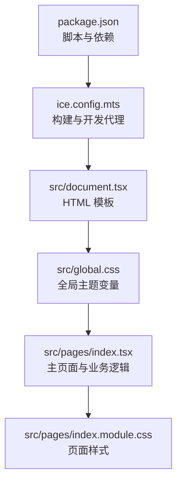
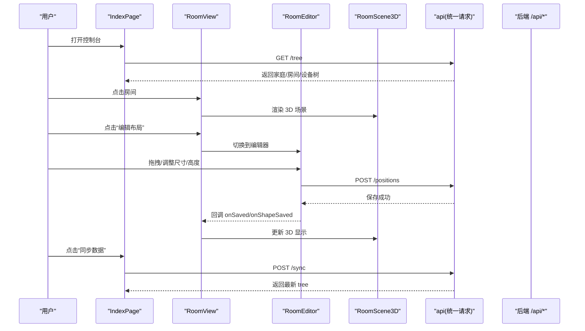
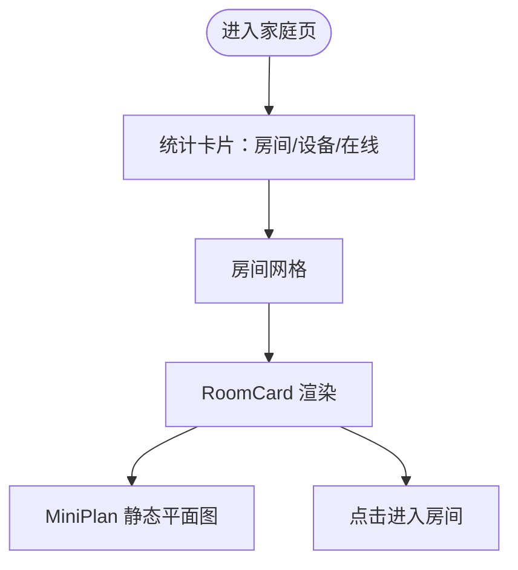
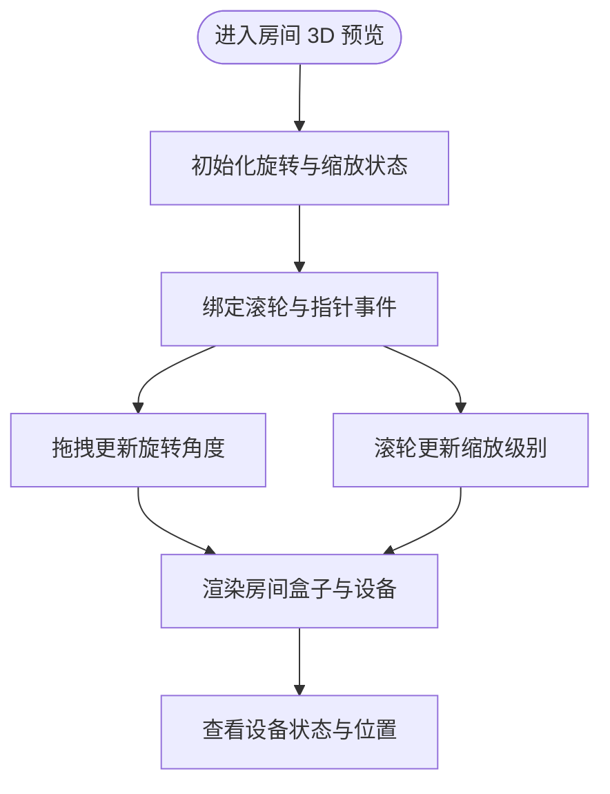
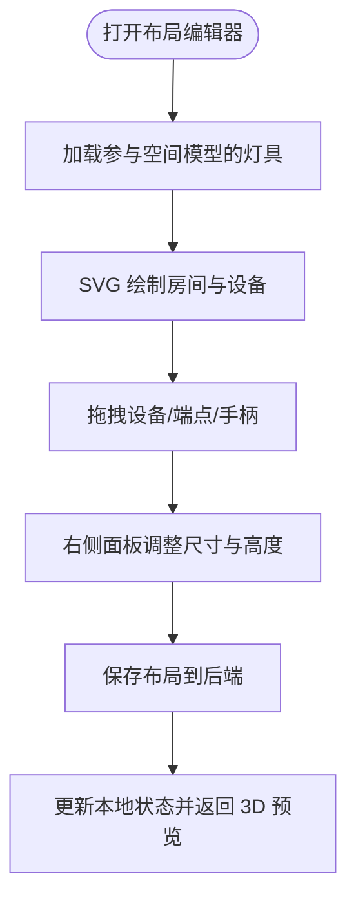
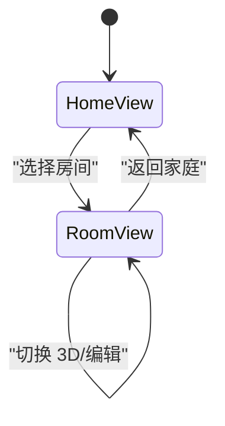
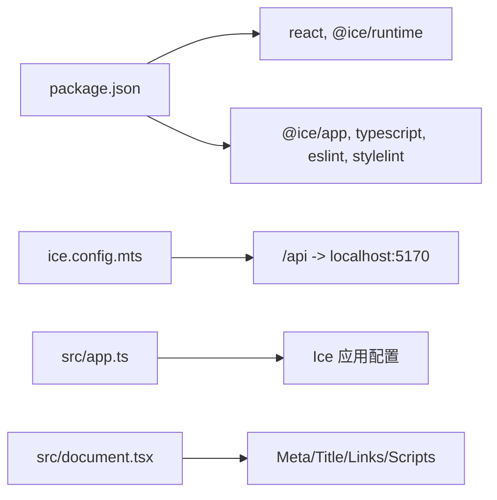

# Web控制台

<cite>
**本文引用的文件**   
- [web/package.json](file://web/package.json)
- [web/ice.config.mts](file://web/ice.config.mts)
- [web/src/app.ts](file://web/src/app.ts)
- [web/src/document.tsx](file://web/src/document.tsx)
- [web/src/global.css](file://web/src/global.css)
- [web/src/pages/index.tsx](file://web/src/pages/index.tsx)
- [web/src/pages/index.module.css](file://web/src/pages/index.module.css)
</cite>

## 目录
1. [简介](#简介)
2. [项目结构](#项目结构)
3. [核心组件](#核心组件)
4. [架构总览](#架构总览)
5. [详细组件分析](#详细组件分析)
6. [依赖关系分析](#依赖关系分析)
7. [性能与可访问性](#性能与可访问性)
8. [故障排查指南](#故障排查指南)
9. [结论](#结论)

## 简介
本仓库的 web 子项目是一个基于 React + Ice 框架的前端应用，提供“欧享家 · 家庭设备管理台”的 Web 控制台。它负责：
- 展示家庭/房间/设备三层结构；
- 在房间内以 3D 空间模型可视化灯具、灯带等设备的安装位置；
- 提供二维布局编辑器，支持拖拽旋转、滚轮缩放、调整房间尺寸与设备安装高度；
- 通过本地代理将 API 请求转发到本地后端服务，完成数据同步与布局保存。

该文档面向产品、设计与前端开发者，帮助理解界面结构、交互流程、数据流与扩展点。

## 项目结构
Web 应用采用 Ice 工程约定目录：
- 页面入口：`src/pages/index.tsx`
- 样式：`src/pages/index.module.css`、`src/global.css`
- 应用配置：`ice.config.mts`、`src/app.ts`
- HTML 模板：`src/document.tsx`
- 包信息：`package.json`

**图表来源**
- [web/package.json:1-31](file://web/package.json#L1-L31)
- [web/ice.config.mts:1-19](file://web/ice.config.mts#L1-L19)
- [web/src/document.tsx:1-26](file://web/src/document.tsx#L1-L26)
- [web/src/global.css:1-39](file://web/src/global.css#L1-L39)
- [web/src/pages/index.tsx:1-950](file://web/src/pages/index.tsx#L1-L950)
- [web/src/pages/index.module.css:1-1117](file://web/src/pages/index.module.css#L1-L1117)

**章节来源**
- [web/package.json:1-31](file://web/package.json#L1-L31)
- [web/ice.config.mts:1-19](file://web/ice.config.mts#L1-L19)
- [web/src/document.tsx:1-26](file://web/src/document.tsx#L1-L26)
- [web/src/global.css:1-39](file://web/src/global.css#L1-L39)

## 核心组件
主页面 `IndexPage` 是应用的根组件，负责：
- 加载并维护家庭/房间/设备树；
- 切换当前家庭与视图（家庭页/房间页）；
- 发起云端同步与本地刷新；
- 处理布局保存、形状更新与设备排除状态切换。

房间级组件包括：
- `HomeView`：家庭统计与房间卡片列表；
- `RoomCard`：房间卡片，含迷你平面图与在线数；
- `RoomView`：房间页容器，切换 3D 预览与二维编辑模式；
- `RoomScene3D`：CSS 3D 房间盒子与设备可视化；
- `RoomEditor`：二维平面布局编辑器；
- `DeviceList`：设备清单侧栏，支持从空间布局中排除/恢复设备。

**章节来源**
- [web/src/pages/index.tsx:262-298](file://web/src/pages/index.tsx#L262-L298)
- [web/src/pages/index.tsx:240-260](file://web/src/pages/index.tsx#L240-L260)
- [web/src/pages/index.tsx:710-767](file://web/src/pages/index.tsx#L710-L767)
- [web/src/pages/index.tsx:300-412](file://web/src/pages/index.tsx#L300-L412)
- [web/src/pages/index.tsx:414-661](file://web/src/pages/index.tsx#L414-L661)
- [web/src/pages/index.tsx:663-708](file://web/src/pages/index.tsx#L663-L708)
- [web/src/pages/index.tsx:769-950](file://web/src/pages/index.tsx#L769-L950)

## 架构总览
应用采用单页路由式结构，由 `IndexPage` 控制视图切换，并通过统一的 `api` 函数调用后端接口。数据流如下：
- 初始加载：读取 `/tree` 获取本地快照或云端数据；
- 用户操作：进入房间、切换 3D 预览/编辑模式、拖拽设备、调整房间尺寸；
- 保存动作：提交 `/positions` 保存设备位置、房间形状与排除列表；
- 同步动作：POST `/sync` 拉取最新结构并更新本地快照。

**图表来源**
- [web/src/pages/index.tsx:769-950](file://web/src/pages/index.tsx#L769-L950)
- [web/src/pages/index.tsx:414-661](file://web/src/pages/index.tsx#L414-L661)
- [web/src/pages/index.tsx:300-412](file://web/src/pages/index.tsx#L300-L412)

## 详细组件分析

### 数据模型与类型定义
- 设备 `Device`：包含虚拟设备 ID、名称、类型、协议、在线状态、父节点、位置信息与是否被排除出空间模型。
- 房间 `Room`：包含房间编号、名称、设备数量、几何形状 `RoomShape`（宽/高/深）与设备数组。
- 家庭 `Home`：包含项目编码、名称、设备总数、在线数与房间数组。
- 位置 `Pos`：三种形态——吸顶灯圆面 `circle`、灯带线段 `segment`、网关/点位 `point`，均使用百分比坐标与安装高度 `elev`。

这些类型用于驱动 3D 渲染与二维编辑器的计算与交互。

**章节来源**
- [web/src/pages/index.tsx:8-47](file://web/src/pages/index.tsx#L8-L47)
- [web/src/pages/index.tsx:15-18](file://web/src/pages/index.tsx#L15-L18)
- [web/src/pages/index.tsx:20-31](file://web/src/pages/index.tsx#L20-L31)
- [web/src/pages/index.tsx:33-47](file://web/src/pages/index.tsx#L33-L47)

### 家庭页与房间卡片
- `HomeView` 展示房间数量、设备数量与在线数量，并提供房间网格。
- `RoomCard` 内嵌 `MiniPlan` 静态平面图，显示在线设备比例与房间尺寸。
- 点击房间卡片进入 `RoomView`。

**图表来源**
- [web/src/pages/index.tsx:262-298](file://web/src/pages/index.tsx#L262-L298)
- [web/src/pages/index.tsx:208-260](file://web/src/pages/index.tsx#L208-L260)

**章节来源**
- [web/src/pages/index.tsx:208-260](file://web/src/pages/index.tsx#L208-L260)
- [web/src/pages/index.tsx:262-298](file://web/src/pages/index.tsx#L262-L298)

### 3D 空间建模与交互
`RoomScene3D` 使用 CSS 3D transform 构建房间盒子，支持：
- 拖拽旋转：监听指针事件，更新旋转角度；
- 滚轮缩放：限制缩放范围，避免过小或过大；
- 设备可视化：根据设备类型渲染圆形吸顶灯、长条灯带，离线设备使用暗色样式；
- 坐标映射：房间宽高深转换为像素坐标系，设备位置按百分比换算。

**图表来源**
- [web/src/pages/index.tsx:300-412](file://web/src/pages/index.tsx#L300-L412)

**章节来源**
- [web/src/pages/index.tsx:300-412](file://web/src/pages/index.tsx#L300-L412)

### 二维布局编辑器
`RoomEditor` 提供 SVG 平面编辑能力：
- 绘制房间地板与网格；
- 渲染可拖拽的设备图形：吸顶灯圆盘（拖动移动、右侧手柄调大小）、灯带线段（拖动端点调方向长度）；
- 右侧面板提供房间尺寸（宽/深/高）与设备安装高度（距顶米数）的滑杆与数值输入；
- 保存时提交 `/positions`，同时更新本地状态并回调父组件。

**图表来源**
- [web/src/pages/index.tsx:414-661](file://web/src/pages/index.tsx#L414-L661)

**章节来源**
- [web/src/pages/index.tsx:414-661](file://web/src/pages/index.tsx#L414-L661)

### 设备清单与排除机制
`DeviceList` 列出房间所有设备，显示类型、品类、安装高度与在线状态。对可定位设备提供“从空间布局中排除/恢复”按钮，调用 `/positions` 更新 excluded 列表，并在 UI 中标记已排除设备。

**章节来源**
- [web/src/pages/index.tsx:663-708](file://web/src/pages/index.tsx#L663-L708)
- [web/src/pages/index.tsx:843-870](file://web/src/pages/index.tsx#L843-L870)

### 页面导航与状态管理
`RoomView` 在 3D 预览与编辑器之间切换，面包屑导航返回家庭页，顶部工具栏显示房间尺寸与在线数。`IndexPage` 维护 homes、activeHome、view、syncInfo 等状态，并提供同步与刷新功能。

**图表来源**
- [web/src/pages/index.tsx:710-767](file://web/src/pages/index.tsx#L710-L767)
- [web/src/pages/index.tsx:769-950](file://web/src/pages/index.tsx#L769-L950)

**章节来源**
- [web/src/pages/index.tsx:710-767](file://web/src/pages/index.tsx#L710-L767)
- [web/src/pages/index.tsx:769-950](file://web/src/pages/index.tsx#L769-L950)

## 依赖关系分析
- 运行时依赖：React 18、Ice Runtime；
- 开发依赖：Ice App、TypeScript、ESLint、Stylelint；
- 构建与开发：`ice.config.mts` 启用按需加载、ESM 格式，并将 `/api` 代理到本地后端 `http://localhost:5170`；
- 应用配置：`src/app.ts` 导出空配置对象，遵循 Ice 约定；
- HTML 模板：`src/document.tsx` 设置字符集、描述、视口与图标。

**图表来源**
- [web/package.json:1-31](file://web/package.json#L1-L31)
- [web/ice.config.mts:1-19](file://web/ice.config.mts#L1-L19)
- [web/src/app.ts:1-5](file://web/src/app.ts#L1-L5)
- [web/src/document.tsx:1-26](file://web/src/document.tsx#L1-L26)

**章节来源**
- [web/package.json:1-31](file://web/package.json#L1-L31)
- [web/ice.config.mts:1-19](file://web/ice.config.mts#L1-L19)
- [web/src/app.ts:1-5](file://web/src/app.ts#L1-L5)
- [web/src/document.tsx:1-26](file://web/src/document.tsx#L1-L26)

## 性能与可访问性

### 性能优化建议
- 减少重绘与重排：
  - 3D 场景使用 CSS transform 进行旋转与缩放，避免频繁修改布局属性；
  - 编辑器拖拽时使用局部状态更新，仅在必要时触发保存。
- 网络请求优化：
  - 初始加载优先本地快照，减少云端请求；
  - 同步操作使用防抖或节流策略，避免重复提交。
- 渲染优化：
  - 仅渲染参与空间模型的灯具，忽略网关与排除设备；
  - 小图标使用 SVG，减少图片资源加载。

### 可访问性最佳实践
- 语义化标签：使用 `<main>`、`<header>`、`<aside>`、`<button>` 等语义元素；
- 键盘与焦点：为交互元素提供清晰的焦点样式与键盘操作支持；
- 屏幕阅读器：为图标添加 `aria-hidden`，为关键控件提供 `title` 与 `aria-label`；
- 颜色对比度：深色主题下确保文本与背景对比度符合 WCAG 标准；
- 响应式设计：使用 CSS Grid/Flexbox 适配不同屏幕尺寸，保证触控友好。

[本节为通用指导，不直接分析具体文件]

## 故障排查指南

### 常见问题与解决
- 数据加载失败：
  - 现象：顶部出现错误横幅，提示 token 可能失效；
  - 排查：检查后端服务是否启动、代理配置是否正确；
  - 参考路径：[web/src/pages/index.tsx:928-933](file://web/src/pages/index.tsx#L928-L933)。
- 同步失败：
  - 现象：点击“同步数据”后无反馈或报错；
  - 排查：确认 `/sync` 接口可达，检查网络与跨域；
  - 参考路径：[web/src/pages/index.tsx:803-816](file://web/src/pages/index.tsx#L803-L816)。
- 布局保存失败：
  - 现象：点击“保存布局”弹出错误提示；
  - 排查：检查 `/positions` 接口参数与权限；
  - 参考路径：[web/src/pages/index.tsx:502-518](file://web/src/pages/index.tsx#L502-L518)。
- 3D 场景无响应：
  - 现象：拖拽或滚轮无效；
  - 排查：检查事件绑定与 pointer capture；
  - 参考路径：[web/src/pages/index.tsx:308-317](file://web/src/pages/index.tsx#L308-L317)、[web/src/pages/index.tsx:332-345](file://web/src/pages/index.tsx#L332-L345)。

**章节来源**
- [web/src/pages/index.tsx:928-933](file://web/src/pages/index.tsx#L928-L933)
- [web/src/pages/index.tsx:803-816](file://web/src/pages/index.tsx#L803-L816)
- [web/src/pages/index.tsx:502-518](file://web/src/pages/index.tsx#L502-L518)
- [web/src/pages/index.tsx:308-317](file://web/src/pages/index.tsx#L308-L317)
- [web/src/pages/index.tsx:332-345](file://web/src/pages/index.tsx#L332-L345)

## 结论
本 Web 控制台以 React + Ice 为基础，构建了家庭/房间/设备三层结构的可视化与管理界面。通过 3D 空间建模与二维布局编辑器，用户能够直观地查看与控制设备，并进行精细化的空间布局调整。应用具备良好的可扩展性与可维护性，适合进一步集成更多设备类型与高级交互功能。

[本节为总结性内容，不直接分析具体文件]