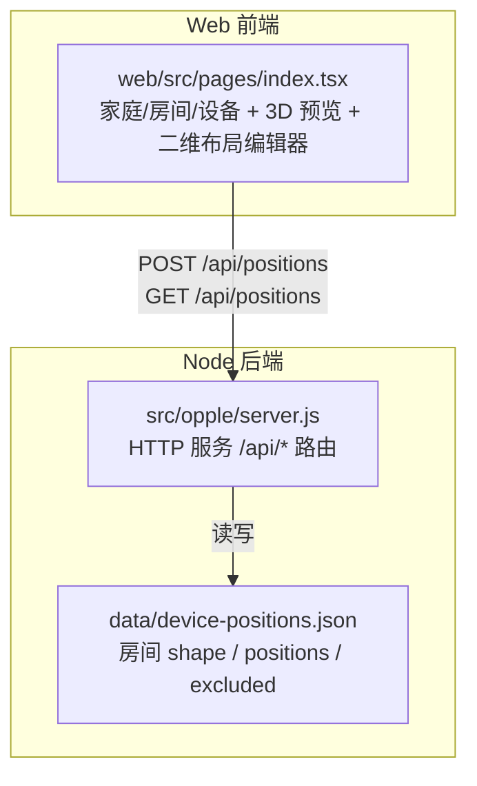
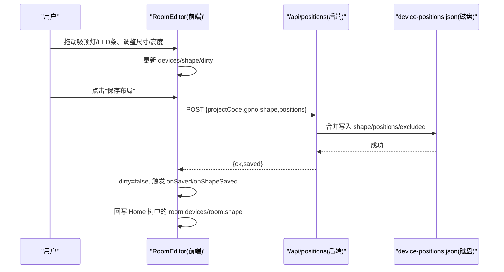
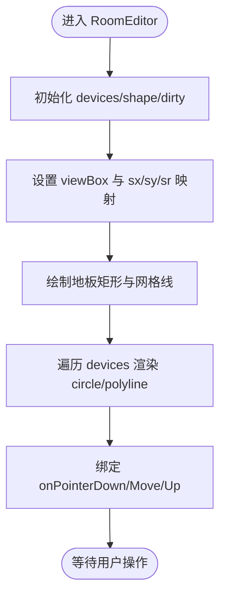
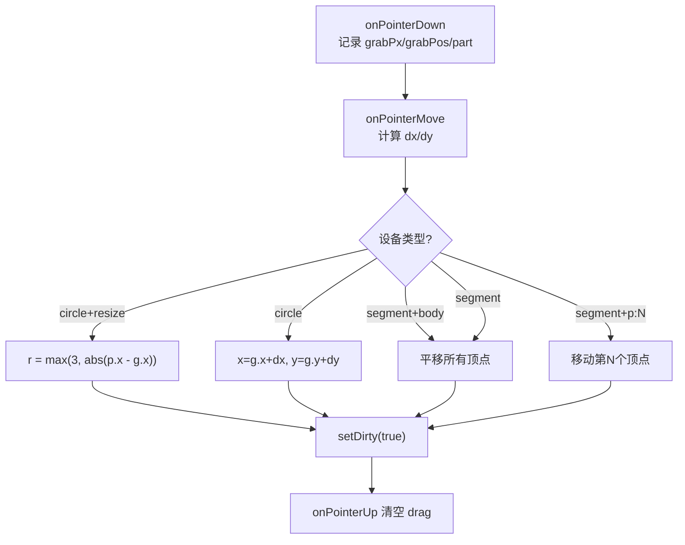
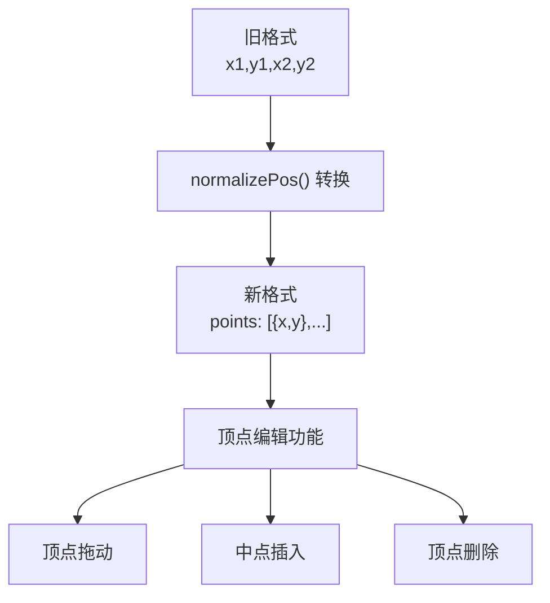
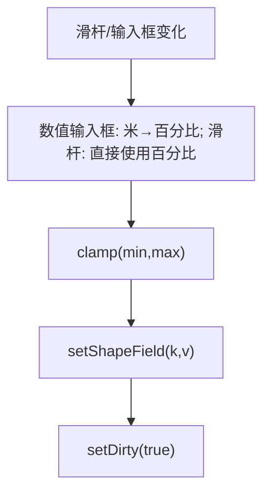
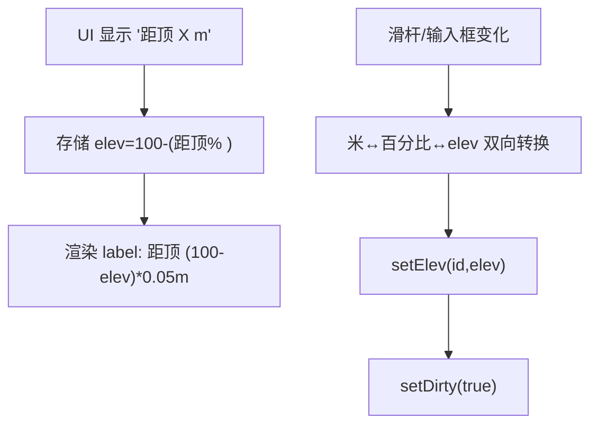
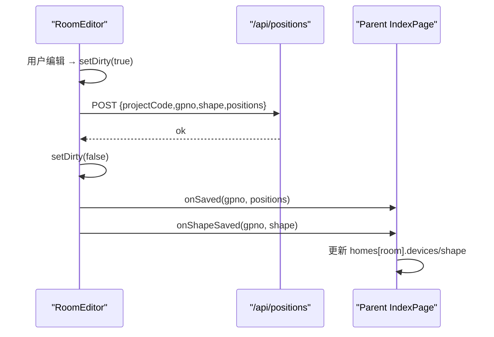
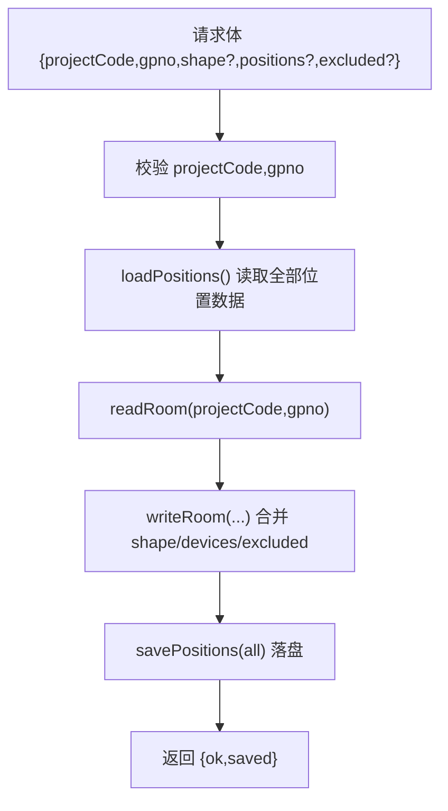
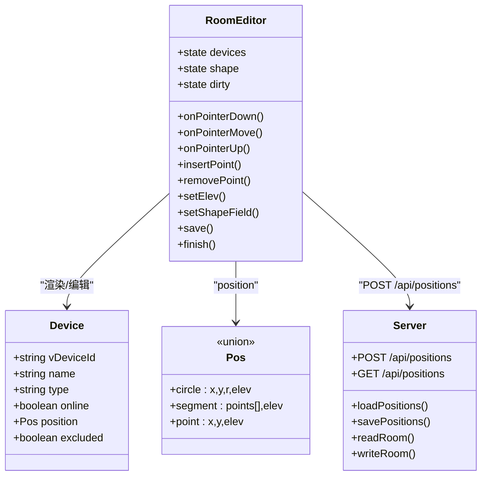

# 布局编辑器

<cite>
**本文引用的文件**   
- [web/src/pages/index.tsx](file://web/src/pages/index.tsx)
- [src/opple/server.js](file://src/opple/server.js)
- [README.md](file://README.md)
</cite>

## 更新摘要
**所做更改**   
- 更新了LED条数据模型章节，详细说明从两点线段到多顶点折线路径的升级
- 新增了顶点操作功能说明（拖动、删除、中点插入）
- 更新了交互特性章节以反映新的折线编辑能力
- 修正了数据模型定义以反映新的SegmentPos结构
- 更新了架构图表以显示新的折线路径渲染逻辑

## 目录
1. [简介](#简介)
2. [项目结构](#项目结构)
3. [核心组件](#核心组件)
4. [架构总览](#架构总览)
5. [详细组件分析](#详细组件分析)
6. [依赖关系分析](#依赖关系分析)
7. [性能与交互特性](#性能与交互特性)
8. [故障排查指南](#故障排查指南)
9. [结论](#结论)
10. [附录：数据模型与接口约定](#附录数据模型与接口约定)

## 简介
本文件为"布局编辑器"的操作指南与技术文档，面向希望理解并扩展二维平面编辑器的开发者与产品/运营人员。内容覆盖以下目标：
- 二维平面编辑器的实现原理：SVG 画布、网格系统、坐标映射。
- 设备拖拽操作：吸顶灯移动与半径调整；**LED条多顶点折线路径编辑**（顶点拖动、中点插入、顶点删除）。
- 房间尺寸编辑：宽、深、高滑杆与数值输入的双向绑定。
- 安装高度调节机制：UI"距顶"米数与存储"离地百分比 elev"的转换。
- 数据持久化流程：本地保存、API 同步、脏标记管理。
- 布局导入导出能力与错误处理策略。

该功能位于 Web 前端页面中，配合 Node 后端提供的 `/api/positions` 等接口完成空间数据的读写。

**章节来源**
- [README.md:6-16](file://README.md#L6-L16)
- [README.md:32-39](file://README.md#L32-L39)

## 项目结构
从仓库视角看，布局编辑器属于 Web 前端工程的一部分，核心逻辑集中在单页入口页面中；后端提供位置数据的读取与落盘能力。

**图表来源**
- [web/src/pages/index.tsx:85-93](file://web/src/pages/index.tsx#L85-L93)
- [src/opple/server.js:171-200](file://src/opple/server.js#L171-L200)

**章节来源**
- [web/src/pages/index.tsx:1-50](file://web/src/pages/index.tsx#L1-L50)
- [src/opple/server.js:32-49](file://src/opple/server.js#L32-L49)

## 核心组件
- `RoomEditor`：二维平面编辑器主体，负责 SVG 渲染、设备拖拽、尺寸与安装高度编辑、脏标记与保存。
- `RoomView`：房间视图容器，切换 3D 预览与二维编辑模式，透传保存回调。
- `DeviceList`：设备清单侧栏，支持将灯具从空间模型中排除或恢复。
- `HomeView` / `IndexPage`：家庭列表与全局状态（本地快照、同步、错误提示）。
- 后端 `/api/positions`：接收 shape、positions、excluded，合并写入本地 JSON 文件。

这些组件共同构成"查看 → 编辑 → 保存 → 刷新"的完整闭环。

**章节来源**
- [web/src/pages/index.tsx:415-661](file://web/src/pages/index.tsx#L415-L661)
- [web/src/pages/index.tsx:711-767](file://web/src/pages/index.tsx#L711-L767)
- [web/src/pages/index.tsx:663-708](file://web/src/pages/index.tsx#L663-L708)
- [web/src/pages/index.tsx:769-950](file://web/src/pages/index.tsx#L769-L950)
- [src/opple/server.js:171-200](file://src/opple/server.js#L171-L200)

## 架构总览
下图展示用户从进入房间到保存布局的关键调用链：

**图表来源**
- [web/src/pages/index.tsx:502-526](file://web/src/pages/index.tsx#L502-L526)
- [web/src/pages/index.tsx:823-840](file://web/src/pages/index.tsx#L823-L840)
- [src/opple/server.js:171-190](file://src/opple/server.js#L171-L190)

## 详细组件分析

### 二维平面编辑器 RoomEditor
RoomEditor 是布局编辑的核心。它维护三类状态：
- `devices`：参与空间模型的灯具及其位置（圆、**折线路径**、点位）。
- `shape`：房间宽高深（单位：百分比刻度，内部换算为米显示）。
- `dirty`：是否有未保存修改。

#### SVG 画布与网格系统
- 画布固定宽度 `VW=1000`，高度根据房间深宽比计算，保证比例真实。
- 坐标系统统一使用 0-100 百分比值，通过 `sx/sy/sr` 映射到 SVG 像素。
- 网格由垂直 9 条线、水平 3 条线组成，辅助对齐。

**图表来源**
- [web/src/pages/index.tsx:439-452](file://web/src/pages/index.tsx#L439-L452)
- [web/src/pages/index.tsx:566-625](file://web/src/pages/index.tsx#L566-L625)

**章节来源**
- [web/src/pages/index.tsx:439-452](file://web/src/pages/index.tsx#L439-L452)
- [web/src/pages/index.tsx:566-625](file://web/src/pages/index.tsx#L566-L625)

#### 设备拖拽操作
- 吸顶灯（circle）：
  - 拖动主体：平移圆心 `(x,y)`。
  - 拖动右侧手柄：调整半径 `r`，最小值为 3。
- **LED条（segment）- 多顶点折线路径**：
  - 拖动主体：保持向量长度不变，整体平移所有顶点。
  - **拖动顶点 p:N**：改变特定顶点位置，实现弯折效果。
  - **中点插入**：在任意两段之间插入新顶点，支持最多32个顶点。
  - **双击删除顶点**：移除指定顶点（至少保留2个顶点）。
- 所有坐标变化均经过 clamp 限制在 0-100 范围内。

**图表来源**
- [web/src/pages/index.tsx:454-487](file://web/src/pages/index.tsx#L454-L487)

**章节来源**
- [web/src/pages/index.tsx:454-487](file://web/src/pages/index.tsx#L454-L487)

#### LED条折线路径编辑功能

**新增功能**：LED条现在支持复杂的多顶点折线路径编辑，而不仅仅是简单的两点直线。

##### 顶点操作
- **顶点拖动**：每个顶点都有可拖动的控制手柄，允许精确调整路径形状
- **中点插入**：在任意两个相邻顶点之间的中点位置插入新顶点，支持复杂的弯曲路径
- **顶点删除**：双击顶点可删除该点，但系统会确保至少保留2个顶点以维持基本线段

##### 数据模型升级
- **旧格式**：`{ x1, y1, x2, y2 }` - 两点直线段
- **新格式**：`{ points: [{x,y}, ...] }` - 多顶点折线路径
- **向后兼容**：系统自动将旧格式转换为新格式，确保历史数据可用

**图表来源**
- [web/src/pages/index.tsx:114-125](file://web/src/pages/index.tsx#L114-L125)
- [web/src/pages/index.tsx:565-589](file://web/src/pages/index.tsx#L565-L589)

**章节来源**
- [web/src/pages/index.tsx:114-125](file://web/src/pages/index.tsx#L114-L125)
- [web/src/pages/index.tsx:565-589](file://web/src/pages/index.tsx#L565-L589)

#### 房间尺寸编辑（宽/深/高）
- 每个维度提供一对控件：
  - 滑杆：快速粗调，单位为百分比刻度。
  - 数值输入框：精确微调，单位为米，内部按 `UNIT=0.05` 换算。
- 任一变更都会触发 `setDirty(true)`，并在保存时提交 `shape`。

**图表来源**
- [web/src/pages/index.tsx:531-545](file://web/src/pages/index.tsx#L531-L545)
- [web/src/pages/index.tsx:497-500](file://web/src/pages/index.tsx#L497-L500)

**章节来源**
- [web/src/pages/index.tsx:497-500](file://web/src/pages/index.tsx#L497-L500)
- [web/src/pages/index.tsx:531-545](file://web/src/pages/index.tsx#L531-L545)

#### 安装高度调节机制（距顶 vs elev）
- 存储格式：`elev` 表示"离地百分比"，0=地面，100=天花。
- UI 呈现：以"距顶"米数显示，计算公式为 `距顶=(100-elev)*0.05m`。
- 输入方式：
  - 滑杆：值为"距顶百分比"（0-100），onChange 转换为 `elev=100-value`。
  - 数值输入框：值为"距顶米数"，onChange 换算为 `elev=100-clamp(m/UNIT,0,100)`。

**图表来源**
- [web/src/pages/index.tsx:528-564](file://web/src/pages/index.tsx#L528-L564)

**章节来源**
- [web/src/pages/index.tsx:528-564](file://web/src/pages/index.tsx#L528-L564)

#### 数据持久化与脏标记管理
- 脏标记：任何拖拽、尺寸或高度变更都会置 `dirty=true`。
- 保存流程：
  - 收集当前 `devices` 中有效 position，构造 `positions` 对象。
  - 调用 `POST /api/positions`，携带 `projectCode/gpno/shape/positions`。
  - 成功后清除 dirty，并通过回调 `onSaved/onShapeSaved` 更新父级 Home 树。
- 退出保护：点击"完成·返回 3D 预览"时若存在 dirty，会先尝试保存。

**图表来源**
- [web/src/pages/index.tsx:502-526](file://web/src/pages/index.tsx#L502-L526)
- [web/src/pages/index.tsx:823-840](file://web/src/pages/index.tsx#L823-L840)

**章节来源**
- [web/src/pages/index.tsx:502-526](file://web/src/pages/index.tsx#L502-L526)
- [web/src/pages/index.tsx:823-840](file://web/src/pages/index.tsx#L823-L840)

#### 设备排除与恢复
- 仅灯具（吸顶灯/LED条）可被加入空间模型；网关等点位始终不参与。
- 用户可在设备清单中切换"眼睛图标"，将设备加入/移出 `excluded` 列表。
- 切换后调用 `POST /api/positions` 只提交 `excluded`，同时立即更新 UI。

**章节来源**
- [web/src/pages/index.tsx:663-708](file://web/src/pages/index.tsx#L663-L708)
- [web/src/pages/index.tsx:843-870](file://web/src/pages/index.tsx#L843-L870)
- [src/opple/server.js:171-190](file://src/opple/server.js#L171-L190)

### 后端位置数据接口
- 读取：`GET /api/positions?projectCode=` 导出结构化位置数据（过滤点位设备）。
- 写入：`POST /api/positions` 接受 `shape/positions/excluded` 三选一或多选，合并写入本地 JSON。
- 数据结构：
  - `shape`：房间宽高深。
  - `devices`：`{vDeviceId: Pos}`。
  - `excluded`：手动排除的设备 id 列表。

**图表来源**
- [src/opple/server.js:171-190](file://src/opple/server.js#L171-L190)

**章节来源**
- [src/opple/server.js:32-49](file://src/opple/server.js#L32-L49)
- [src/opple/server.js:171-200](file://src/opple/server.js#L171-L200)

## 依赖关系分析
- 前端 `RoomEditor` 依赖：
  - 几何模型定义：`Pos`（circle/**segment(points数组)**/point）、`RoomShape`、`Device`、`Room`、`Home`。
  - 工具函数：`kindOf`、`isPositioned`、`inSpace`、`defaultPos`、`toM`、`clamp`。
  - 网络层：`api(path, init)` 封装 fetch。
- 后端 `server.js` 依赖：
  - 文件系统：读写 `data/device-positions.json`。
  - 数据访问：`loadPositions/savePositions/readRoom/writeRoom/stripPoints`。

**图表来源**
- [web/src/pages/index.tsx:8-31](file://web/src/pages/index.tsx#L8-L31)
- [web/src/pages/index.tsx:415-661](file://web/src/pages/index.tsx#L415-L661)
- [src/opple/server.js:171-200](file://src/opple/server.js#L171-L200)

**章节来源**
- [web/src/pages/index.tsx:8-31](file://web/src/pages/index.tsx#L8-L31)
- [web/src/pages/index.tsx:415-661](file://web/src/pages/index.tsx#L415-L661)
- [src/opple/server.js:171-200](file://src/opple/server.js#L171-L200)

## 性能与交互特性
- 坐标系统采用百分比，避免像素缩放带来的精度问题，且便于在不同屏幕尺寸下保持一致的相对布局。
- 拖拽过程中仅更新当前设备的 position，不重绘整个场景，减少不必要的渲染开销。
- **折线路径优化**：LED条的折线路径渲染采用增量更新，仅在顶点变化时重新计算路径数据。
- 脏标记机制避免频繁保存，仅在用户主动保存或退出时进行 I/O 操作。
- 3D 预览与二维编辑器共享同一套几何模型，确保所见即所得。
- **向后兼容性**：系统自动处理旧的两点线段格式，无需用户干预即可迁移到新格式。

**章节来源**
- [web/src/pages/index.tsx:424-456](file://web/src/pages/index.tsx#L424-L456)
- [web/src/pages/index.tsx:114-125](file://web/src/pages/index.tsx#L114-L125)

## 故障排查指南
- 保存失败：
  - 前端会弹出 `alert('保存失败: ...')`，通常由网络错误或后端返回 error 字段引起。
  - 检查 token 是否失效、后端服务是否运行、`/api/positions` 是否可达。
- 同步失败：
  - 首页顶部会显示"同步失败：..."，可能是云端鉴权失败或网络异常。
  - 重新抓包获取 token/projectcode，并确保请求头全小写。
- 数据不同步：
  - 确认当前数据来源是"本地快照"还是"云端数据"。
  - 点击"同步数据"拉取最新结构，再进入房间编辑。
- 设备不显示或不可编辑：
  - 检查设备是否被排除（设备清单中"已排除"）。
  - 网关等点位设备不参与空间模型，不会出现在编辑器中。
- **LED条编辑问题**：
  - 如果折线路径无法编辑，检查顶点数量是否在2-32范围内。
  - 确保浏览器支持现代JavaScript语法（箭头函数、可选链等）。

**章节来源**
- [web/src/pages/index.tsx:514-516](file://web/src/pages/index.tsx#L514-L516)
- [web/src/pages/index.tsx:803-816](file://web/src/pages/index.tsx#L803-L816)
- [web/src/pages/index.tsx:928-933](file://web/src/pages/index.tsx#L928-L933)
- [README.md:41-45](file://README.md#L41-L45)

## 结论
布局编辑器通过统一的百分比坐标系统与清晰的几何模型，实现了直观的二维平面编辑体验。**最新的LED条多顶点折线路径功能**提供了强大的路径编辑能力，包括顶点拖动、中点插入和顶点删除，支持最多32个顶点的复杂路径设计。吸顶灯与LED条的拖拽、半径与方向调整，以及房间尺寸与安装高度的双输入绑定，提供了灵活而可控的空间建模能力。脏标记与按需保存策略在保证用户体验的同时降低了 I/O 压力。向后兼容性确保了历史数据能够无缝迁移到新格式。后端 `/api/positions` 接口将形状、位置与排除列表合并落盘，形成稳定可靠的数据持久化方案。

## 附录：数据模型与接口约定

### 几何模型
- 房间：`{ w, h, depth }`，单位：百分比刻度（内部换算为米显示）。
- 吸顶灯：`{ kind:'circle', x, y, r, elev }`。
- **LED条（多顶点折线）**：`{ kind:'segment', points: [{x,y},...], elev }`，其中 `points` 数组包含2-32个顶点坐标。
- 网关/点位：`{ kind:'point', x, y, elev }`。
- `elev`：离地百分比（0=地面，100=天花）；UI 显示"距顶"米数。

**章节来源**
- [web/src/pages/index.tsx:8-18](file://web/src/pages/index.tsx#L8-L18)
- [README.md:71-83](file://README.md#L71-L83)

### 前端 API 封装
- `api(path, init)`：统一 fetch 封装，自动解析 JSON，非 2xx 或返回 `error` 字段时抛出错误。

**章节来源**
- [web/src/pages/index.tsx:85-93](file://web/src/pages/index.tsx#L85-L93)

### 后端接口
- `POST /api/positions`：
  - 请求体：`{ projectCode, gpno, shape?, positions?, excluded? }`。
  - 行为：合并写入本地 JSON，返回 `{ ok, saved }`。
- `GET /api/positions?projectCode=`：
  - 行为：导出结构化位置数据（过滤点位设备）。

**章节来源**
- [src/opple/server.js:171-200](file://src/opple/server.js#L171-L200)

### LED条数据模型升级详情

#### 向后兼容性处理
系统提供了 `normalizePos()` 函数来自动处理旧格式数据：
- **旧格式**：`{ x1, y1, x2, y2, elev }` - 两点直线段
- **新格式**：`{ points: [{x,y}, {x,y}], elev }` - 两顶点折线
- 转换过程：自动将旧格式的四个坐标点转换为新的points数组格式

#### 顶点操作限制
- **最小顶点数**：2个（确保至少有一条线段）
- **最大顶点数**：32个（防止过度复杂的几何计算）
- **删除保护**：双击删除时会验证剩余顶点数不少于2个

**章节来源**
- [web/src/pages/index.tsx:114-125](file://web/src/pages/index.tsx#L114-L125)
- [web/src/pages/index.tsx:565-589](file://web/src/pages/index.tsx#L565-L589)