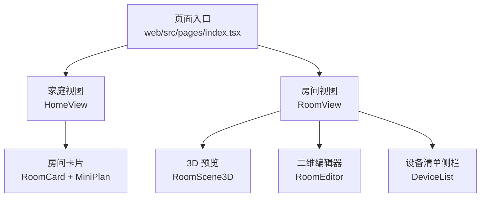
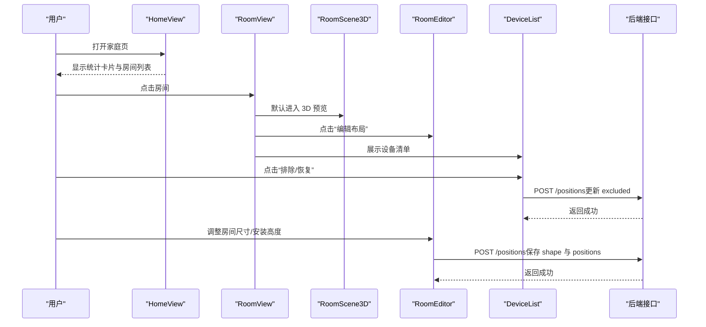
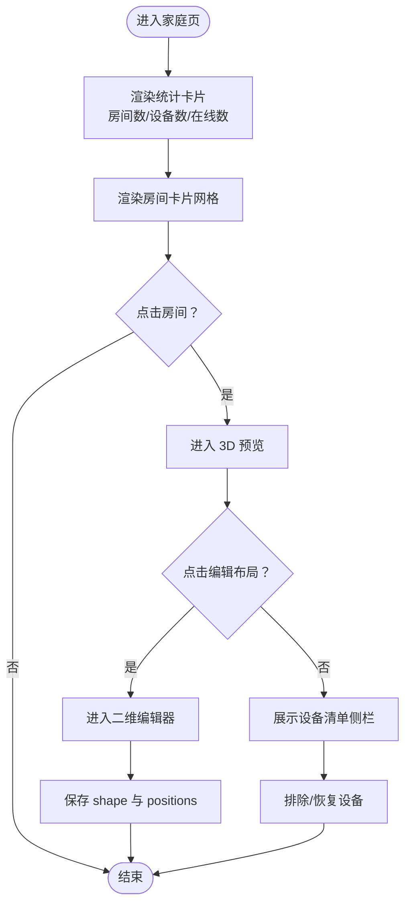
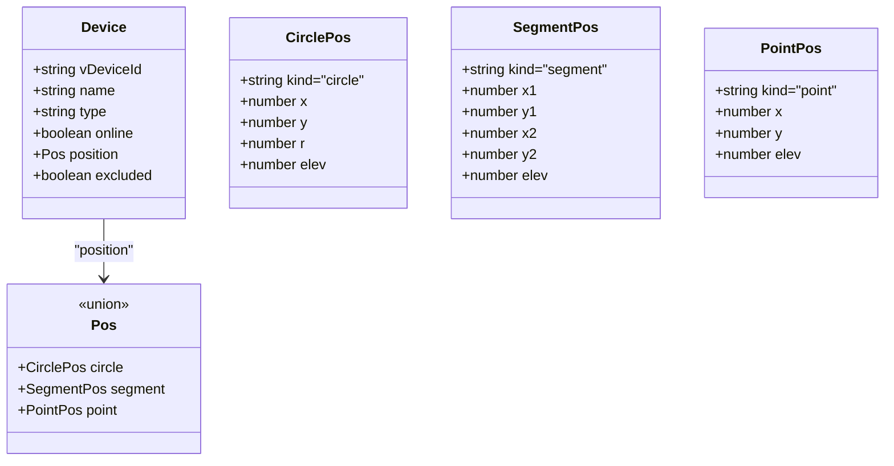
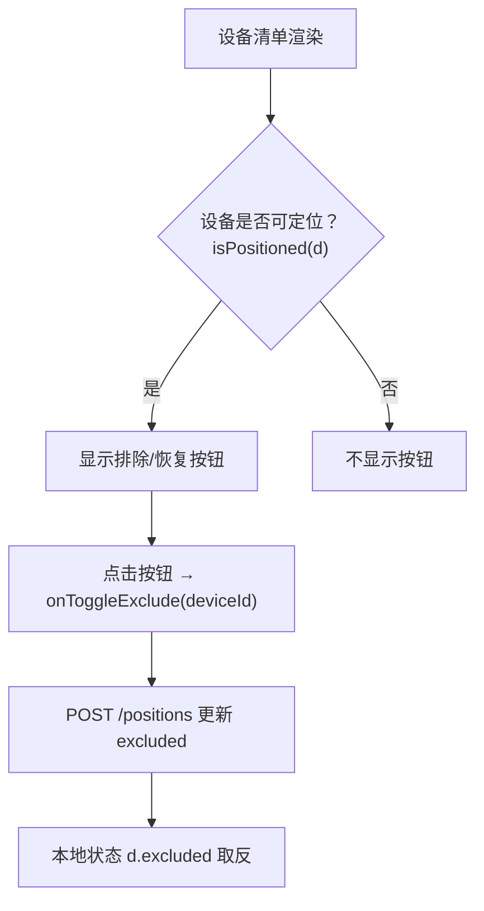
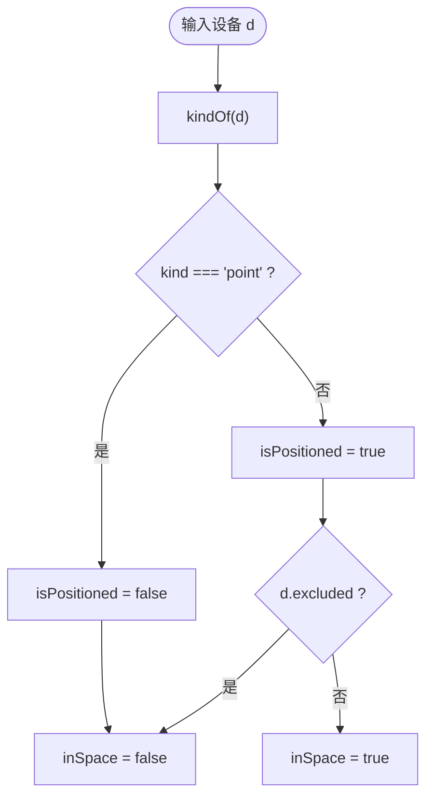
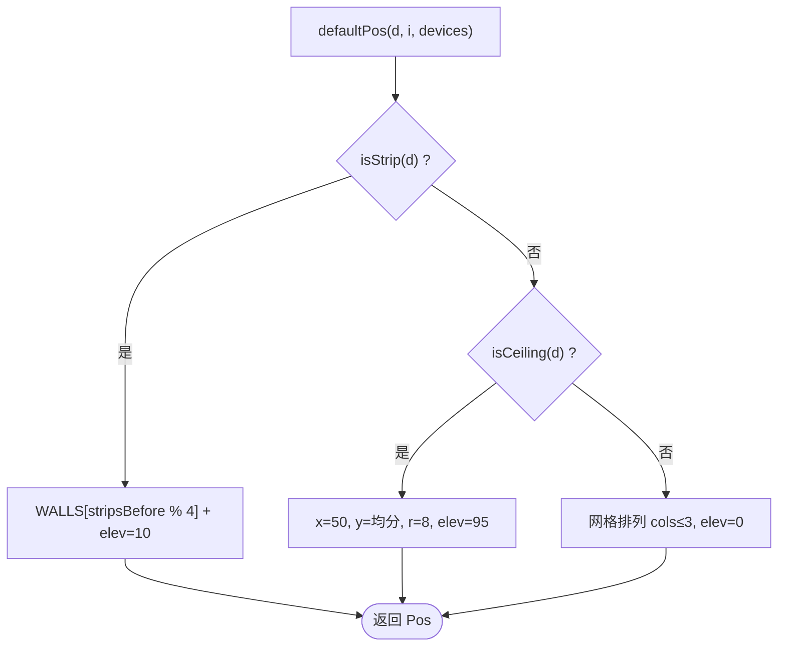
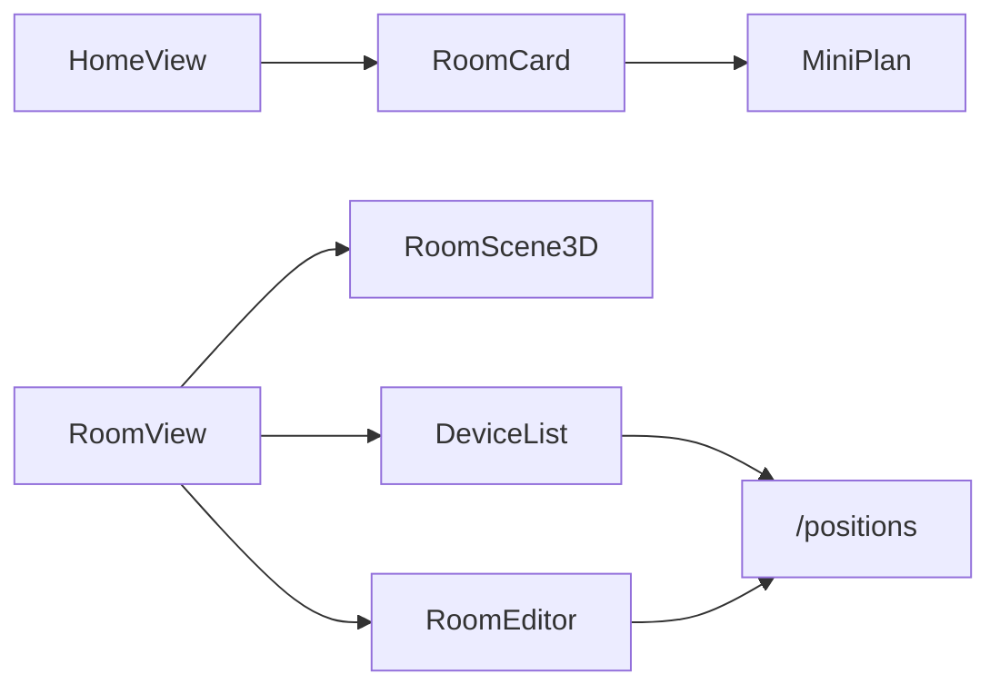

# 设备管理界面

<cite>
**本文引用的文件**   
- [web/src/pages/index.tsx](file://web/src/pages/index.tsx)
- [web/README.md](file://web/README.md)
</cite>

## 目录
1. [简介](#简介)
2. [项目结构](#项目结构)
3. [核心组件](#核心组件)
4. [架构总览](#架构总览)
5. [详细组件分析](#详细组件分析)
6. [依赖关系分析](#依赖关系分析)
7. [性能与优化建议](#性能与优化建议)
8. [故障排查指南](#故障排查指南)
9. [结论](#结论)

## 简介
本用户文档面向“欧享家 · 家庭设备管理台”的设备管理界面，帮助运营、安装与运维人员快速理解并高效使用。界面围绕“家庭 / 房间 / 设备”三层结构组织数据与交互：
- 家庭层：统计卡片展示房间数、设备总数、在线数；列出所有房间卡片。
- 房间层：提供 3D 预览与二维布局编辑，支持拖拽旋转、滚轮缩放、尺寸调整与安装高度设置。
- 设备层：清单侧栏展示设备类型图标、在线状态、排除/恢复按钮与安装高度信息。

同时，文档解释设备过滤逻辑（isPositioned、inSpace）与默认位置生成算法，并提供设备状态监控的最佳实践与性能优化建议。

**章节来源**
- [web/README.md:1-35](file://web/README.md#L1-L35)

## 项目结构
该前端基于 ice.js 构建，页面入口位于 web/src/pages/index.tsx，样式通过 CSS Modules 引入。整体采用单页应用模式，首页渲染家庭视图，进入房间后切换至 3D 预览或二维编辑器，并在右侧展示设备清单侧栏。

**图表来源**
- [web/src/pages/index.tsx:262-298](file://web/src/pages/index.tsx#L262-L298)
- [web/src/pages/index.tsx:300-412](file://web/src/pages/index.tsx#L300-L412)
- [web/src/pages/index.tsx:414-661](file://web/src/pages/index.tsx#L414-L661)
- [web/src/pages/index.tsx:663-708](file://web/src/pages/index.tsx#L663-L708)
- [web/src/pages/index.tsx:710-767](file://web/src/pages/index.tsx#L710-L767)

**章节来源**
- [web/src/pages/index.tsx:1-12](file://web/src/pages/index.tsx#L1-L12)
- [web/src/pages/index.tsx:262-298](file://web/src/pages/index.tsx#L262-L298)

## 核心组件
- 家庭视图 HomeView：汇总房间数、设备数、在线数，并渲染房间网格。
- 房间卡片 RoomCard 与迷你平面图 MiniPlan：展示房间尺寸、设备数量与在线情况，以及仅参与空间模型的灯具/灯带在平面上的示意。
- 3D 预览 RoomScene3D：以 CSS 3D 盒子呈现房间，按设备类型渲染吸顶灯圆盘与灯带长条，支持拖拽旋转与滚轮缩放。
- 二维编辑器 RoomEditor：SVG 平面编辑，支持拖动吸顶灯圆盘、调节灯带端点与长度、调整房间宽高深与设备安装高度。
- 设备清单 DeviceList：展示设备列表、类型图标、在线状态、排除/恢复按钮与安装高度提示。

**章节来源**
- [web/src/pages/index.tsx:262-298](file://web/src/pages/index.tsx#L262-L298)
- [web/src/pages/index.tsx:300-412](file://web/src/pages/index.tsx#L300-L412)
- [web/src/pages/index.tsx:414-661](file://web/src/pages/index.tsx#L414-L661)
- [web/src/pages/index.tsx:663-708](file://web/src/pages/index.tsx#L663-L708)

## 架构总览
下图展示了从家庭到房间再到设备的可视化与交互流程，包括状态来源、过滤规则与持久化路径。

**图表来源**
- [web/src/pages/index.tsx:262-298](file://web/src/pages/index.tsx#L262-L298)
- [web/src/pages/index.tsx:710-767](file://web/src/pages/index.tsx#L710-L767)
- [web/src/pages/index.tsx:843-870](file://web/src/pages/index.tsx#L843-L870)
- [web/src/pages/index.tsx:502-518](file://web/src/pages/index.tsx#L502-L518)

## 详细组件分析

### 家庭/房间/设备三层结构与可视化
- 家庭层
  - 统计卡片：房间数、设备数、在线数。在线数由所有房间设备 online 字段汇总计算。
  - 房间列表：每个房间卡片包含迷你平面图、在线徽章、房间名称与尺寸信息。
- 房间层
  - 3D 预览：根据房间形状 w/h/depth 渲染房间盒子，设备按 position.kind 渲染为圆盘（吸顶灯）或长条（灯带），离线设备使用非发光样式。
  - 二维编辑器：SVG 平面，支持拖动吸顶灯圆盘、调节灯带端点与长度、调整房间尺寸与安装高度。
- 设备层
  - 清单侧栏：展示设备名、类型标签、品类、安装高度（距顶）、排除状态与在线指示灯。

**图表来源**
- [web/src/pages/index.tsx:262-298](file://web/src/pages/index.tsx#L262-L298)
- [web/src/pages/index.tsx:300-412](file://web/src/pages/index.tsx#L300-L412)
- [web/src/pages/index.tsx:414-661](file://web/src/pages/index.tsx#L414-L661)
- [web/src/pages/index.tsx:663-708](file://web/src/pages/index.tsx#L663-L708)

**章节来源**
- [web/src/pages/index.tsx:262-298](file://web/src/pages/index.tsx#L262-L298)
- [web/src/pages/index.tsx:300-412](file://web/src/pages/index.tsx#L300-L412)
- [web/src/pages/index.tsx:414-661](file://web/src/pages/index.tsx#L414-L661)
- [web/src/pages/index.tsx:663-708](file://web/src/pages/index.tsx#L663-L708)

### 设备在线状态指示
- 在线状态来源于设备对象的 online 布尔值。
- 在以下位置体现：
  - 家庭统计卡片中的“在线”数值。
  - 房间卡片的在线徽章（如 “X/Y 在线”）。
  - 3D 预览中设备对象的光效类名差异（在线 vs 离线）。
  - 设备清单侧栏的在线小圆点。

最佳实践：
- 刷新数据时优先更新 online 字段，避免全量重绘。
- 对大量设备场景，使用局部更新或虚拟滚动减少渲染压力。
- 将在线状态与业务控制（开关灯等）解耦，确保 UI 只反映真实状态。

**章节来源**
- [web/src/pages/index.tsx:262-298](file://web/src/pages/index.tsx#L262-L298)
- [web/src/pages/index.tsx:364-402](file://web/src/pages/index.tsx#L364-L402)
- [web/src/pages/index.tsx:663-708](file://web/src/pages/index.tsx#L663-L708)

### 设备类型图标与视觉表示
设备类型通过 kindOf 函数判定，映射为三类：
- 吸顶灯：kind = 'circle'，在清单中使用圆形图标，在 3D 中渲染为圆盘，在平面图中为圆。
- 灯带：kind = 'segment'，在清单中使用斜线图标，在 3D 中渲染为长条，在平面图中为线段。
- 网关/点位：kind = 'point'，在清单中使用方块图标，不参与空间模型与位置编辑。

**图表来源**
- [web/src/pages/index.tsx:8-31](file://web/src/pages/index.tsx#L8-L31)
- [web/src/pages/index.tsx:64-83](file://web/src/pages/index.tsx#L64-L83)

**章节来源**
- [web/src/pages/index.tsx:64-83](file://web/src/pages/index.tsx#L64-L83)
- [web/src/pages/index.tsx:130-159](file://web/src/pages/index.tsx#L130-L159)
- [web/src/pages/index.tsx:663-708](file://web/src/pages/index.tsx#L663-L708)

### 设备清单侧栏功能
- 设备列表展示：遍历房间 devices，显示设备名、类型标签、品类、安装高度（距顶）与排除状态。
- 排除/恢复：对可参与空间模型的设备（isPositioned 为真）显示眼睛图标按钮，点击调用 onToggleExclude，更新 excluded 标志并持久化。
- 安装高度显示：对非点位的设备，若存在 position.elev，则显示“距顶 X m”。

**图表来源**
- [web/src/pages/index.tsx:663-708](file://web/src/pages/index.tsx#L663-L708)
- [web/src/pages/index.tsx:843-870](file://web/src/pages/index.tsx#L843-L870)

**章节来源**
- [web/src/pages/index.tsx:663-708](file://web/src/pages/index.tsx#L663-L708)
- [web/src/pages/index.tsx:843-870](file://web/src/pages/index.tsx#L843-L870)

### 设备过滤逻辑（isPositioned、inSpace）
- isPositioned：仅当设备不是“网关/点位”时，才允许参与空间模型（即吸顶灯与灯带）。
- inSpace：实际参与空间渲染与位置编辑的设备需满足“可定位且未被手动排除”。

**图表来源**
- [web/src/pages/index.tsx:64-83](file://web/src/pages/index.tsx#L64-L83)

**章节来源**
- [web/src/pages/index.tsx:64-83](file://web/src/pages/index.tsx#L64-L83)

### 默认位置生成算法
当设备没有 position 时，系统会调用 defaultPos 生成初始位置：
- 灯带：沿四面墙循环分配，elev=10（靠近踢脚线）。
- 吸顶灯：沿房间纵向均匀分布，居中 x=50，elev=95（靠近天花）。
- 网关/点位：按列行网格排列，elev=0（地面）。

**图表来源**
- [web/src/pages/index.tsx:95-128](file://web/src/pages/index.tsx#L95-L128)

**章节来源**
- [web/src/pages/index.tsx:95-128](file://web/src/pages/index.tsx#L95-L128)

## 依赖关系分析
- 组件耦合
  - HomeView 依赖 RoomCard 与 MiniPlan 进行房间概览。
  - RoomView 组合 RoomScene3D、RoomEditor 与 DeviceList。
  - DeviceList 依赖 onToggleExclude 回调与后端 /positions 接口。
  - RoomEditor 依赖 onSaved/onShapeSaved 回调与后端 /positions 接口。
- 外部依赖
  - 通过 api(path, init) 统一发起 fetch 请求，统一处理错误。
  - 样式通过 CSS Modules 引入，组件内通过 className 绑定。

**图表来源**
- [web/src/pages/index.tsx:262-298](file://web/src/pages/index.tsx#L262-L298)
- [web/src/pages/index.tsx:300-412](file://web/src/pages/index.tsx#L300-L412)
- [web/src/pages/index.tsx:414-661](file://web/src/pages/index.tsx#L414-L661)
- [web/src/pages/index.tsx:663-708](file://web/src/pages/index.tsx#L663-L708)
- [web/src/pages/index.tsx:85-93](file://web/src/pages/index.tsx#L85-L93)

**章节来源**
- [web/src/pages/index.tsx:85-93](file://web/src/pages/index.tsx#L85-L93)
- [web/src/pages/index.tsx:262-298](file://web/src/pages/index.tsx#L262-L298)
- [web/src/pages/index.tsx:300-412](file://web/src/pages/index.tsx#L300-L412)
- [web/src/pages/index.tsx:414-661](file://web/src/pages/index.tsx#L414-L661)
- [web/src/pages/index.tsx:663-708](file://web/src/pages/index.tsx#L663-L708)

## 性能与优化建议
- 数据加载
  - 使用本地快照优先策略，减少不必要的云端请求，提升首屏速度。
  - 对大房间设备列表，考虑分页或虚拟列表，降低 DOM 节点数量。
- 渲染优化
  - 3D 预览中仅渲染 inSpace 设备，避免无关点位干扰。
  - 对频繁更新的在线状态，使用细粒度状态更新，避免整树重渲染。
- 交互优化
  - 拖拽与缩放事件使用 passive:false 精确控制，避免滚动抖动。
  - 二维编辑器中，仅在拖拽期间标记 dirty，保存时再提交，减少网络请求。
- 内存与稳定性
  - 清理事件监听器（如 wheel、pointer 事件），防止内存泄漏。
  - 对异常响应统一捕获并提示，保证界面稳定。

[本节为通用指导，不直接分析具体文件]

## 故障排查指南
- 无法加载家庭数据
  - 检查 /tree 接口返回，确认 tree 数据结构与 projectCode 匹配。
  - 查看错误状态与 loading 标志，必要时重试或回退到本地缓存。
- 设备排除失败
  - 检查 /positions 的 POST 请求体是否正确包含 projectCode、gpno、excluded。
  - 确认 onToggleExclude 回调已正确触发，并更新了本地 d.excluded。
- 布局保存失败
  - 检查 /positions 的 POST 请求体是否包含 shape 与 positions。
  - 确认 RoomEditor 的 save 函数在异常分支弹出错误提示。
- 在线状态不一致
  - 核对设备 online 字段是否与后端一致，必要时刷新数据源。
  - 检查统计卡片与房间卡片的在线计数逻辑是否基于最新数据。

**章节来源**
- [web/src/pages/index.tsx:85-93](file://web/src/pages/index.tsx#L85-L93)
- [web/src/pages/index.tsx:502-518](file://web/src/pages/index.tsx#L502-L518)
- [web/src/pages/index.tsx:843-870](file://web/src/pages/index.tsx#L843-L870)

## 结论
该设备管理界面以清晰的三层结构组织家庭、房间与设备数据，并通过统计卡片、房间卡片、3D 预览、二维编辑器与设备清单侧栏提供完整的可视化与编辑能力。设备过滤逻辑与默认位置算法确保了合理的初始布局与可控的空间模型范围。遵循本文的最佳实践与优化建议，可在大规模设备场景下获得更流畅的用户体验与更稳定的系统表现。