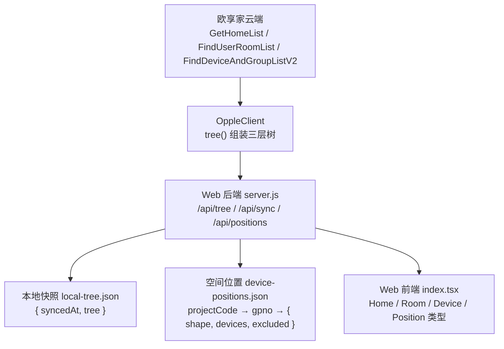
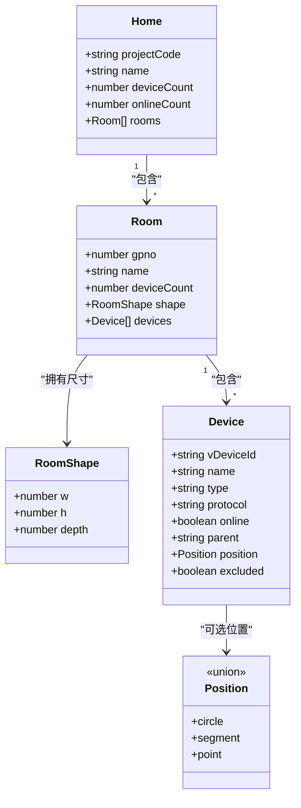
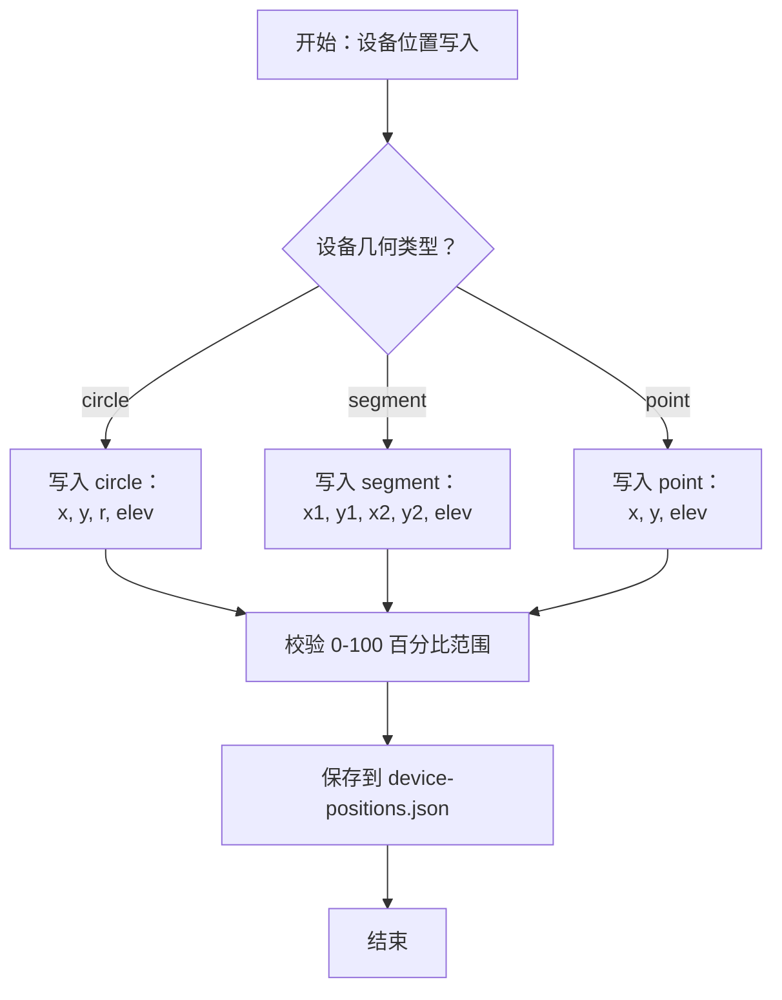
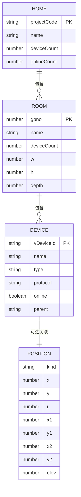
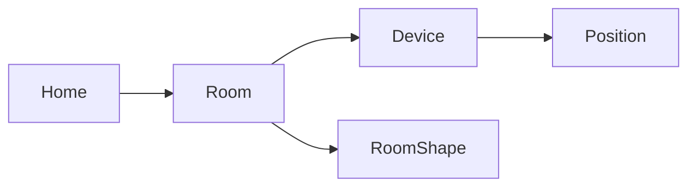
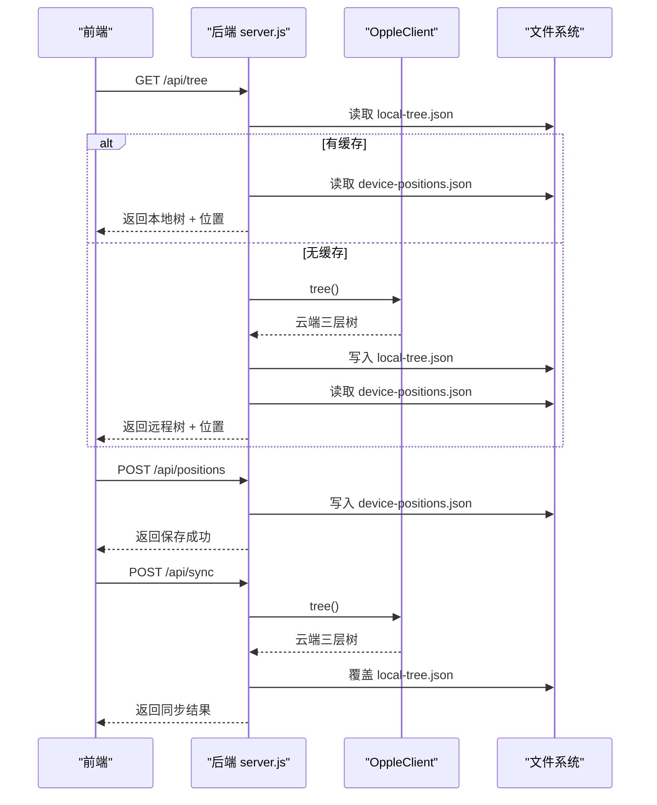
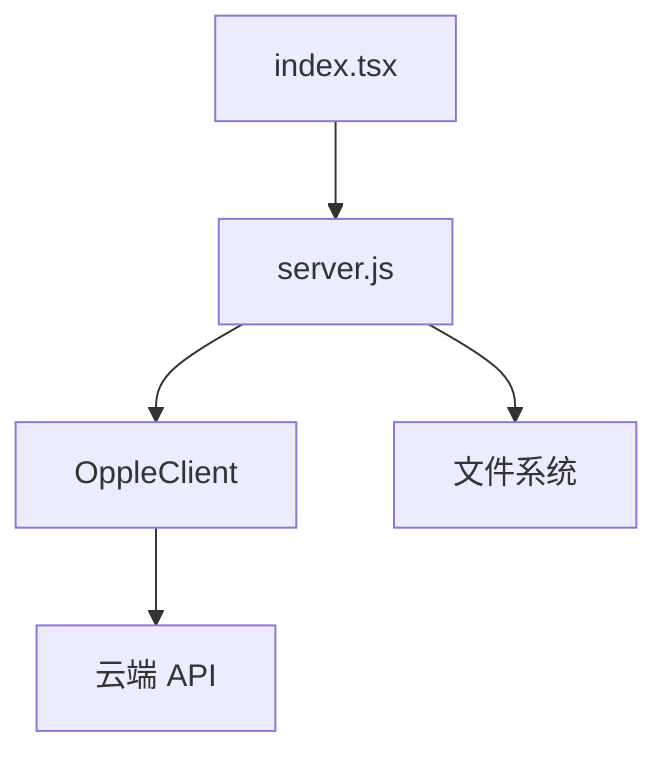

# 数据模型设计

<cite>
**本文引用的文件**   
- [README.md](file://README.md)
- [server.js](file://src/opple/server.js)
- [client.js](file://src/opple/client.js)
- [index.tsx](file://web/src/pages/index.tsx)
- [reverse-engineering-report.md](file://docs/reverse-engineering-report.md)
</cite>

## 目录
1. [引言](#引言)
2. [项目结构](#项目结构)
3. [核心实体与字段定义](#核心实体与字段定义)
4. [三层空间建模结构](#三层空间建模结构)
5. [设备位置坐标系统与 3D 几何语义](#设备位置坐标系统与-3d-几何语义)
6. [数据验证规则、业务约束与完整性要求](#数据验证规则业务约束与完整性要求)
7. [数据库 Schema 图与实体关系图](#数据库-schema-图与实体关系图)
8. [数据生命周期、缓存策略与同步机制](#数据生命周期缓存策略与同步机制)
9. [数据迁移方案与版本兼容性](#数据迁移方案与版本兼容性)
10. [依赖关系分析](#依赖关系分析)
11. [性能考虑](#性能考虑)
12. [故障排查指南](#故障排查指南)
13. [结论](#结论)

## 引言
本文件面向“欧享家（欧普 INNO 生态）本地控制”项目的数据模型，目标是把家庭、房间、设备、位置等核心概念抽象成统一、可演进的数据结构。项目通过逆向云端 API，提供 CLI 与 Web 控制台，并在 Web 端实现家庭→房间→设备的三层结构与 3D 空间建模；后端 Node 服务负责 REST API、本地快照与空间位置文件的读写。

该文档重点说明：
- Home、Room、Device、Position 等实体的关系、字段含义与数据类型。
- 三层空间建模的数据结构设计。
- 设备位置坐标系统、3D 几何数据的存储格式和空间语义。
- 数据验证规则、业务约束和数据完整性要求。
- 数据生命周期管理、缓存策略与同步机制。
- 数据迁移方案和版本兼容性考虑。

## 项目结构
从数据角度，本项目涉及三类关键数据载体：
- 云端返回的三层树结构：家庭 → 房间 → 设备。
- 本地空间位置文件：按家庭 projectCode 与房间 gpno 保存房间尺寸和设备 3D 位置。
- Web 前端类型定义：对 Home、Room、Device、Position 的前端表达进行约束。

**图表来源**
- [client.js:160-204](file://src/opple/client.js#L160-L204)
- [server.js:12-72](file://src/opple/server.js#L12-L72)
- [server.js:132-200](file://src/opple/server.js#L132-L200)
- [index.tsx:8-47](file://web/src/pages/index.tsx#L8-L47)

**章节来源**
- [README.md:6-16](file://README.md#L6-L16)
- [README.md:60-83](file://README.md#L60-L83)
- [client.js:160-204](file://src/opple/client.js#L160-L204)
- [server.js:12-72](file://src/opple/server.js#L12-L72)
- [index.tsx:8-47](file://web/src/pages/index.tsx#L8-L47)

## 核心实体与字段定义
本节给出 Home、Room、Device、Position 的核心字段、含义与类型。这些类型在 Web 前端有明确 TypeScript 接口定义，在后端则通过 JSON 结构承载。

### Home（家庭）
| 字段 | 类型 | 含义 | 数据来源 |
|---|---|---|---|
| `projectCode` | string | 家庭项目编码，用于区分不同家庭 | 云端 GetHomeList |
| `name` | string | 家庭名称 | 云端 GetHomeList |
| `deviceCount` | number | 设备数量 | 云端 GetHomeList |
| `onlineCount` | number \| null | 在线设备数 | 云端 GetHomeList |
| `rooms` | Room[] | 房间列表 | 云端 FindUserRoomList + FindDeviceAndGroupListV2 |

**章节来源**
- [client.js:154-198](file://src/opple/client.js#L154-L198)
- [index.tsx:41-47](file://web/src/pages/index.tsx#L41-L47)

### Room（房间）
| 字段 | 类型 | 含义 | 数据来源 |
|---|---|---|---|
| `gpno` | number | 房间编号，作为房间唯一标识之一 | 云端 FindUserRoomList |
| `name` | string | 房间名称 | 云端 FindUserRoomList |
| `deviceCount` | number \| null | 房间设备数量 | 云端 FindUserRoomList |
| `shape` | RoomShape | 房间三维尺寸 | 本地空间位置文件；缺失时使用默认值 |
| `devices` | Device[] | 房间内设备列表 | 云端 FindDeviceAndGroupListV2 |

RoomShape 表示房间宽高深：
| 字段 | 类型 | 含义 |
|---|---|---|
| `w` | number | 房间宽度（百分比单位） |
| `h` | number | 房间高度（百分比单位） |
| `depth` | number | 房间深度（百分比单位） |

**章节来源**
- [client.js:176-190](file://src/opple/client.js#L176-L190)
- [server.js:40-68](file://src/opple/server.js#L40-L68)
- [index.tsx:20-39](file://web/src/pages/index.tsx#L20-L39)

### Device（设备）
| 字段 | 类型 | 含义 | 数据来源 |
|---|---|---|---|
| `vDeviceId` | string | 虚拟设备 ID，作为设备唯一标识 | 云端 FindDeviceAndGroupListV2 |
| `name` | string | 设备名称 | 云端 FindDeviceAndGroupListV2 |
| `type` | string \| null | 设备类型或 SKU 名称 | 云端 FindDeviceAndGroupListV2 |
| `protocol` | string \| null | 协议类型 | 云端 FindDeviceAndGroupListV2 |
| `online` | boolean | 是否在线 | 云端 FindDeviceAndGroupListV2 |
| `parent` | string \| null | 父设备 ID | 云端 FindDeviceAndGroupListV2 |
| `position` | Position \| null | 设备在房间中的 3D 位置 | 本地空间位置文件注入 |
| `excluded` | boolean | 是否被手动排除出空间模型 | 本地空间位置文件 excluded 列表推导 |

**章节来源**
- [client.js:182-189](file://src/opple/client.js#L182-L189)
- [server.js:57-71](file://src/opple/server.js#L57-L71)
- [index.tsx:22-31](file://web/src/pages/index.tsx#L22-L31)

### Position（设备位置）
Position 是联合类型，支持三种几何形态：

| kind | 字段 | 类型 | 含义 |
|---|---|---|---|
| `circle` | `x` | number | 圆心 x 坐标（房间平面百分比） |
| `circle` | `y` | number | 圆心 y 坐标（房间平面百分比） |
| `circle` | `r` | number | 吸顶灯半径（房间平面百分比） |
| `circle` | `elev` | number \| undefined | 离地高度百分比（0=地面，100=天花） |
| `segment` | `x1` | number | 灯带起点 x |
| `segment` | `y1` | number | 灯带起点 y |
| `segment` | `x2` | number | 灯带终点 x |
| `segment` | `y2` | number | 灯带终点 y |
| `segment` | `elev` | number \| undefined | 灯带安装高度百分比 |
| `point` | `x` | number | 点位设备 x |
| `point` | `y` | number | 点位设备 y |
| `point` | `elev` | number \| undefined | 点位设备高度百分比 |

Position 不参与 `/api/positions` 导出时会被过滤，仅保留 circle 和 segment。

**章节来源**
- [index.tsx:8-18](file://web/src/pages/index.tsx#L8-L18)
- [server.js:74-86](file://src/opple/server.js#L74-L86)

## 三层空间建模结构
三层空间建模是项目的核心数据结构：家庭包含多个房间，每个房间包含多个设备。后端在读取云端树后，会注入房间 shape 和设备 position，形成最终对外暴露的树结构。

**图表来源**
- [client.js:160-204](file://src/opple/client.js#L160-L204)
- [server.js:57-71](file://src/opple/server.js#L57-L71)
- [index.tsx:8-47](file://web/src/pages/index.tsx#L8-L47)

**章节来源**
- [client.js:160-204](file://src/opple/client.js#L160-L204)
- [server.js:57-71](file://src/opple/server.js#L57-L71)
- [index.tsx:8-47](file://web/src/pages/index.tsx#L8-L47)

## 设备位置坐标系统与 3D 几何语义
设备位置使用房间平面百分比坐标系，所有 x、y、w、h、depth、r 等数值均以 0-100 百分比表示。elev 表示离地高度百分比：0 为地面，100 为天花。

### 坐标系统
- 房间平面坐标系：以房间左下角为原点，x 向右，y 向上，范围 0-100。
- 高度方向：elev 表示离地百分比；UI 中常转换为“距顶米数”，公式为 `(100 - elev) × 0.05m`。
- 单位换算：前端常量 UNIT 为 0.05，即 100 百分比单位对应 5 米。

### 几何语义
- 吸顶灯：kind 为 circle，表示圆盘面光源，由圆心 x/y、半径 r、高度 elev 描述。
- 灯带：kind 为 segment，表示线段，由两个端点 x1/y1、x2/y2 和高度 elev 描述。
- 网关/插座等点位设备：kind 为 point，不参与空间模型编辑与导出，但可在内部记录位置。

**图表来源**
- [index.tsx:8-18](file://web/src/pages/index.tsx#L8-L18)
- [server.js:171-190](file://src/opple/server.js#L171-L190)

**章节来源**
- [README.md:71-83](file://README.md#L71-L83)
- [index.tsx:8-18](file://web/src/pages/index.tsx#L8-L18)
- [server.js:12-14](file://src/opple/server.js#L12-L14)

## 数据验证规则、业务约束与完整性要求
### 基本验证规则
- `projectCode` 和 `gpno` 是房间空间数据的必填键；后端在 `/api/positions` 写入时校验。
- 位置坐标 x、y、w、h、depth、r 应为 0-100 范围内的数字。
- `elev` 应为 0-100 范围内的数字，表示离地百分比。
- `position.kind` 必须为 circle、segment 或 point。
- `excluded` 是布尔值，表示设备是否被手动排除出空间模型。

### 业务约束
- 只有 circle 和 segment 类型的设备参与空间模型编辑、3D 渲染和 `/api/positions` 导出。
- point 类型设备（如网关、插座）不参与空间模型导出。
- 如果房间没有 shape，后端使用默认值 `{ w: 100, h: 45, depth: 100 }`。
- 如果设备没有 position，前端可使用默认位置逻辑生成初始布局。

### 数据完整性要求
- 本地快照 `local-tree.json` 必须包含 `syncedAt` 和 `tree` 数组。
- 空间位置文件 `device-positions.json` 必须按 `projectCode → gpno → { shape, devices, excluded }` 结构组织。
- 设备 `vDeviceId` 必须在房间设备列表中唯一存在。
- 如果设备被加入 `excluded` 列表，其 position 不应出现在导出结果中。

**章节来源**
- [server.js:40-55](file://src/opple/server.js#L40-L55)
- [server.js:57-86](file://src/opple/server.js#L57-L86)
- [server.js:171-190](file://src/opple/server.js#L171-L190)
- [index.tsx:22-47](file://web/src/pages/index.tsx#L22-L47)

## 数据库 Schema 图与实体关系图
由于项目未使用传统关系型数据库，而是以 JSON 文件形式存储本地数据，因此以下图展示的是逻辑 Schema 与实体关系。

### 逻辑 Schema

**图表来源**
- [client.js:160-204](file://src/opple/client.js#L160-L204)
- [index.tsx:8-47](file://web/src/pages/index.tsx#L8-L47)

### 实体关系图

**图表来源**
- [client.js:160-204](file://src/opple/client.js#L160-L204)
- [server.js:57-71](file://src/opple/server.js#L57-L71)
- [index.tsx:8-47](file://web/src/pages/index.tsx#L8-L47)

## 数据生命周期、缓存策略与同步机制
### 数据生命周期
1. **拉取云端数据**：OppleClient.tree() 调用 GetHomeList、FindUserRoomList、FindDeviceAndGroupListV2，组装 Home→Room→Device 树。
2. **本地快照缓存**：GET /api/tree 优先读取 local-tree.json；若无缓存，则回源云端并落盘。
3. **空间位置合并**：无论是否使用本地快照，都会实时加载 device-positions.json，将 room.shape 和 device.position 注入到树结构中。
4. **用户编辑位置**：POST /api/positions 直接写盘 device-positions.json，不经过快照。
5. **一键同步**：POST /api/sync 拉取最新云端树并覆盖 local-tree.json。

**图表来源**
- [server.js:18-30](file://src/opple/server.js#L18-L30)
- [server.js:32-55](file://src/opple/server.js#L32-L55)
- [server.js:132-152](file://src/opple/server.js#L132-L152)
- [server.js:171-190](file://src/opple/server.js#L171-L190)

**章节来源**
- [server.js:18-30](file://src/opple/server.js#L18-L30)
- [server.js:32-55](file://src/opple/server.js#L32-L55)
- [server.js:132-152](file://src/opple/server.js#L132-L152)
- [server.js:171-190](file://src/opple/server.js#L171-L190)

## 数据迁移方案与版本兼容性
### 历史兼容
- 旧版位置文件中可能包含 point 类型设备；后端在导出 `/api/positions` 时会剔除 point 类型和 excluded 设备。
- 如果房间缺少 shape，后端使用默认值 `{ w: 100, h: 45, depth: 100 }`。
- 如果设备缺少 position，前端可使用默认位置逻辑生成初始布局。

### 迁移建议
- 若未来引入新几何类型，应在 Position 联合类型中新增 kind，并在后端 stripPoints 中决定是否导出。
- 若未来扩展 RoomShape 字段，应保证 readRoom/writeRoom 能兼容旧数据。
- 若未来扩展 Device 字段，应保证前端类型定义与后端注入逻辑一致。

**章节来源**
- [server.js:74-86](file://src/opple/server.js#L74-L86)
- [server.js:40-55](file://src/opple/server.js#L40-L55)
- [index.tsx:8-18](file://web/src/pages/index.tsx#L8-L18)

## 依赖关系分析
### 组件耦合
- OppleClient 依赖云端 API，负责认证、请求封装和树组装。
- server.js 依赖 OppleClient 和本地文件系统，负责 API 路由、缓存和位置文件操作。
- 前端 index.tsx 依赖后端 API，负责 UI 展示、位置编辑和状态更新。

**图表来源**
- [client.js:1-226](file://src/opple/client.js#L1-L226)
- [server.js:1-232](file://src/opple/server.js#L1-L232)
- [index.tsx:1-833](file://web/src/pages/index.tsx#L1-L833)

**章节来源**
- [client.js:1-226](file://src/opple/client.js#L1-L226)
- [server.js:1-232](file://src/opple/server.js#L1-L232)
- [index.tsx:1-833](file://web/src/pages/index.tsx#L1-L833)

## 性能考虑
- 本地快照避免每次请求都访问云端，提升 `/api/tree` 响应速度。
- 空间位置文件独立于快照，确保位置编辑实时生效。
- 前端默认位置逻辑减少首次渲染时的计算开销。
- 后端使用简单 JSON 文件存储，适合小规模智能家居场景；若设备数量增长，应考虑数据库或内存缓存优化。

[本节为通用性能讨论，不直接分析具体文件]

## 故障排查指南
### 常见问题
- **Token 无效或权限错误**：检查 token 和 projectCode 是否正确，注意请求头必须全小写。
- **本地快照损坏**：删除 local-tree.json 后重新同步。
- **位置文件损坏**：删除 device-positions.json 后重新编辑位置。
- **设备未显示位置**：检查设备是否为 circle 或 segment 类型，且未被 excluded。

**章节来源**
- [README.md:41-45](file://README.md#L41-L45)
- [server.js:18-30](file://src/opple/server.js#L18-L30)
- [server.js:32-38](file://src/opple/server.js#L32-L38)
- [server.js:74-86](file://src/opple/server.js#L74-L86)

## 结论
本数据模型以 Home→Room→Device 三层结构为核心，结合 Position 的 3D 几何语义，实现了家庭空间建模和设备位置管理。通过本地快照和空间位置文件的分离设计，项目在性能和灵活性之间取得平衡。未来可扩展新的几何类型、设备属性和空间语义，同时保持向后兼容。

[本节为总结性内容，不直接分析具体文件]