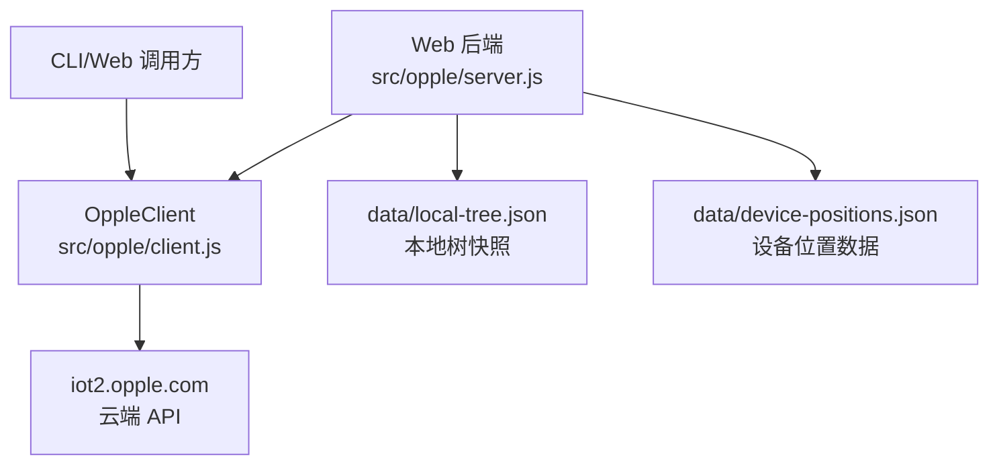
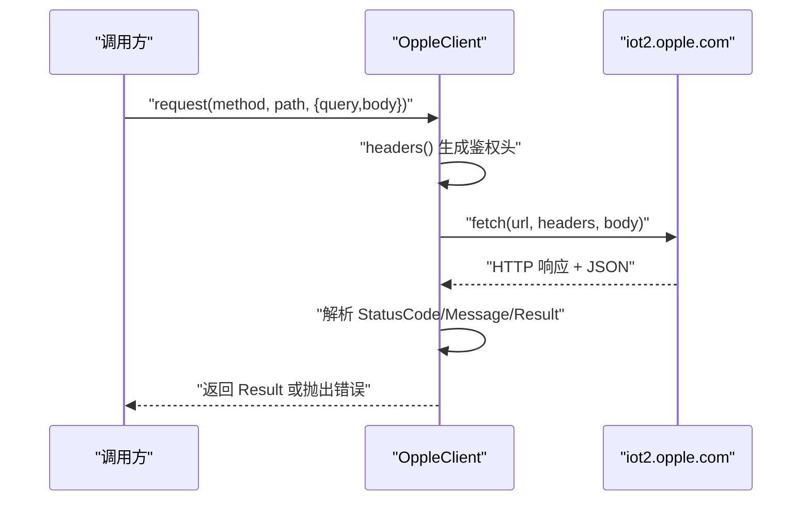
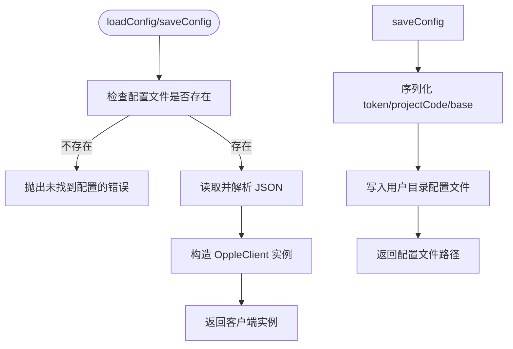
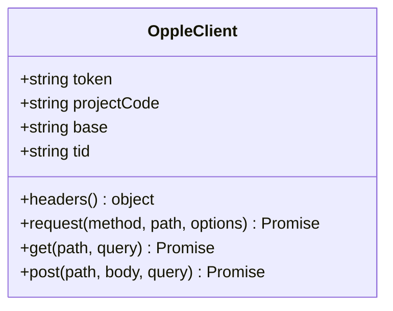
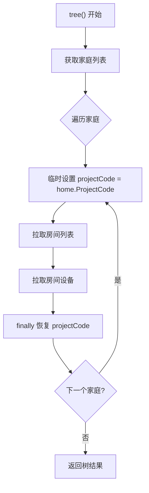
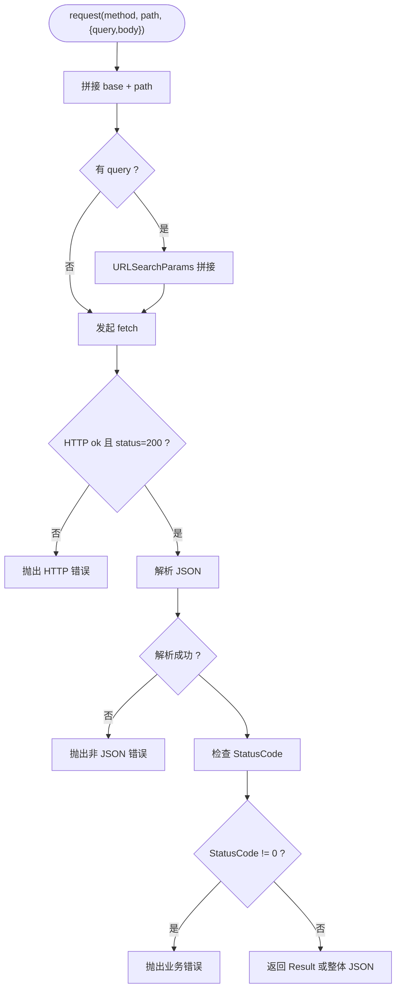
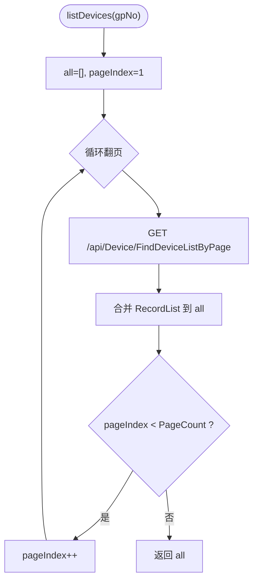
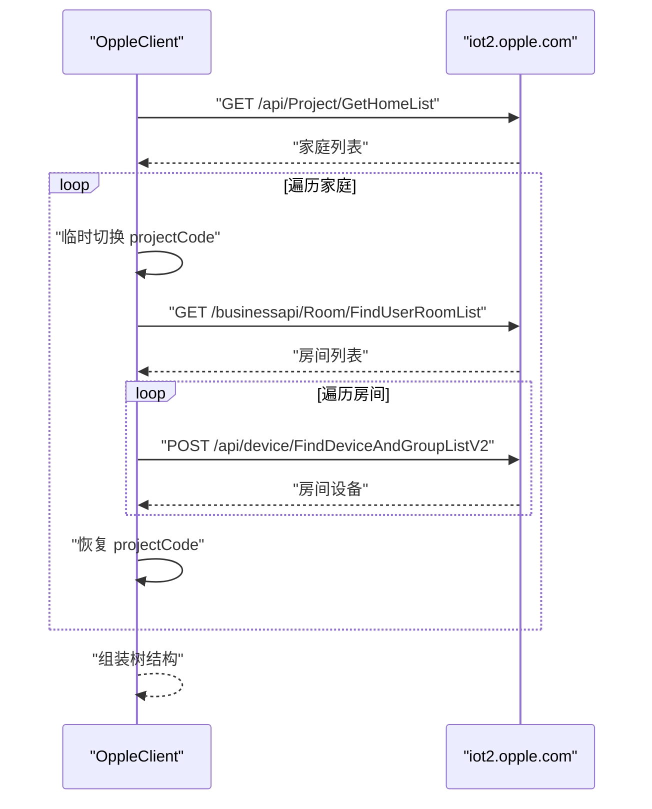
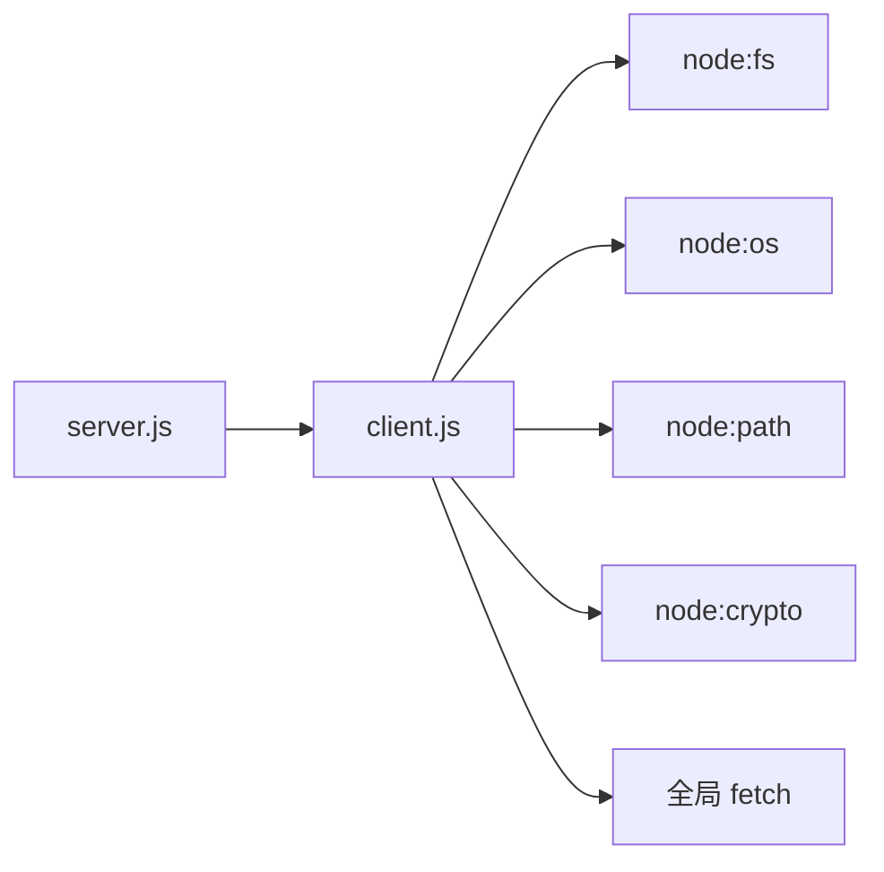

# OppleClient 客户端模块

<cite>
**本文引用的文件**   
- [client.js](file://src/opple/client.js)
- [server.js](file://src/opple/server.js)
- [README.md](file://README.md)
- [package.json](file://package.json)
</cite>

## 目录
1. [简介](#简介)
2. [项目结构](#项目结构)
3. [核心组件](#核心组件)
4. [架构总览](#架构总览)
5. [详细组件分析](#详细组件分析)
6. [依赖关系分析](#依赖关系分析)
7. [性能与可靠性](#性能与可靠性)
8. [故障排查指南](#故障排查指南)
9. [结论](#结论)
10. [附录：使用示例](#附录使用示例)

## 简介
OppleClient 是欧享家云端 API 的 Node 客户端实现，提供统一的 HTTP 请求封装、鉴权头生成、Token 管理、项目代码切换以及设备/家庭/房间等业务的接口封装。它被 CLI 和 Web 后端共同复用，作为与 iot2.opple.com 云端的唯一通道。

该模块遵循“零依赖”原则，仅使用 Node 标准库（fs、os、path、crypto）与全局 fetch，确保在 Node 22+ 环境下稳定运行。

## 项目结构
本仓库中与 OppleClient 直接相关的核心文件如下：
- src/opple/client.js：OppleClient 类定义，包含配置加载保存、HTTP 封装、业务方法。
- src/opple/server.js：Web 后端服务，通过 OppleClient 暴露 REST API，并维护本地快照与位置数据。
- README.md：项目说明、快速开始、API 文档与逆向背景。
- package.json：包元信息、入口脚本与运行环境要求。

图表来源
- [client.js:1-226](file://src/opple/client.js#L1-L226)
- [server.js:1-232](file://src/opple/server.js#L1-L232)

章节来源
- [README.md:6-16](file://README.md#L6-L16)
- [package.json:1-17](file://package.json#L1-L17)

## 核心组件
- OppleClient：封装与欧享家云端的交互，包括：
  - 配置持久化：用户目录下的 .opple-cli.json
  - 鉴权头生成：统一小写键名、固定字段与动态 tid/timestamp
  - 通用请求：URL 拼接、查询参数处理、JSON 响应解析、错误统一抛出
  - 业务接口：设备列表、摘要、动作能力、动作调用、家庭列表、房间设备、三层树构建

章节来源
- [client.js:13-98](file://src/opple/client.js#L13-L98)
- [client.js:101-224](file://src/opple/client.js#L101-L224)

## 架构总览
OppleClient 位于系统底层，向上为 CLI 与 Web 后端提供服务；向下对接欧享家云端 API。Web 后端还负责本地缓存与空间数据管理，以减轻云端压力并提升前端体验。

图表来源
- [client.js:41-94](file://src/opple/client.js#L41-L94)

## 详细组件分析

### 配置加载与保存机制
- 配置文件路径：用户主目录下的 .opple-cli.json。
- 加载流程：
  - 检查文件是否存在，不存在则抛出明确错误提示。
  - 读取并解析 JSON，构造 OppleClient 实例。
- 保存流程：
  - 将 token、projectCode、base 序列化为格式化 JSON 写入文件。
- 用户目录路径处理：
  - 使用 os.homedir() 获取用户目录，避免硬编码平台差异。

图表来源
- [client.js:24-39](file://src/opple/client.js#L24-L39)

章节来源
- [client.js:24-39](file://src/opple/client.js#L24-L39)

### 鉴权头生成逻辑
- 所有请求头键名统一为小写，避免服务端校验异常（如 12004/11009）。
- 固定字段：语言、时区、客户端标识、操作系统、应用版本、User-Agent 等。
- 动态字段：
  - projectcode：当前项目代码，支持运行时切换。
  - token：当前 Token。
  - tid：每次实例创建时随机生成 UUID。
  - client-up-time：当前时间戳。

图表来源
- [client.js:13-58](file://src/opple/client.js#L13-L58)

章节来源
- [client.js:41-58](file://src/opple/client.js#L41-L58)

### Token 管理与项目代码切换
- Token 管理：
  - 构造函数接收 token，checkToken() 用于校验/刷新 Token。
  - 注意：checkToken() 不走通用 request()，直接 fetch 并返回原始 JSON。
- 项目代码切换：
  - tree() 中遍历家庭列表时，临时覆盖 this.projectCode 以适配不同 ProjectCode 的请求。
  - 使用 try/finally 保证切换后恢复原值，避免并发或异常导致状态污染。

图表来源
- [client.js:165-204](file://src/opple/client.js#L165-L204)

章节来源
- [client.js:101-108](file://src/opple/client.js#L101-L108)
- [client.js:165-204](file://src/opple/client.js#L165-L204)

### 通用请求处理流程 request()
- URL 构建：
  - 基础地址 base + 路径 path。
  - 若提供 query 对象，则使用 URLSearchParams 拼接，过滤 undefined/null。
- 请求发送：
  - 使用全局 fetch，GET 无 body，POST 将 body 序列化为 JSON。
  - 自动附加 headers() 生成的鉴权头。
- 响应解析：
  - 非 200 且 res.ok 为 false 时抛出 HTTP 错误。
  - 尝试解析 JSON，失败则抛出“响应非 JSON”错误。
  - 统一错误码判断：StatusCode 非 0（含字符串 '0' 转数字）视为失败，抛出带 Message 的错误。
  - 成功时返回 Result 字段，否则返回整个 JSON。

图表来源
- [client.js:67-94](file://src/opple/client.js#L67-L94)

章节来源
- [client.js:67-94](file://src/opple/client.js#L67-L94)

### 业务接口实现

#### 设备列表 listDevices(gpNo)
- 分页全量拉取：默认 gpNo=-1 表示根设备，指定 gpNo 表示某房间设备。
- 循环翻页，合并 RecordList，直到 pageIndex 达到 PageCount。

图表来源
- [client.js:110-125](file://src/opple/client.js#L110-L125)

章节来源
- [client.js:110-125](file://src/opple/client.js#L110-L125)

#### 设备摘要 deviceSummary()
- 轻量列表接口，附带时间戳 t 防缓存。

章节来源
- [client.js:127-130](file://src/opple/client.js#L127-L130)

#### 设备动作能力 actionAbility(vDeviceId)
- 查询设备可用动作，供上层控制 UI 展示与参数校验。

章节来源
- [client.js:132-135](file://src/opple/client.js#L132-L135)

#### 设备动作调用 callAction(vDeviceId, msgType, values, channelId)
- 将 values 按 KeyId 升序逗号拼接，调用 CallAction 下发控制指令。

章节来源
- [client.js:137-152](file://src/opple/client.js#L137-L152)

#### 家庭列表 homeList()
- 拉取家庭列表，返回 RecordList 或整体结果。

章节来源
- [client.js:154-158](file://src/opple/client.js#L154-L158)

#### 房间设备 roomDevices(gpNo)
- POST 拉取房间设备（网关+子设备），参数与 App 一致。

章节来源
- [client.js:206-224](file://src/opple/client.js#L206-L224)

#### 三层树 tree()
- 组合 homeList → FindUserRoomList(version=2) → FindDeviceAndGroupListV2。
- 对每个家庭临时切换 projectCode，最终恢复。
- 返回结构化树：家庭→房间→设备，包含在线状态、协议类型、父设备等。

图表来源
- [client.js:160-204](file://src/opple/client.js#L160-L204)

章节来源
- [client.js:160-204](file://src/opple/client.js#L160-L204)

## 依赖关系分析
- 内部依赖：
  - server.js 依赖 client.js 提供的 OppleClient。
- 外部依赖：
  - Node 标准库：fs、os、path、crypto。
  - 全局 fetch（Node 22+ 内置）。
- 耦合度：
  - client.js 低耦合，仅提供方法与配置；server.js 高内聚地组织路由与缓存。
- 潜在风险：
  - checkToken() 未走通用 request()，错误处理与其他接口不一致。
  - 网络层无重试与超时控制，依赖调用方或上层策略。

图表来源
- [client.js:1-6](file://src/opple/client.js#L1-L6)
- [server.js:1-7](file://src/opple/server.js#L1-L7)

章节来源
- [client.js:1-6](file://src/opple/client.js#L1-L6)
- [server.js:1-7](file://src/opple/server.js#L1-L7)

## 性能与可靠性
- 性能优化建议：
  - 增加请求去重与缓存（例如设备列表、动作能力）。
  - 对长轮询或批量接口启用并发限制与超时控制。
  - 对频繁调用的头部计算进行惰性初始化或缓存。
- 可靠性增强：
  - 在网络层增加指数退避重试（针对 5xx、网络抖动）。
  - 统一错误包装，区分网络错误、鉴权错误、业务错误。
  - 对 checkToken() 也接入通用 request() 以保持一致的错误处理。
- 现有特性：
  - Web 后端已实现本地树快照（local-tree.json），减少云端请求频率。
  - 位置数据独立存储（device-positions.json），实时读写不影响快照。

章节来源
- [server.js:18-38](file://src/opple/server.js#L18-L38)
- [server.js:132-151](file://src/opple/server.js#L132-L151)

## 故障排查指南
- 常见错误与定位：
  - 未找到配置文件：确认是否执行过 token save，路径为用户主目录下的 .opple-cli.json。
  - HTTP 非 200：检查网络连通性、Token 有效性、projectCode 是否正确。
  - 响应非 JSON：检查接口返回是否为 HTML 或错误页。
  - 业务错误 StatusCode 非 0：查看 Message 字段，结合接口文档定位问题。
- 调试建议：
  - 使用 raw 命令或 Web 的任意接口调试能力验证请求头与参数。
  - 抓包比对 App 请求头，确保键名全小写。
  - 检查 tid 与 client-up-time 是否变化，避免服务端拒绝。

章节来源
- [client.js:24-39](file://src/opple/client.js#L24-L39)
- [client.js:67-94](file://src/opple/client.js#L67-L94)
- [README.md:41-46](file://README.md#L41-L46)

## 结论
OppleClient 提供了稳定、简洁的欧享家云端 API 访问能力，涵盖鉴权、配置、通用请求与常用业务接口。配合 Web 后端的本地缓存与空间数据管理，可在保证功能完整性的同时显著提升性能与用户体验。建议在后续迭代中完善网络层的重试与超时控制，并对 checkToken() 接入统一错误处理，进一步提升健壮性与可维护性。

## 附录：使用示例

### 初始化客户端
- 从配置文件加载：
  - 调用 OppleClient.loadConfig()，若未配置会抛出错误提示。
- 手动构造：
  - new OppleClient({ token, projectCode, base? })，适用于测试或自定义 base。

章节来源
- [client.js:17-22](file://src/opple/client.js#L17-L22)
- [client.js:24-30](file://src/opple/client.js#L24-L30)

### 发起 API 调用与处理响应
- 通用请求：
  - const result = await client.request('GET', '/api/Device/DeviceSummaryV2', { query: { t: Date.now() } });
- GET/POST 便捷方法：
  - const devices = await client.listDevices();
  - const actions = await client.actionAbility(vDeviceId);
- 错误处理：
  - 捕获 Error，根据 message 中的 StatusCode 与 Message 判断具体原因。

章节来源
- [client.js:67-98](file://src/opple/client.js#L67-L98)
- [client.js:110-135](file://src/opple/client.js#L110-L135)

### 典型业务流程
- 获取三层树：
  - const tree = await client.tree();
  - 返回家庭→房间→设备的结构化数据，包含在线状态与协议信息。
- 调用设备动作：
  - const r = await client.callAction(vDeviceId, '0x03130000', ['value1','value2']);
  - values 需按 KeyId 升序拼接。

章节来源
- [client.js:160-204](file://src/opple/client.js#L160-L204)
- [client.js:137-152](file://src/opple/client.js#L137-L152)