# Server 服务端模块

<cite>
**本文引用的文件**   
- [server.js](file://src/opple/server.js)
- [client.js](file://src/opple/client.js)
- [ice.config.mts](file://web/ice.config.mts)
- [package.json](file://package.json)
- [opple.js](file://bin/opple.js)
</cite>

## 更新摘要
**变更内容**   
- 开发服务器架构完全重构，在 web/ice.config.mts 中集成 Opple 后端到 Ice.js 开发服务器
- Server 模块重构为导出 handleRequest 作为可复用函数，同时保持独立执行的向后兼容性
- 添加自定义中间件用于开发环境中的动态 API 路由
- 支持双模式运行：Ice.js 开发服务器内嵌模式和独立 HTTP 服务模式

## 目录
1. [简介](#简介)
2. [项目结构](#项目结构)
3. [核心组件](#核心组件)
4. [架构总览](#架构总览)
5. [详细组件分析](#详细组件分析)
6. [依赖关系分析](#依赖关系分析)
7. [性能与并发](#性能与并发)
8. [故障排查指南](#故障排查指南)
9. [结论](#结论)
10. [附录：扩展指南](#附录扩展指南)

## 简介
本模块为欧享家（Opple）智能家居的 Node.js HTTP 服务，提供 REST API 与静态前端托管能力。其职责包括：
- 路由分发与请求生命周期管理
- 中间件式处理（CORS、统一 JSON 响应、请求体解析）
- 本地缓存策略（家庭/房间/设备树快照、设备位置数据持久化）
- 与 OppleClient 集成，访问欧享家云端接口
- 提供 /api/tree、/api/sync、/api/positions 等 RESTful 端点

该服务采用零依赖设计，基于 Node.js 内置 http 模块实现，支持双模式运行：Ice.js 开发服务器内嵌模式和独立 HTTP 服务模式，适合轻量部署与快速迭代。

## 项目结构
- bin/opple.js：CLI 入口，调用 CLI 运行逻辑（与服务端无关）
- src/opple/server.js：HTTP 服务器、路由、中间件、文件缓存、静态资源托管，导出 handleRequest 供 Ice.js 使用
- src/opple/client.js：OppleClient 类，封装欧享家云端 API 调用
- web/ice.config.mts：Ice.js 配置，集成 Opple 后端到开发服务器
- package.json：脚本与二进制入口定义

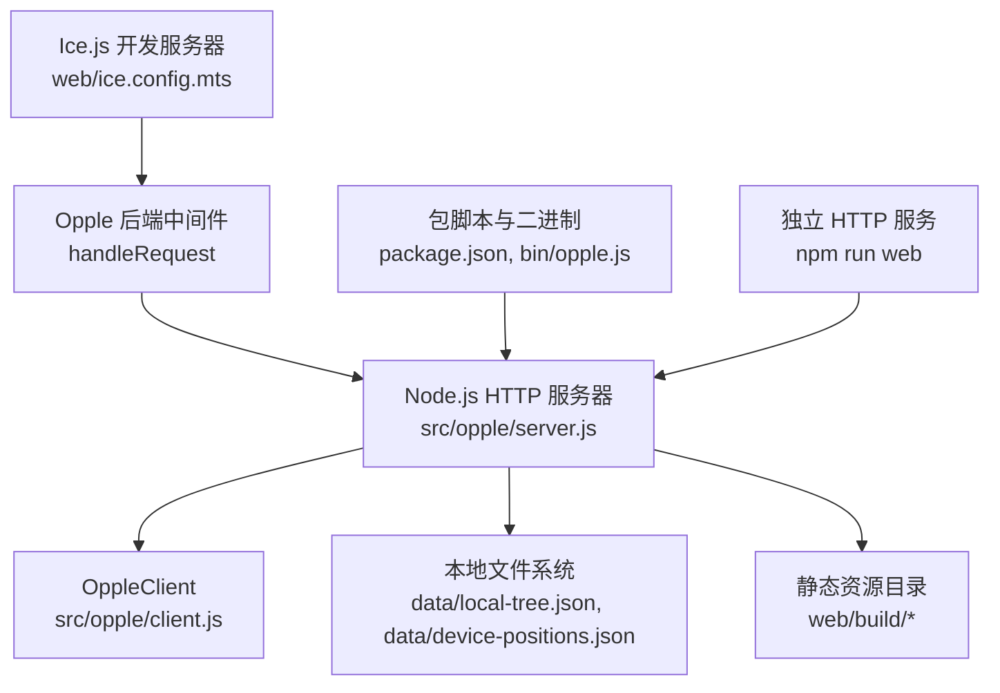

图表来源
- [ice.config.mts:1-47](file://web/ice.config.mts#L1-L47)
- [server.js:1-238](file://src/opple/server.js#L1-L238)
- [client.js:1-226](file://src/opple/client.js#L1-L226)
- [package.json:1-19](file://package.json#L1-L19)

章节来源
- [ice.config.mts:1-47](file://web/ice.config.mts#L1-L47)
- [server.js:1-238](file://src/opple/server.js#L1-L238)
- [client.js:1-226](file://src/opple/client.js#L1-L226)
- [package.json:1-19](file://package.json#L1-L19)

## 核心组件
- **双模式请求处理器**：
  - `handleRequest(req, res)`：可复用的异步请求处理函数，支持 Ice.js 和独立模式
  - 独立 HTTP 服务器：当直接运行 server.js 时启动端口监听
- **Ice.js 集成中间件**：
  - 动态导入 Opple 后端模块
  - `/api/*` 请求拦截和处理
  - 错误处理和降级响应
- **中间件层**：
  - CORS 头设置与 OPTIONS 预检处理
  - 统一 JSON 响应函数 json()
  - 请求体读取 readBody()
- **文件缓存**：
  - 家庭/房间/设备树本地快照 local-tree.json
  - 设备位置数据 device-positions.json
- **OppleClient 客户端**：
  - 配置加载与保存
  - 鉴权头生成
  - 通用 request/get/post 方法
  - 业务方法：homeList、tree、roomDevices、listDevices、deviceSummary、actionAbility、callAction

章节来源
- [server.js:114-227](file://src/opple/server.js#L114-L227)
- [ice.config.mts:24-42](file://web/ice.config.mts#L24-L42)
- [server.js:100-112](file://src/opple/server.js#L100-L112)
- [client.js:13-97](file://src/opple/client.js#L13-L97)

## 架构总览
服务整体流程如下：
- **Ice.js 开发模式**：Ice.js 开发服务器通过自定义中间件拦截 `/api/*` 请求，动态导入并调用 Opple 后端的 handleRequest 函数
- **独立服务模式**：直接运行 server.js 启动独立 HTTP 服务器监听指定端口
- 接收 HTTP 请求
- 应用 CORS 中间件
- 匹配 /api/* 路由，进入 API 处理分支
- 根据路径与方法选择具体处理器
- 必要时通过 OppleClient 访问云端
- 读写本地缓存文件
- 返回统一 JSON 响应或静态文件

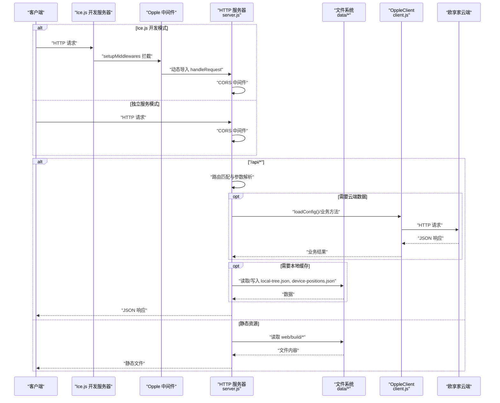

图表来源
- [ice.config.mts:24-42](file://web/ice.config.mts#L24-L42)
- [server.js:114-227](file://src/opple/server.js#L114-L227)
- [client.js:67-97](file://src/opple/client.js#L67-L97)

## 详细组件分析

### 双模式请求处理器
**新增** 支持 Ice.js 开发服务器内嵌和独立 HTTP 服务两种运行模式

- **handleRequest 函数**：
  - 统一的请求处理逻辑，不关心调用上下文
  - 支持 CORS 跨域处理
  - API 路由分发和静态文件托管
  - 错误处理和响应格式化
- **独立服务模式**：
  - 检测是否为直接运行的主模块
  - 创建 HTTP 服务器监听端口（默认 5170）
  - 输出启动日志和前端就绪状态
- **Ice.js 集成模式**：
  - 通过 setupMiddlewares 钩子注册中间件
  - 动态导入 Opple 后端模块避免重复加载
  - 固定端口 3000，避免端口冲突

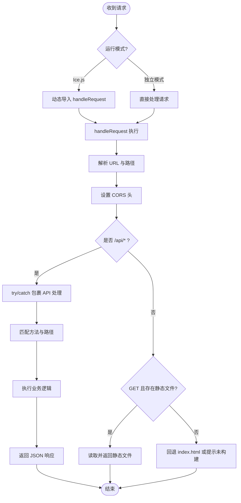

图表来源
- [server.js:114-237](file://src/opple/server.js#L114-L237)
- [ice.config.mts:24-42](file://web/ice.config.mts#L24-L42)

章节来源
- [server.js:114-237](file://src/opple/server.js#L114-L237)
- [ice.config.mts:24-42](file://web/ice.config.mts#L24-L42)

### Ice.js 开发服务器集成
**新增** 完整的 Ice.js 开发服务器集成方案

- **配置结构**：
  - 使用 `defineConfig` 定义 Ice.js 配置
  - 通过 webpack 配置扩展 devServer
  - 固定端口 3000，避免自动端口探测
- **中间件机制**：
  - 使用 `setupMiddlewares` 钩子注册自定义中间件
  - 中间件名称 'opple-api'，优先级最高（unshift）
  - 仅拦截 `/api/*` 路径的请求
- **动态模块加载**：
  - 使用 `pathToFileURL` 转换相对路径为 URL
  - 首次请求时动态 import Opple 后端模块
  - Promise 缓存避免重复导入
- **错误处理**：
  - 捕获模块导入和请求处理异常
  - 返回标准 JSON 错误格式
  - 确保响应头正确设置

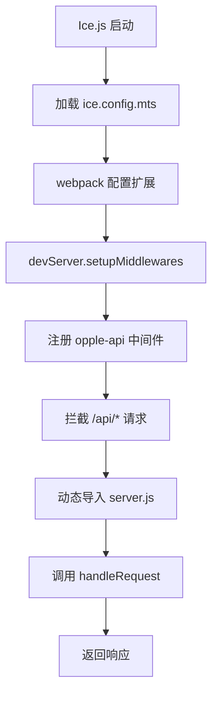

图表来源
- [ice.config.mts:11-46](file://web/ice.config.mts#L11-L46)

章节来源
- [ice.config.mts:11-46](file://web/ice.config.mts#L11-L46)

### HTTP 服务器与请求生命周期
- 监听端口：默认 5170，可通过环境变量 PORT 覆盖
- 请求处理：
  - 构造 URL 并提取 pathname
  - 设置 CORS 响应头；OPTIONS 直接返回 204
  - 对 /api/* 进行集中 try/catch，统一错误码 502
  - 对静态资源 GET 请求，优先返回对应文件，否则回退 index.html
- 响应格式：
  - json(res, code, data) 统一设置 Content-Type 并序列化 body

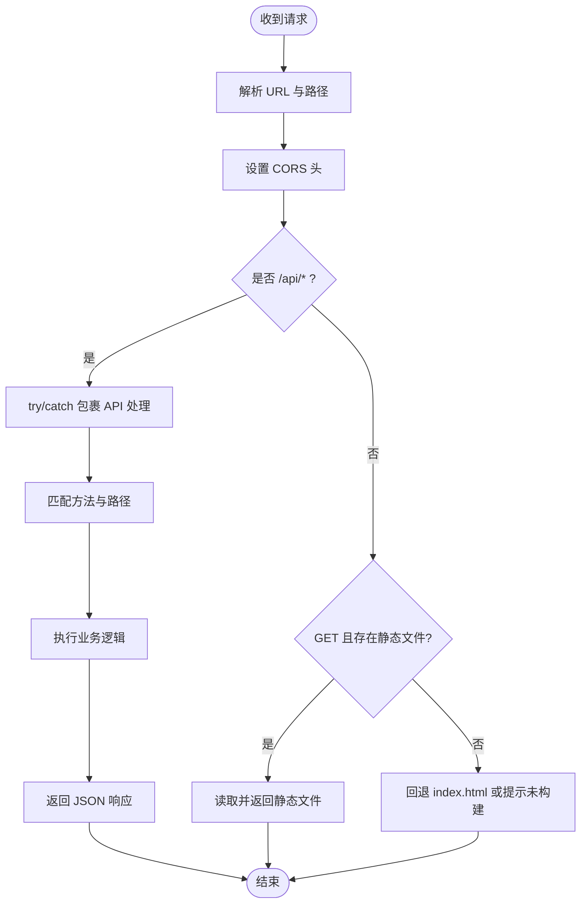

图表来源
- [server.js:114-227](file://src/opple/server.js#L114-L227)

章节来源
- [server.js:114-227](file://src/opple/server.js#L114-L227)

### 路由注册机制
- 所有 /api/* 路由集中在一个分支内，按 method + path 精确匹配
- 支持的方法：
  - GET：/api/homes、/api/tree、/api/devices、/api/summary、/api/actions、/api/positions
  - POST：/api/sync、/api/positions
- 未匹配的路径返回 404

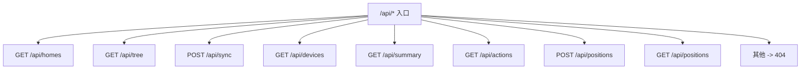

图表来源
- [server.js:126-205](file://src/opple/server.js#L126-L205)

章节来源
- [server.js:126-205](file://src/opple/server.js#L126-L205)

### 中间件处理流程
- CORS 中间件：
  - 允许任意来源、常用方法与 Content-Type 头
  - 对 OPTIONS 预检请求直接返回 204
- 统一 JSON 响应：
  - json(res, code, data) 负责状态码与 Content-Type
- 请求体解析：
  - readBody(req) 使用流式累积 Buffer，再 JSON.parse
  - 空体返回 {}，解析失败也返回 {}

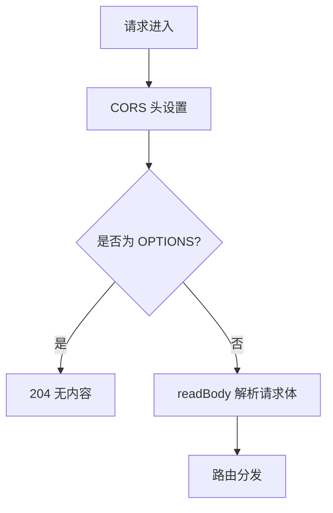

图表来源
- [server.js:119-123](file://src/opple/server.js#L119-L123)
- [server.js:100-112](file://src/opple/server.js#L100-L112)

章节来源
- [server.js:119-123](file://src/opple/server.js#L119-L123)
- [server.js:100-112](file://src/opple/server.js#L100-L112)

### RESTful API 端点详解

#### /api/tree（获取家庭/房间/设备树）
- 方法：GET
- 行为：
  - 优先从本地缓存 local-tree.json 读取
  - 若无缓存，则通过 OppleClient.tree() 拉取云端最新结构，并落盘
  - 返回 { source: 'local'|'remote', syncedAt, tree }
  - 每次返回都会合并实时设备位置数据（不受缓存影响）
- 错误处理：
  - 配置文件缺失或损坏时返回 500
  - 其他异常捕获后返回 502

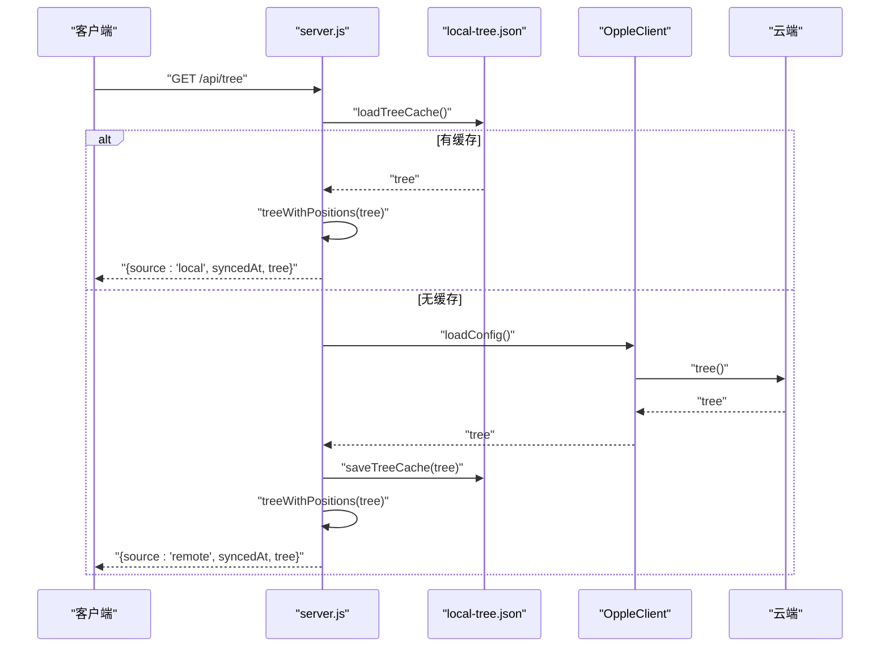

图表来源
- [server.js:135-144](file://src/opple/server.js#L135-L144)
- [client.js:165-204](file://src/opple/client.js#L165-L204)

章节来源
- [server.js:135-144](file://src/opple/server.js#L135-L144)
- [client.js:165-204](file://src/opple/client.js#L165-L204)

#### /api/sync（一键同步）
- 方法：POST
- 行为：
  - 强制拉取云端最新 tree 并写入本地缓存
  - 返回 { ok: true, syncedAt, tree }
- 错误处理：
  - 配置缺失返回 500
  - 其他异常返回 502

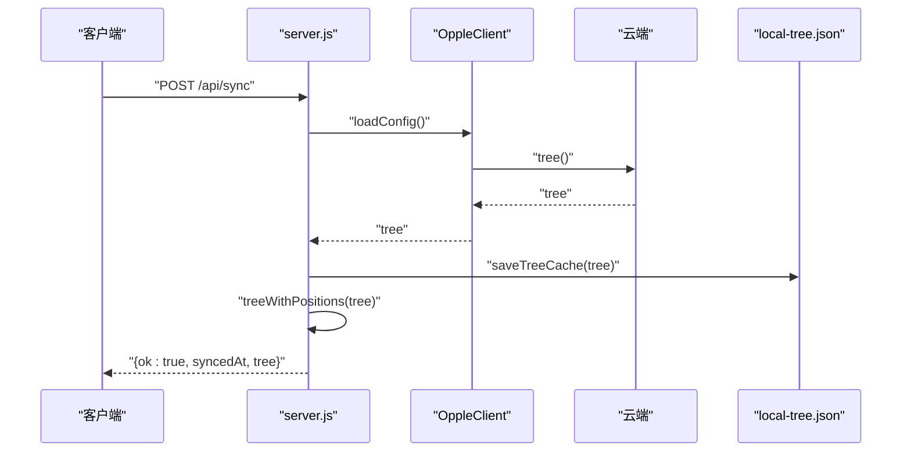

图表来源
- [server.js:147-152](file://src/opple/server.js#L147-L152)
- [client.js:165-204](file://src/opple/client.js#L165-L204)

章节来源
- [server.js:147-152](file://src/opple/server.js#L147-L152)
- [client.js:165-204](file://src/opple/client.js#L165-L204)

#### /api/positions（保存与导出设备位置）
- 保存：POST /api/positions
  - 请求体包含 projectCode、gpno、shape、positions、excluded
  - 校验必填字段，合并旧数据，写回 device-positions.json
  - 返回 { ok: true, saved: 数量 }
- 导出：GET /api/positions
  - 可选 query projectCode
  - 返回清理后的位置数据（剔除 point 类型与手动排除的设备）

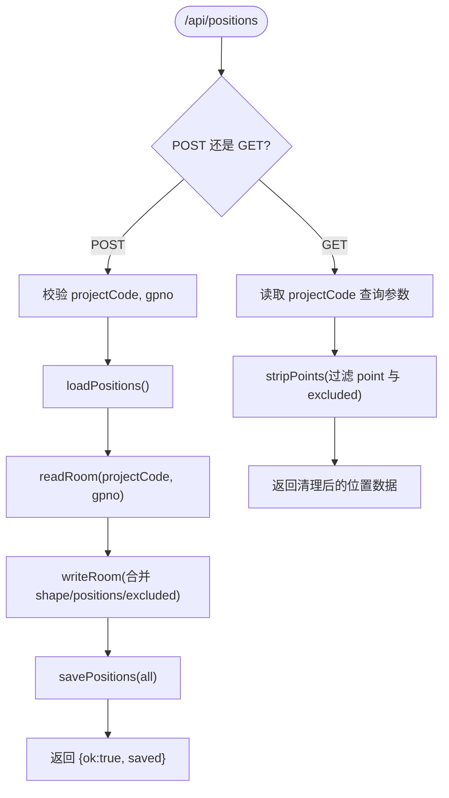

图表来源
- [server.js:175-200](file://src/opple/server.js#L175-L200)

章节来源
- [server.js:175-200](file://src/opple/server.js#L175-L200)

#### 其他 API 端点
- /api/homes：GET，返回家庭列表
- /api/devices：GET，支持可选 gpNo 查询房间设备
- /api/summary：GET，返回设备摘要
- /api/actions：GET，需 vDeviceId，返回设备可用动作

章节来源
- [server.js:128-171](file://src/opple/server.js#L128-L171)

### 文件操作系统与本地缓存
- 本地树缓存 local-tree.json：
  - 结构：{ syncedAt, tree }
  - 用途：避免频繁请求云端，提升 /api/tree 响应速度
  - 写入时机：首次拉取或执行 /api/sync
- 设备位置数据 device-positions.json：
  - 结构：projectCode -> gpno -> { shape, devices, excluded }
  - 用途：记录房间尺寸、设备位置与手动排除清单
  - 写入时机：POST /api/positions
- 读取与写入均为同步操作，简单可靠但可能阻塞事件循环

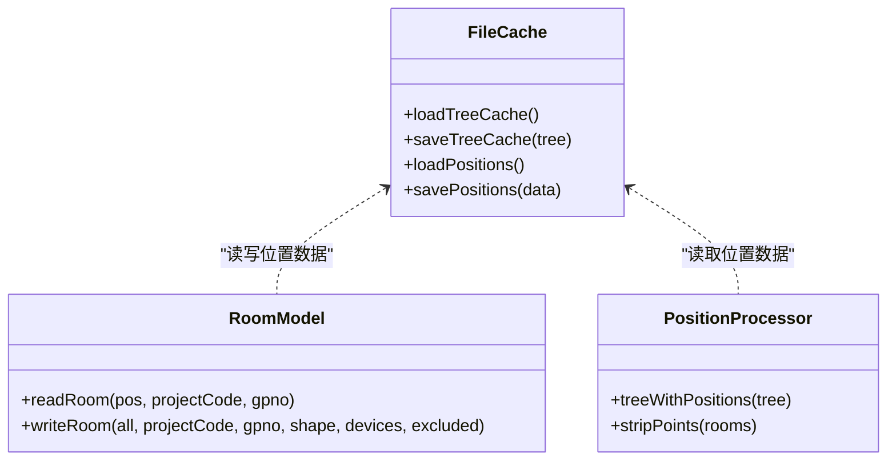

图表来源
- [server.js:18-38](file://src/opple/server.js#L18-L38)
- [server.js:40-86](file://src/opple/server.js#L40-L86)

章节来源
- [server.js:18-38](file://src/opple/server.js#L18-L38)
- [server.js:40-86](file://src/opple/server.js#L40-L86)

### 与 OppleClient 的集成
- 配置加载：
  - OppleClient.loadConfig() 从用户主目录 .opple-cli.json 读取 token 与 projectCode
  - 若不存在抛出错误，由 server 捕获并返回 500
- 请求封装：
  - headers() 生成与 App 一致的鉴权头
  - request(method, path, {query, body}) 统一处理 fetch、错误码与 JSON 解析
  - get/post 便捷方法
- 业务方法：
  - homeList、tree、roomDevices、listDevices、deviceSummary、actionAbility、callAction
- 错误传播：
  - 云端非 200 或非 JSON 会抛错
  - StatusCode !== 0 视为失败，抛错信息包含状态码与消息

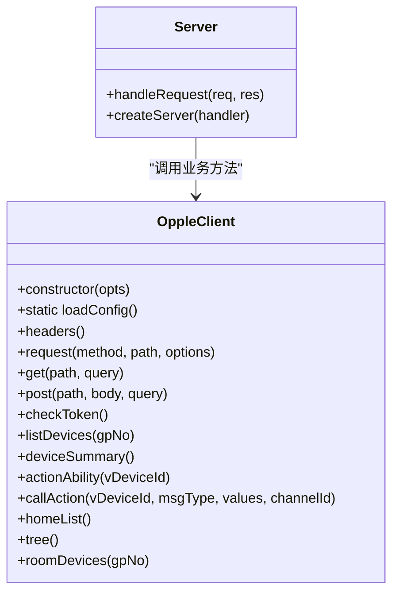

图表来源
- [client.js:13-224](file://src/opple/client.js#L13-L224)
- [server.js:128-171](file://src/opple/server.js#L128-L171)

章节来源
- [client.js:13-224](file://src/opple/client.js#L13-L224)
- [server.js:128-171](file://src/opple/server.js#L128-L171)

## 依赖关系分析
- 内部依赖：
  - server.js 依赖 client.js 提供的 OppleClient
  - server.js 依赖 Node.js fs/path/url/http 内置模块
  - ice.config.mts 依赖 server.js 导出的 handleRequest
- 外部依赖：
  - 欧享家云端 API（https://iot2.opple.com）
  - Ice.js 开发服务器框架
- 耦合度：
  - server.js 与 client.js 解耦良好，仅通过 OppleClient 暴露的业务方法进行交互
  - server.js 与 ice.config.mts 通过 handleRequest 函数解耦
  - 文件缓存与业务逻辑在 server.js 内聚，便于维护

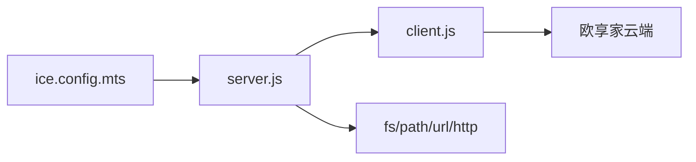

图表来源
- [ice.config.mts:1-47](file://web/ice.config.mts#L1-L47)
- [server.js:1-8](file://src/opple/server.js#L1-L8)
- [client.js:1-6](file://src/opple/client.js#L1-L6)

章节来源
- [ice.config.mts:1-47](file://web/ice.config.mts#L1-L47)
- [server.js:1-8](file://src/opple/server.js#L1-L8)
- [client.js:1-6](file://src/opple/client.js#L1-L6)

## 性能与并发
- 并发模型：
  - Node.js 单线程事件循环，createServer 回调为异步处理
  - Ice.js 开发模式下，handleRequest 通过中间件链式处理
  - 当前实现中，每个请求独立处理，无显式限流或队列
- I/O 模式：
  - 文件读写使用同步 API（readFileSync/writeFileSync），在高并发下可能阻塞事件循环
  - 建议将关键路径改为异步 fs.promises 以提升吞吐
- 内存管理：
  - readBody 累积请求体 Buffer，大请求可能导致内存峰值
  - 建议增加请求体大小限制与流式解析
- 缓存策略：
  - local-tree.json 有效减少云端请求，提高 /api/tree 性能
  - device-positions.json 作为增量更新，避免全量重写
  - Ice.js 模式下动态导入模块，避免重复加载开销
- 监控建议：
  - 添加请求耗时统计与错误率指标
  - 监控文件 I/O 延迟与内存占用
  - 监控 Ice.js 中间件链性能

[本节为通用指导，不直接分析具体文件]

## 故障排查指南
- 常见问题：
  - 配置文件缺失：OppleClient.loadConfig() 抛错，server 返回 500
  - 云端返回非 JSON：client.request 抛错，server 返回 502
  - 静态资源未构建：返回提示信息，需在 web 目录构建产物
  - Ice.js 端口冲突：固定端口 3000，被占用时直接报错
  - 模块导入失败：动态导入 Opple 后端模块异常
- 定位步骤：
  - 检查 .opple-cli.json 是否存在且包含 token 与 projectCode
  - 查看 data/local-tree.json 与 data/device-positions.json 是否可读写
  - 确认 web/build/index.html 是否存在
  - 检查 Ice.js 开发服务器端口占用情况
  - 验证 server.js 模块语法和依赖是否正确
- 日志与调试：
  - 启动时会输出端口与前端就绪状态
  - Ice.js 模式下可在中间件中添加强制日志
  - 可在 server.js 中添加结构化日志以追踪请求链路

章节来源
- [server.js:232-236](file://src/opple/server.js#L232-L236)
- [client.js:24-30](file://src/opple/client.js#L24-L30)
- [ice.config.mts:33-38](file://web/ice.config.mts#L33-L38)

## 结论
Server 服务端模块经过重构后实现了更灵活的架构设计：
- **双模式支持**：既可作为独立的 HTTP 服务运行，也可嵌入 Ice.js 开发服务器
- **清晰的模块化**：handleRequest 函数作为单一职责的可复用组件
- **Ice.js 深度集成**：通过自定义中间件实现无缝的 API 路由
- **清晰的路由与中间件分层**
- **有效的本地缓存降低云端压力**
- **与 OppleClient 的良好解耦**
- **可扩展的 API 设计便于新增端点**

建议在后续迭代中引入异步文件 I/O、请求体大小限制、限流与监控，以进一步提升稳定性与性能。

[本节为总结性内容，不直接分析具体文件]

## 附录：扩展指南

### 新增 API 端点示例
- 在 /api/* 分支内添加新的 if 条件，匹配方法与路径
- 如需读取配置，使用 OppleClient.loadConfig()
- 如需访问云端，调用 OppleClient 对应业务方法
- 返回统一 JSON 响应

参考路径
- [server.js:126-205](file://src/opple/server.js#L126-L205)
- [client.js:99-224](file://src/opple/client.js#L99-L224)

### 添加自定义中间件示例
- 在 Ice.js 的 setupMiddlewares 中注册新中间件
- 可使用统一的 json() 返回响应
- 注意保持 try/catch 包裹，确保错误统一处理

参考路径
- [ice.config.mts:24-42](file://web/ice.config.mts#L24-L42)
- [server.js:119-123](file://src/opple/server.js#L119-L123)

### 实现业务逻辑示例
- 在 OppleClient 中新增业务方法
- 在 server.js 中通过 OppleClient 调用该方法
- 结合本地缓存或文件系统进行数据持久化

参考路径
- [client.js:99-224](file://src/opple/client.js#L99-L224)
- [server.js:135-200](file://src/opple/server.js#L135-L200)

### Ice.js 开发服务器配置示例
- 修改 ice.config.mts 中的端口配置
- 调整中间件优先级和拦截规则
- 添加自定义的错误处理和日志记录

参考路径
- [ice.config.mts:17-46](file://web/ice.config.mts#L17-L46)