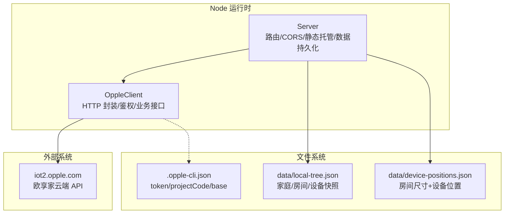
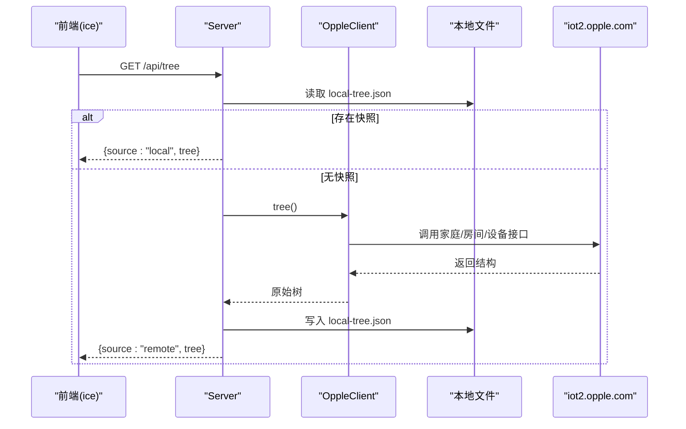
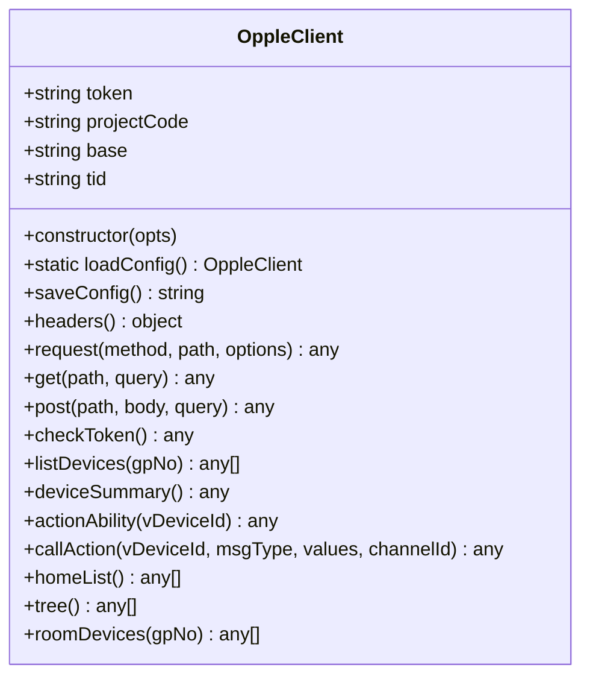
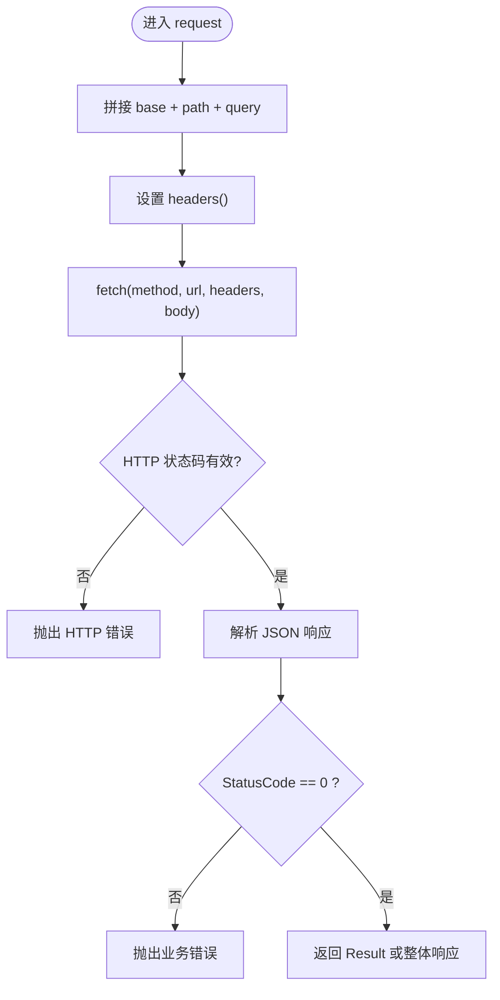
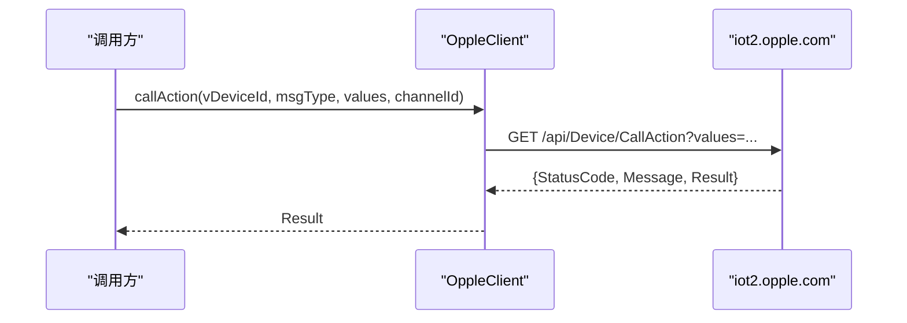
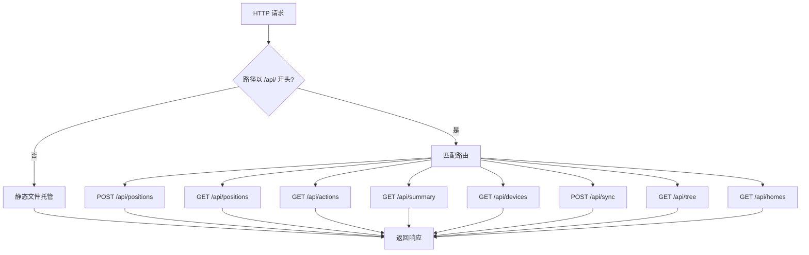
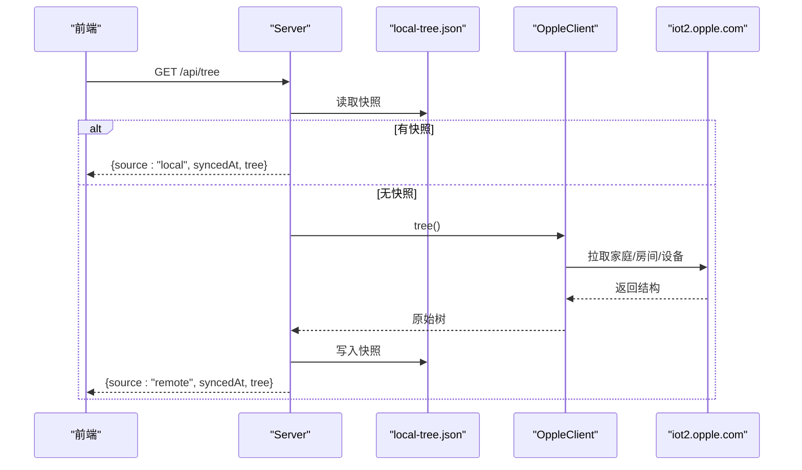
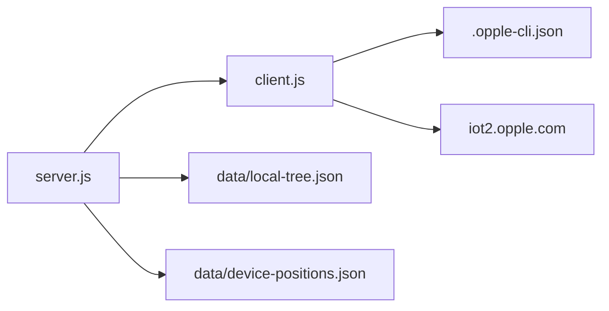

# 核心模块详解

<cite>
**本文引用的文件**   
- [src/opple/client.js](file://src/opple/client.js)
- [src/opple/server.js](file://src/opple/server.js)
- [package.json](file://package.json)
- [README.md](file://README.md)
</cite>

## 目录
1. [引言](#引言)
2. [项目结构](#项目结构)
3. [核心组件](#核心组件)
4. [架构总览](#架构总览)
5. [详细组件分析](#详细组件分析)
6. [依赖关系分析](#依赖关系分析)
7. [性能与并发](#性能与并发)
8. [故障排查指南](#故障排查指南)
9. [扩展与集成](#扩展与集成)
10. [结论](#结论)

## 引言
本仓库实现欧享家（欧普 INNO 生态）的本地控制能力，包含命令行工具、Web 控制台与云端 API 适配层。核心由两部分组成：
- OppleClient：封装 HTTP 请求、鉴权头、错误处理与业务接口调用。
- Server：基于 Node 原生 http 的服务端，提供 REST API、静态资源托管、房间/设备位置数据持久化，并复用 OppleClient 访问云端。

本文围绕客户端与服务端的实现原理、数据流、错误处理、扩展点与性能优化展开，帮助开发者快速理解并二次开发。

## 项目结构
- src/opple/client.js：OppleClient 客户端实现，负责与 iot2.opple.com 交互。
- src/opple/server.js：Node 后端服务，提供 /api/* 路由与静态文件托管。
- package.json：定义 CLI 入口与脚本命令。
- README.md：使用说明、API 文档与逆向说明。

图表来源
- [src/opple/client.js:1-226](file://src/opple/client.js#L1-L226)
- [src/opple/server.js:1-232](file://src/opple/server.js#L1-L232)

章节来源
- [package.json:1-17](file://package.json#L1-L17)
- [README.md:1-103](file://README.md#L1-L103)

## 核心组件
- OppleClient：统一封装请求头、鉴权、分页拉取、动作调用、家庭/房间/设备树构建等。
- Server：零依赖 Node 服务，提供 REST API、CORS、静态资源托管、位置与快照数据读写。

章节来源
- [src/opple/client.js:13-225](file://src/opple/client.js#L13-L225)
- [src/opple/server.js:114-226](file://src/opple/server.js#L114-L226)

## 架构总览
服务端作为网关，将前端请求转发到 OppleClient；OppleClient 通过标准 fetch 发起 HTTP 请求，附加 App 同款鉴权头，并对响应进行统一错误处理。部分数据（家庭/房间/设备树）会缓存到本地 JSON 文件以减少云端调用。

图表来源
- [src/opple/server.js:132-144](file://src/opple/server.js#L132-L144)
- [src/opple/client.js:165-204](file://src/opple/client.js#L165-L204)

## 详细组件分析

### OppleClient 客户端
- 构造与配置
  - 支持传入 token、projectCode、base URL；默认 base 为 iot2.opple.com。
  - 提供 loadConfig/saveConfig 从用户目录配置文件读写凭据。
- 请求封装与鉴权
  - headers() 生成与 App 一致的请求头（全小写），包含 lang、accept、content-type、app-version、clientid、ostype、projectcode、token、tid、user-agent 等。
  - request() 统一拼接 URL、query、POST body，使用 fetch 发起请求，校验 HTTP 状态码与业务 StatusCode。
- 业务接口
  - checkToken：校验/刷新 token。
  - listDevices：分页拉取设备列表。
  - deviceSummary：轻量设备摘要。
  - actionAbility：查询设备可用动作。
  - callAction：调用设备动作（msgType + values）。
  - homeList：获取家庭列表。
  - tree：构建家庭→房间→设备三层结构，按房间拉取设备。
  - roomDevices：按房间拉取设备（含网关+子设备）。

图表来源
- [src/opple/client.js:13-225](file://src/opple/client.js#L13-L225)

#### 关键流程：请求与鉴权

图表来源
- [src/opple/client.js:67-94](file://src/opple/client.js#L67-L94)

#### 关键流程：设备动作调用

图表来源
- [src/opple/client.js:145-152](file://src/opple/client.js#L145-L152)

章节来源
- [src/opple/client.js:17-94](file://src/opple/client.js#L17-L94)
- [src/opple/client.js:101-224](file://src/opple/client.js#L101-L224)

### Server 服务端
- 启动与端口
  - 使用 createServer 创建 Node http 服务，默认端口来自环境变量 PORT，未设置时默认 5170。
- CORS 与中间件
  - 对所有响应添加跨域头，OPTIONS 预检直接返回 204。
- 路由处理
  - /api/homes：返回家庭列表。
  - /api/tree：优先返回本地快照，否则回源云端并落盘。
  - /api/sync：强制同步云端最新结构并落盘。
  - /api/devices：设备列表（可按 gpNo 过滤）。
  - /api/summary：设备摘要。
  - /api/actions：设备动作能力。
  - /api/positions：保存房间布局（shape/positions/excluded）。
  - /api/positions：导出空间数据（仅灯/灯带）。
- 静态资源托管
  - 托管 web/build 下的构建产物，SPA 回退到 index.html。
- 数据持久化
  - data/local-tree.json：家庭/房间/设备结构快照。
  - data/device-positions.json：房间尺寸与设备位置。

图表来源
- [src/opple/server.js:114-226](file://src/opple/server.js#L114-L226)

#### 关键流程：/api/tree 本地快照优先

图表来源
- [src/opple/server.js:132-144](file://src/opple/server.js#L132-L144)
- [src/opple/client.js:165-204](file://src/opple/client.js#L165-L204)

章节来源
- [src/opple/server.js:10-38](file://src/opple/server.js#L10-L38)
- [src/opple/server.js:114-226](file://src/opple/server.js#L114-L226)

## 依赖关系分析
- OppleClient 依赖 Node 内置模块 fs、os、path、crypto 与全局 fetch。
- Server 依赖 Node 内置模块 http、fs、path、url，并导入 OppleClient。
- 数据文件依赖：
  - .opple-cli.json：用户凭据（token、projectCode、base）。
  - data/local-tree.json：家庭/房间/设备结构快照。
  - data/device-positions.json：房间尺寸与设备位置。

图表来源
- [src/opple/server.js:1-16](file://src/opple/server.js#L1-L16)
- [src/opple/client.js:1-7](file://src/opple/client.js#L1-L7)

章节来源
- [src/opple/server.js:1-16](file://src/opple/server.js#L1-L16)
- [src/opple/client.js:1-7](file://src/opple/client.js#L1-L7)

## 性能与并发
- 本地快照减少云端调用
  - /api/tree 优先读取 data/local-tree.json，避免每次请求都调用云端，显著降低延迟与网络开销。
- 文件 I/O 策略
  - 使用 readFileSync/writeFileSync 同步读写 JSON 文件，简单可靠但阻塞事件循环；适合低频配置与快照场景。
- 并发模型
  - Node 单线程事件循环，所有请求串行处理；对于高并发场景可考虑引入连接池、异步 I/O 与限流。
- 内存管理
  - 大型 JSON 文件（如设备清单）可能占用较多内存；建议按需分页加载与缓存淘汰策略。
- 网络层
  - 使用全局 fetch，未显式设置超时与重试；建议增加超时控制与指数退避重试。

[本节为通用指导，不直接分析具体文件]

## 故障排查指南
- 鉴权失败（12004/11009）
  - 原因：请求头大小写不一致导致云端校验异常。
  - 解决：确保 headers() 中所有键均为小写；检查 token/projectcode/clientid 等字段。
- 配置文件缺失
  - 现象：loadConfig 抛出“未找到配置文件”错误。
  - 解决：先执行 CLI 命令保存 token 与 projectCode，或使用 saveConfig 写入 .opple-cli.json。
- 非 JSON 响应
  - 现象：响应体无法解析为 JSON。
  - 解决：检查接口是否返回文本或 HTML；在 request() 中捕获并记录原始响应片段。
- 业务错误码非 0
  - 现象：StatusCode 非 0 抛出业务错误。
  - 解决：根据 Message 定位问题；必要时使用 raw 命令调试原始接口。
- 前端未构建
  - 现象：访问根路径返回提示“前端未构建”。
  - 解决：进入 web 目录执行 npm install 与 npm run build，再重启服务。

章节来源
- [src/opple/client.js:24-30](file://src/opple/client.js#L24-L30)
- [src/opple/client.js:41-58](file://src/opple/client.js#L41-L58)
- [src/opple/client.js:81-93](file://src/opple/client.js#L81-L93)
- [src/opple/server.js:207-223](file://src/opple/server.js#L207-L223)

## 扩展与集成
- 新增 OppleClient 业务接口
  - 在 client.js 中添加方法，遵循 request() 的统一封装；注意参数顺序与返回值结构。
  - 示例路径参考：[src/opple/client.js:101-224](file://src/opple/client.js#L101-L224)
- 新增 Server 路由
  - 在 server.js 的路由分支中添加新的 if 条件，复用 OppleClient 方法；保持 json() 响应格式一致。
  - 示例路径参考：[src/opple/server.js:124-204](file://src/opple/server.js#L124-L204)
- 自定义数据持久化
  - 替换 data/local-tree.json 与 data/device-positions.json 的读写逻辑，或接入数据库/对象存储。
  - 示例路径参考：[src/opple/server.js:18-38](file://src/opple/server.js#L18-L38)
- 插件化建议
  - 将业务接口与路由解耦为独立模块，通过注册表动态加载；便于团队协作与版本管理。
- 安全与鉴权增强
  - 在服务端增加 JWT/Session 校验，限制 /api/* 访问权限；对敏感操作增加审计日志。
- 性能优化
  - 引入 Redis 缓存热点数据；对频繁调用的接口做聚合与分页优化；对 fetch 增加超时与重试。

章节来源
- [src/opple/client.js:67-94](file://src/opple/client.js#L67-L94)
- [src/opple/server.js:114-226](file://src/opple/server.js#L114-L226)

## 结论
OppleClient 与 Server 共同构成欧享家设备的本地控制核心：客户端负责与云端交互并提供稳定接口，服务端提供 REST API、静态托管与数据持久化。通过本地快照与位置数据，系统在易用性与性能之间取得平衡。开发者可在现有基础上扩展业务接口、路由与持久化策略，并结合安全与性能优化满足更复杂的场景需求。