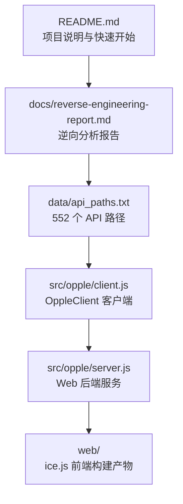
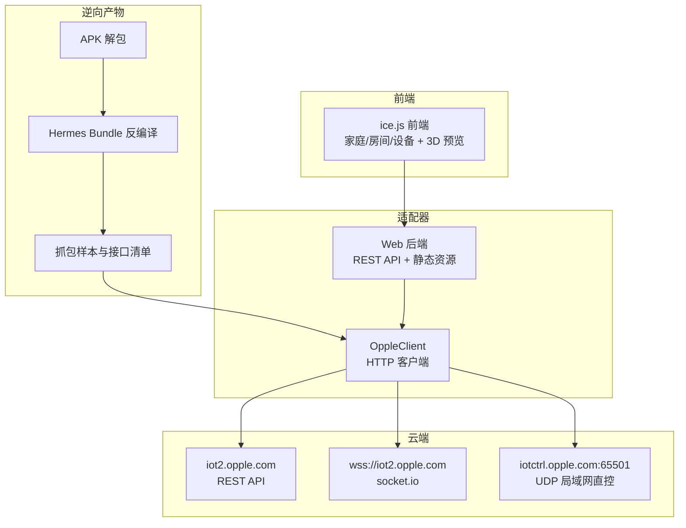
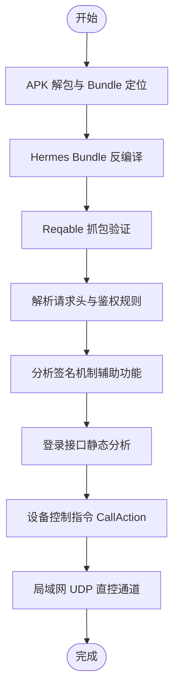
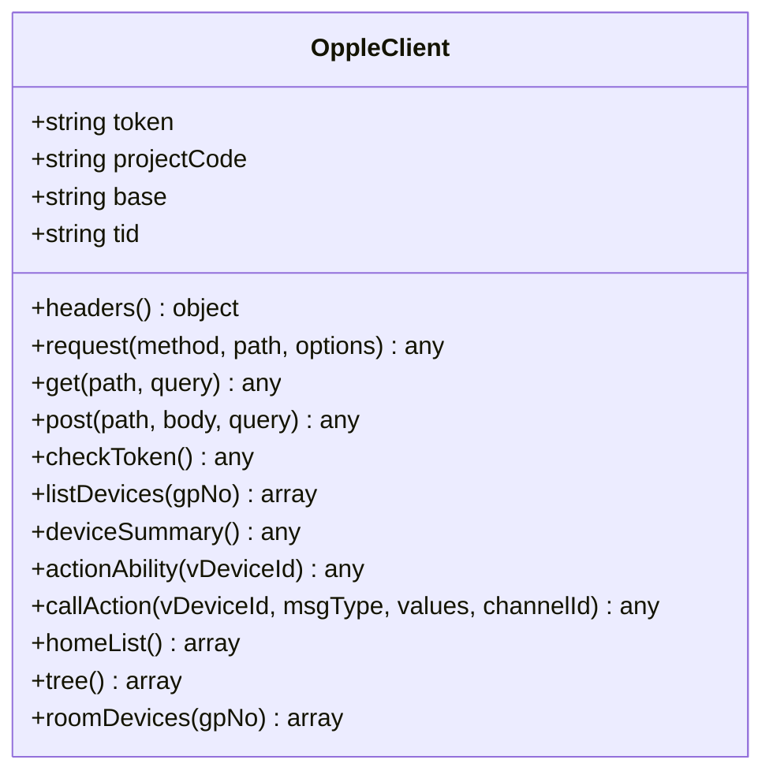
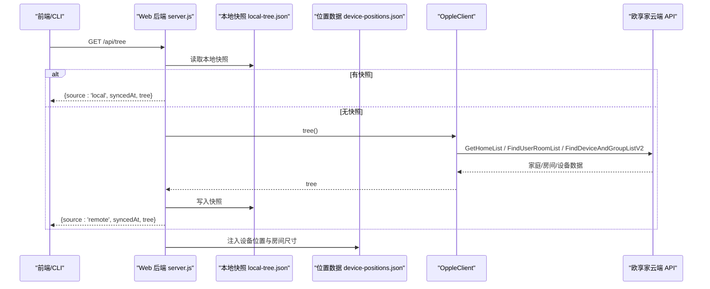
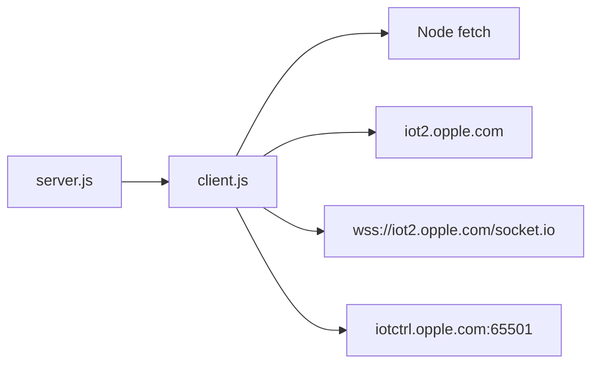

# 逆向工程报告

<cite>
**本文引用的文件**   
- [README.md](file://README.md)
- [reverse-engineering-report.md](file://docs/reverse-engineering-report.md)
- [api_paths.txt](file://data/api_paths.txt)
- [client.js](file://src/opple/client.js)
- [server.js](file://src/opple/server.js)
</cite>

## 目录
1. [引言](#引言)
2. [项目结构](#项目结构)
3. [核心组件](#核心组件)
4. [架构总览](#架构总览)
5. [详细组件分析](#详细组件分析)
6. [依赖关系分析](#依赖关系分析)
7. [性能与可用性考量](#性能与可用性考量)
8. [故障排查指南](#故障排查指南)
9. [结论](#结论)
10. [附录：API 接口清单与协议说明](#附录api-接口清单与协议说明)

## 引言
本逆向工程报告围绕欧享家移动应用（com.opple.smarthome）的本地控制适配展开，目标是记录从 APK 解包、React Native Bundle 反编译、网络协议分析到鉴权机制破解的全过程，并沉淀出可复用的 API 清单、请求头规范、签名与安全机制分析结果，以及后续维护建议。本项目在 README 中明确“通过逆向欧享家云端 API，实现欧普 INNO 设备的本地统一控制”，并在 docs/reverse-engineering-report.md 中给出完整的逆向方法摘要与关键发现。

## 项目结构
仓库采用“逆向产物 + 适配器实现”的分层组织方式：
- 逆向产物与数据：`data/` 下包含 APK、反编译 JS、抓包样本与 552 个接口路径清单。
- 适配器实现：`src/opple/` 提供 Node 端 OppleClient 与 Web 后端服务。
- Web 前端：`web/` 基于 ice.js v3，提供家庭/房间/设备管理与 3D 空间建模。
- CLI：`bin/opple.js` 暴露命令行工具，复用 OppleClient。

图示来源
- [README.md:1-17](file://README.md#L1-L17)
- [reverse-engineering-report.md:96-99](file://docs/reverse-engineering-report.md#L96-L99)
- [api_paths.txt:1-553](file://data/api_paths.txt#L1-L553)
- [client.js:1-226](file://src/opple/client.js#L1-L226)
- [server.js:1-232](file://src/opple/server.js#L1-L232)

章节来源
- [README.md:1-17](file://README.md#L1-L17)
- [reverse-engineering-report.md:96-99](file://docs/reverse-engineering-report.md#L96-L99)

## 核心组件
- OppleClient：封装 HTTP 请求、统一鉴权头、错误处理与业务接口（设备列表、动作能力、CallAction、家庭/房间/设备树）。
- Web 后端 server.js：零依赖 Node http 服务，提供 REST API（家庭/房间/设备树、同步、位置编辑、导出），并托管 web 构建产物。
- 逆向报告：APK 解包、Hermes Bundle 反编译、抓包验证、请求头与鉴权机制、签名机制、设备控制指令、局域网直控通道等。

章节来源
- [client.js:1-226](file://src/opple/client.js#L1-L226)
- [server.js:1-232](file://src/opple/server.js#L1-L232)
- [reverse-engineering-report.md:8-13](file://docs/reverse-engineering-report.md#L8-L13)

## 架构总览
整体架构由“逆向产物 → 适配器客户端 → Web 后端 → 前端 UI”构成，同时对接欧享家云端 API 与 socket.io 实时通道。

图示来源
- [reverse-engineering-report.md:14-23](file://docs/reverse-engineering-report.md#L14-L23)
- [reverse-engineering-report.md:110-113](file://docs/reverse-engineering-report.md#L110-L113)
- [client.js:1-226](file://src/opple/client.js#L1-L226)
- [server.js:1-232](file://src/opple/server.js#L1-L232)

## 详细组件分析

### 逆向工程流程与技术要点
- APK 解包与 Hermes Bundle 定位：使用 REA/apktool 解 manifest，定位 `assets/index.android.bundle`（Hermes v96），再用 hbc-decompiler 反编译为可读 JS。
- 抓包交叉验证：iOS 端 Reqable 抓包，确认域名、请求头、响应结构与调用链。
- 请求头与鉴权：普通业务接口无 sign 签名，鉴权仅依赖 Token + ProjectCode；请求头字段必须全小写，否则触发 12004/11009 错误。
- 签名机制：事件日志上传与 getNetworkSign 两处签名逻辑，均为辅助功能，不在主控制链路中使用。
- 登录接口：验证码登录、一键登录、验证码发送、token 刷新等接口已静态分析补齐。
- 设备控制指令：统一走 `/api/Device/CallAction`，msgType 与 values 参数结构经抓包与能力表验证。
- 局域网直控通道：同网段时走 UDP 直发至 iotctrl.opple.com:65501，绕过云端。

图示来源
- [reverse-engineering-report.md:8-13](file://docs/reverse-engineering-report.md#L8-L13)
- [reverse-engineering-report.md:24-56](file://docs/reverse-engineering-report.md#L24-L56)
- [reverse-engineering-report.md:57-113](file://docs/reverse-engineering-report.md#L57-L113)

章节来源
- [reverse-engineering-report.md:8-13](file://docs/reverse-engineering-report.md#L8-L13)
- [reverse-engineering-report.md:24-56](file://docs/reverse-engineering-report.md#L24-L56)
- [reverse-engineering-report.md:57-113](file://docs/reverse-engineering-report.md#L57-L113)

### OppleClient 客户端分析
- 构造与配置：支持 token、projectCode、base URL，tid 随机生成，配置文件位于用户目录。
- 请求头：严格遵循 App 实测的小写字段名，包含语言、时区、版本、客户端标识、系统类型、项目码、token、tid、时间戳与 UA。
- 通用请求：GET/POST 统一封装，自动拼接 query、序列化 body、统一 StatusCode 错误处理。
- 业务接口：
  - checkToken：校验/刷新 token。
  - listDevices：分页拉取设备列表，支持按房间过滤。
  - deviceSummary：轻量设备摘要。
  - actionAbility：查询设备可用动作。
  - callAction：统一控制入口，msgType + values 升序逗号拼接。
  - homeList / tree / roomDevices：三层模型（家庭→房间→设备）。

图示来源
- [client.js:13-226](file://src/opple/client.js#L13-L226)

章节来源
- [client.js:1-226](file://src/opple/client.js#L1-L226)

### Web 后端服务分析
- 路由与缓存：
  - GET /api/homes：家庭列表。
  - GET /api/tree：本地快照优先，无快照则回源拉取并落盘。
  - POST /api/sync：一键同步云端最新结构并落盘。
  - GET /api/devices：设备列表（可按 gpNo 过滤）。
  - GET /api/summary：设备摘要。
  - GET /api/actions：设备动作能力。
  - POST /api/positions：保存房间布局（shape/positions/excluded）。
  - GET /api/positions：导出空间数据（供 AI 推理）。
- 位置数据模型：房间 shape（宽/高/深）、设备 position（circle/segment/point）、excluded（手动排除）。
- 静态资源托管：ice 构建产物，SPA 回退 index.html。

图示来源
- [server.js:18-72](file://src/opple/server.js#L18-L72)
- [server.js:124-204](file://src/opple/server.js#L124-L204)
- [client.js:154-224](file://src/opple/client.js#L154-L224)

章节来源
- [server.js:1-232](file://src/opple/server.js#L1-L232)

### 协议安全机制与鉴权破解
- 鉴权机制：普通业务接口无需 sign 签名，仅依赖 Token + ProjectCode 与固定请求头。
- 请求头大小写敏感：必须全小写（token/projectcode/clientid/app-version/ostype/lang），混用 PascalCase 会触发 12004/11009 错误。
- 签名机制：
  - 事件日志上传：HmacSHA256，密钥硬编码，用于辅助功能。
  - getNetworkSign：RSA 签名（jsrsasign），私钥硬编码，未在主控制链路发现调用。
- 绕过方法：控制链路不依赖签名，仅需正确设置请求头与 token/projectcode；若需扩展辅助功能，可复用现有签名算法与密钥。

章节来源
- [reverse-engineering-report.md:24-56](file://docs/reverse-engineering-report.md#L24-L56)

### 设备控制指令与命令字
- 统一控制入口：GET /api/Device/CallAction，参数包括 vDeviceId、msgType、channelId=65535、values（按 KeyId 升序逗号拼接）。
- 灯光命令字：开关、亮度、色温、DUV、颜色（CXCY）、日光模式预设、分级调光/调色温等。
- CXCY 颜色编码：32 位打包，高 16 位 = cx×10000，低 16 位 = cy×10000；日光模式预设有例外。
- 悦动灯效命令：流水、跑马、呼吸、律动、静态/动态色温渐变、静态颜色渐变等。
- 局域网直控：同网段走 UDP 直发至 iotctrl.opple.com:65501，绕过云端。

章节来源
- [reverse-engineering-report.md:67-113](file://docs/reverse-engineering-report.md#L67-L113)

## 依赖关系分析
- 模块耦合：
  - server.js 依赖 client.js 进行云端交互。
  - client.js 依赖 Node 标准库（fs、os、path、crypto）与 fetch。
  - 逆向产物（APK/Bundle/抓包）为协议定义与接口清单的来源。
- 外部依赖：
  - 欧享家云端 API（iot2.opple.com）。
  - socket.io over WebSocket（wss://iot2.opple.com）。
  - 局域网 UDP 直控（iotctrl.opple.com:65501）。

图示来源
- [server.js:1-232](file://src/opple/server.js#L1-L232)
- [client.js:1-226](file://src/opple/client.js#L1-L226)
- [reverse-engineering-report.md:14-23](file://docs/reverse-engineering-report.md#L14-L23)
- [reverse-engineering-report.md:110-113](file://docs/reverse-engineering-report.md#L110-L113)

章节来源
- [server.js:1-232](file://src/opple/server.js#L1-L232)
- [client.js:1-226](file://src/opple/client.js#L1-L226)
- [reverse-engineering-report.md:14-23](file://docs/reverse-engineering-report.md#L14-L23)

## 性能与可用性考量
- 本地快照优化：GET /api/tree 优先返回本地快照，避免每次请求云端，提升响应速度。
- 位置数据实时合并：无论是否使用快照，设备位置与房间尺寸始终实时合并，保证 UI 一致性。
- 分页与批量：设备列表分页拉取，减少单次负载；房间设备一次性拉取网关+子设备。
- 静态资源托管：web 构建产物直接由 Node 服务提供，简化部署。

[本节为通用指导，不涉及具体文件分析]

## 故障排查指南
- 请求头大小写问题：确保所有请求头字段为小写，避免 12004/11009 错误。
- Token 失效或权限不足：使用 checkToken 定期刷新，或在启动时刷新。
- 非 JSON 响应：client.js 对非 JSON 响应抛出错误，便于快速定位。
- StatusCode 非 0：统一错误处理，抛出带消息的错误信息。
- 本地快照损坏：server.js 在读取快照失败时视为无缓存，回源拉取。

章节来源
- [reverse-engineering-report.md:41-43](file://docs/reverse-engineering-report.md#L41-L43)
- [client.js:81-93](file://src/opple/client.js#L81-L93)
- [server.js:18-29](file://src/opple/server.js#L18-L29)

## 结论
本项目通过逆向欧享家移动应用，成功还原了云端 API 的请求头、鉴权机制与控制指令结构，并在此基础上构建了零依赖的 Node 适配器与 Web 控制台。核心成果包括：
- 明确的请求头规范与鉴权方式（Token + ProjectCode，无签名）。
- 完整的设备控制指令与命令字表（CallAction）。
- 局域网直控通道的架构发现（UDP 直发）。
- 本地快照与位置数据的持久化与实时合并。
未来维护建议：
- 持续跟踪云端 API 变更，尤其是登录接口与 socket.io 事件格式。
- 完善灯效命令的真机下发验证，确保组包顺序正确。
- 扩展更多设备类型的动作能力映射。

[本节为总结性内容，不涉及具体文件分析]

## 附录：API 接口清单与协议说明

### 请求头规范
- 必需字段（全小写）：lang、accept、content-type、app-timezone、app-timezone-offset、app-version、clientid、ostype、projectcode、token、tid、client-up-time、user-agent。
- 鉴权方式：Token + ProjectCode，无需签名。
- 错误码：12004（token 失效）、11009（无项目权限）。

章节来源
- [reverse-engineering-report.md:24-43](file://docs/reverse-engineering-report.md#L24-L43)
- [client.js:41-58](file://src/opple/client.js#L41-L58)

### 核心 API 接口
- 登录与认证：
  - POST /baseservice/User/LoginOrRegisterByCode
  - POST /baseservice/User/OneClickLogin
  - GET /api/User/SendVerifyCode
  - GET /api/User/CheckAndRefreshToken?token=xxx
  - POST /baseservice/Common/CaptchaVerify
- 设备控制：
  - GET /api/Device/CallAction?vDeviceId=&msgType=&channelId=65535&values=...
- 房间批量控制：
  - GET /api/Area/AdjustBright?gpNo=&bright=
  - GET /api/Area/AdjustCCT?gpNo=&temperature=
  - GET /api/Area/AdjustColor
  - GET /api/Area/AdjustByTemplate
  - GET /api/area/GroupControl

章节来源
- [reverse-engineering-report.md:57-120](file://docs/reverse-engineering-report.md#L57-L120)

### 完整接口路径清单
全部 552 个接口路径已导出至 data/api_paths.txt，涵盖 Area、Common、Device、FastMatching、HCL、IFttt、LED、MessageCenter、OTA、Package、Project、Scene、Schedule、StatisticalAnalysis、SyncPanel、Upload、User、businessapi、gateway、toolserviceapi 等模块。

章节来源
- [api_paths.txt:1-553](file://data/api_paths.txt#L1-L553)