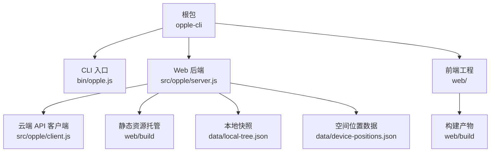
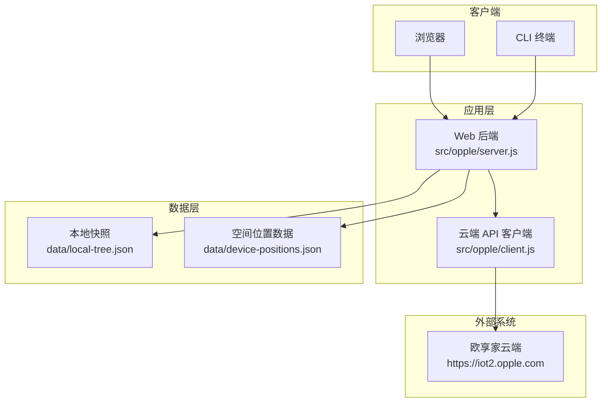
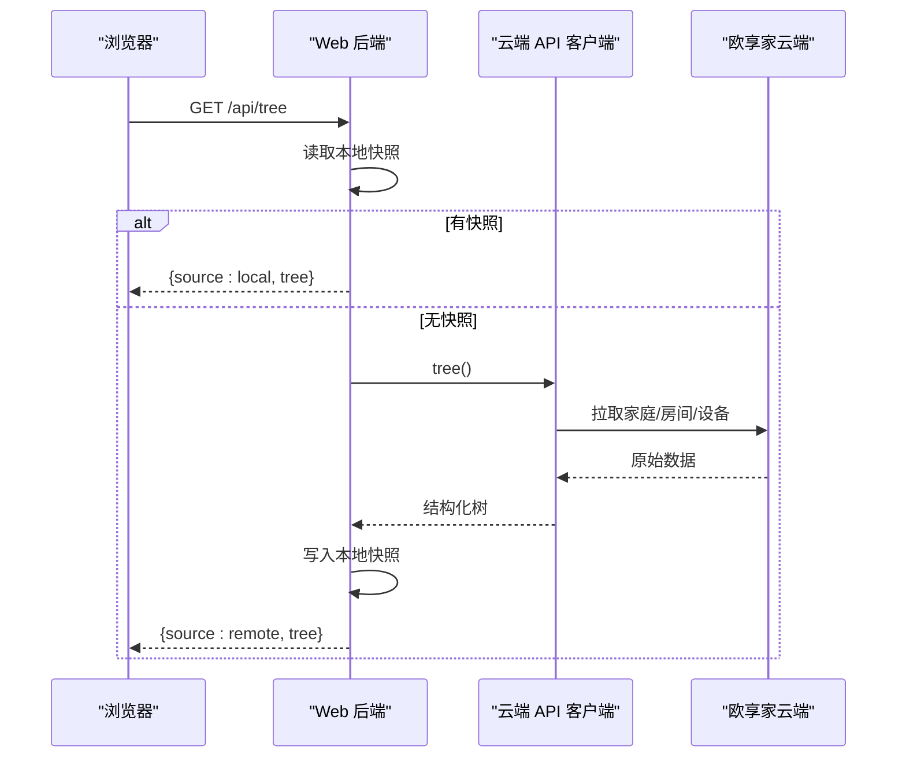
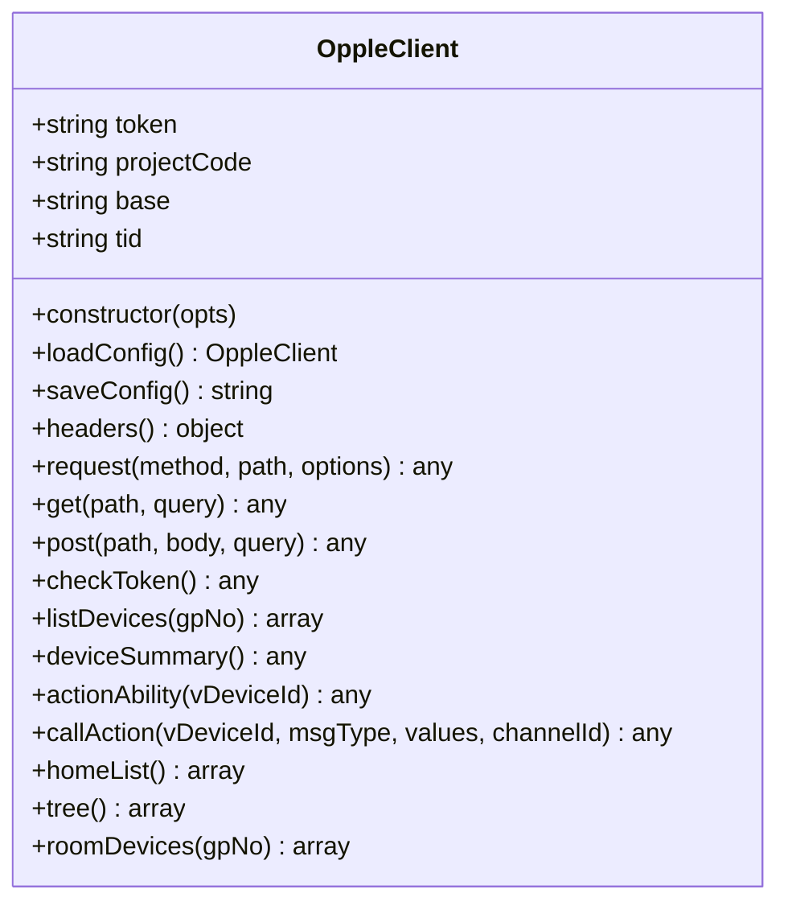
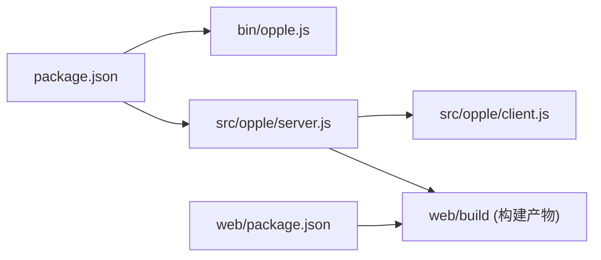

# 部署指南

<cite>
**本文引用的文件**   
- [package.json](file://package.json)
- [README.md](file://README.md)
- [bin/opple.js](file://bin/opple.js)
- [src/opple/server.js](file://src/opple/server.js)
- [src/opple/client.js](file://src/opple/client.js)
- [web/package.json](file://web/package.json)
- [docs/reverse-engineering-report.md](file://docs/reverse-engineering-report.md)
</cite>

## 目录
1. [简介](#简介)
2. [项目结构](#项目结构)
3. [环境要求与依赖安装](#环境要求与依赖安装)
4. [构建步骤](#构建步骤)
5. [配置文件说明](#配置文件说明)
6. [运行方式](#运行方式)
7. [生产环境部署最佳实践](#生产环境部署最佳实践)
8. [架构总览](#架构总览)
9. [详细组件分析](#详细组件分析)
10. [依赖关系分析](#依赖关系分析)
11. [性能调优与容量规划](#性能调优与容量规划)
12. [备份、恢复与数据迁移](#备份恢复与数据迁移)
13. [容器化部署](#容器化部署)
14. [CI/CD 流水线配置](#cicd-流水线配置)
15. [监控与日志](#监控与日志)
16. [故障排查指南](#故障排查指南)
17. [结论](#结论)

## 简介
本项目是欧享家（欧普 INNO 生态）本地控制适配器，提供命令行工具与 Web 控制台。后端通过逆向云端 API 实现家庭、房间、设备的统一建模与控制；前端基于 ice.js v3 提供家庭/房间/设备管理与 3D 空间建模能力。核心后端为 Node.js HTTP 服务，零外部运行时依赖，适合直接部署到任意 Node.js 环境。

## 项目结构
- 根包 `opple-cli`：CLI 入口与 Web 后端服务。
- `bin/opple.js`：CLI 可执行入口。
- `src/opple/server.js`：Web 后端，提供 REST API 并托管静态前端产物。
- `src/opple/client.js`：欧享家云端 API 客户端，封装鉴权头、请求与业务接口。
- `web/`：ice.js v3 前端工程，构建后输出到 `web/build`。
- `data/`：逆向产物、API 路径清单、空间位置快照等数据文件。
- `docs/reverse-engineering-report.md`：协议逆向报告，包含域名、请求头、关键接口与注意事项。



**图示来源**
- [package.json:1-17](file://package.json#L1-L17)
- [bin/opple.js:1-9](file://bin/opple.js#L1-L9)
- [src/opple/server.js:1-20](file://src/opple/server.js#L1-L20)
- [src/opple/client.js:1-20](file://src/opple/client.js#L1-L20)
- [web/package.json:1-31](file://web/package.json#L1-L31)

**章节来源**
- [package.json:1-17](file://package.json#L1-L17)
- [README.md:1-17](file://README.md#L1-L17)

## 环境要求与依赖安装
- Node.js 版本：>=22（由根包 engines 字段约束）。
- npm 或 pnpm/yarn 均可，建议使用与 Node 版本匹配的官方包管理器。
- 前端构建需要 Node.js 环境以执行 ice.js 构建脚本。

安装步骤：
1. 在仓库根目录执行依赖安装：
   - `npm install`
2. 进入前端目录安装前端依赖：
   - `cd web && npm install`

验证：
- CLI：`node bin/opple.js --help`（若存在帮助命令）或直接调用 `opple`（全局链接后）。
- Web：启动后端后访问 `http://localhost:5170`。

**章节来源**
- [package.json:13-15](file://package.json#L13-L15)
- [web/package.json:19-25](file://web/package.json#L19-L25)

## 构建步骤
- 后端无需额外构建，可直接运行。
- 前端需构建静态资源供后端托管：
  - `cd web && npm run build`
- 构建产物位于 `web/build`，后端默认从该目录读取静态文件。

注意：
- 如果未构建前端，后端会返回提示“前端未构建：cd web && npm i && npm run build”。

**章节来源**
- [src/opple/server.js:207-223](file://src/opple/server.js#L207-L223)
- [web/package.json:19-25](file://web/package.json#L19-L25)

## 配置文件说明
- 用户凭据配置文件：`~/.opple-cli.json`
  - 字段：`token`、`projectCode`、`base`（可选，默认 `https://iot2.opple.com`）。
  - 通过 CLI 保存凭据后生成，后端通过 `OppleClient.loadConfig()` 自动加载。
- 本地快照：`data/local-tree.json`
  - 存储家庭/房间/设备树结构及同步时间戳，用于加速读取，避免每次请求云端。
- 空间位置数据：`data/device-positions.json`
  - 存储房间尺寸与设备 3D 几何位置，供编辑器与 3D 预览使用。

自定义选项：
- 环境变量 `PORT`：设置 Web 后端监听端口，默认 `5170`。
- 配置项 `base`：可覆盖云端基础地址，适用于代理或私有网关场景。

安全建议：
- `~/.opple-cli.json` 包含敏感凭据，请限制文件权限（仅当前用户可读）。
- 生产环境建议使用进程环境变量注入敏感信息，避免落盘明文。

**章节来源**
- [src/opple/client.js:7-39](file://src/opple/client.js#L7-L39)
- [src/opple/server.js:10-16](file://src/opple/server.js#L10-L16)

## 运行方式
- CLI：
  - 根目录运行：`npm run opple`
  - 全局链接后直接使用 `opple` 命令。
- Web 后端：
  - 根目录运行：`npm run web`
  - 或直接执行：`node src/opple/server.js`
  - 默认监听 `http://localhost:5170`。

启动行为：
- 后端启动后会打印监听地址与前端是否就绪状态。
- 首次读取 `/api/tree` 若无本地快照，将回源拉取云端并写入 `data/local-tree.json`。

**章节来源**
- [package.json:9-12](file://package.json#L9-L12)
- [src/opple/server.js:228-231](file://src/opple/server.js#L228-L231)

## 生产环境部署最佳实践
- 进程管理：
  - 使用 systemd、PM2 或 Docker 容器管理 Node 进程，确保崩溃自重启。
  - 绑定非特权端口（如 8080），由反向代理（Nginx/Caddy/Traefik）暴露 80/443。
- 静态资源：
  - 预构建前端至 `web/build`，并在部署镜像中固化。
  - 若使用反向代理，可将静态资源交由 Nginx 托管以提升性能。
- 凭据管理：
  - 生产环境优先使用环境变量注入 `token` 与 `projectCode`，或通过密钥管理服务（如 Vault、KMS）动态注入。
  - 若必须使用配置文件，严格限制文件权限并定期轮换。
- 网络与安全：
  - 仅开放必要端口，启用防火墙策略。
  - 使用 HTTPS 终止于反向代理，后端仅处理内网流量。
- 多实例与水平扩展：
  - Web 后端无状态，可多实例横向扩展；本地快照与位置数据为文件级共享，建议使用分布式文件系统或对象存储。

[本节为通用指导，不直接分析具体代码文件]

## 架构总览


**图示来源**
- [src/opple/server.js:1-20](file://src/opple/server.js#L1-L20)
- [src/opple/client.js:1-20](file://src/opple/client.js#L1-L20)
- [docs/reverse-engineering-report.md:14-22](file://docs/reverse-engineering-report.md#L14-L22)

## 详细组件分析

### Web 后端组件
职责：
- 提供 REST API（家庭、房间、设备、动作、位置等）。
- 托管前端静态资源（`web/build`）。
- 管理本地快照与空间位置数据。

关键逻辑：
- 路由解析与 CORS 支持。
- JSON 响应封装与请求体解析。
- 本地快照优先读取，无缓存时回源拉取并落盘。
- 位置数据合并与导出过滤（排除 point 类设备与手动排除项）。



**图示来源**
- [src/opple/server.js:124-151](file://src/opple/server.js#L124-L151)
- [src/opple/client.js:165-204](file://src/opple/client.js#L165-L204)

**章节来源**
- [src/opple/server.js:1-232](file://src/opple/server.js#L1-L232)

### 云端 API 客户端组件
职责：
- 封装鉴权头（小写字段）、请求方法与错误处理。
- 提供业务接口：家庭列表、房间设备、动作能力、CallAction 控制指令等。

关键逻辑：
- 构造标准请求头，确保字段全小写以避免服务端校验异常。
- 统一错误处理：HTTP 状态码与业务 StatusCode 检查。
- 分页拉取设备列表，组合三层树结构。



**图示来源**
- [src/opple/client.js:13-225](file://src/opple/client.js#L13-L225)

**章节来源**
- [src/opple/client.js:1-226](file://src/opple/client.js#L1-L226)

### CLI 入口组件
职责：
- 作为 Node.js 可执行入口，调用 CLI 主逻辑（实际实现位于 `src/cli.js`，但本仓库未包含该文件）。
- 捕获异常并输出错误信息。

注意：
- 当前仓库缺少 `src/cli.js`，CLI 命令可能无法完整运行。若需 CLI 功能，请补充对应实现或使用 Web 后端 API 进行交互。

**章节来源**
- [bin/opple.js:1-9](file://bin/opple.js#L1-L9)

## 依赖关系分析


**图示来源**
- [package.json:1-17](file://package.json#L1-L17)
- [web/package.json:1-31](file://web/package.json#L1-L31)
- [src/opple/server.js:1-10](file://src/opple/server.js#L1-L10)

**章节来源**
- [package.json:1-17](file://package.json#L1-L17)
- [web/package.json:1-31](file://web/package.json#L1-L31)

## 性能调优与容量规划
- 后端性能：
  - 本地快照显著降低云端请求频率，提升 `/api/tree` 响应速度。
  - 静态资源托管建议由反向代理（Nginx）处理，减少 Node.js I/O 压力。
- 并发与连接数：
  - Node.js 单线程事件循环适合高并发低 CPU 场景；根据设备规模调整实例数量。
- 内存与磁盘：
  - 本地快照与位置数据随设备数量增长，建议定期清理无效快照或归档历史数据。
- 容量规划：
  - 小型家庭（<10 设备）：单实例足够。
  - 中型家庭（10-50 设备）：2-4 实例，配合负载均衡。
  - 大型场景（>50 设备）：考虑分布式存储替代本地文件，引入缓存层（Redis）加速热点数据。

[本节为通用指导，不直接分析具体代码文件]

## 备份、恢复与数据迁移
- 备份范围：
  - `data/local-tree.json`：家庭/房间/设备树快照。
  - `data/device-positions.json`：房间尺寸与设备 3D 位置。
  - `~/.opple-cli.json`：用户凭据（谨慎备份）。
- 备份策略：
  - 定时任务（cron/systemd timer）每日备份至对象存储或远程服务器。
  - 保留最近 N 天快照，避免无限增长。
- 恢复流程：
  - 停止服务，替换数据文件，重启服务。
  - 验证 `/api/tree` 与 `/api/positions` 返回正常。
- 数据迁移：
  - 跨机器迁移时，确保 Node.js 版本一致，避免 JSON 序列化差异。
  - 若升级数据结构，需在迁移脚本中兼容旧格式。

**章节来源**
- [src/opple/server.js:18-38](file://src/opple/server.js#L18-L38)
- [src/opple/client.js:7-39](file://src/opple/client.js#L7-L39)

## 容器化部署
- 基础镜像：
  - 使用 Node.js 22+ 官方镜像（如 `node:22-alpine`）。
- 构建阶段：
  - 安装前端依赖并构建静态资源。
  - 复制构建产物到最终镜像。
- 运行阶段：
  - 暴露端口（默认 5170，可通过环境变量覆盖）。
  - 挂载数据卷持久化 `data/` 目录。
- 示例 Dockerfile 思路：
  ```dockerfile
  FROM node:22-alpine AS builder
  WORKDIR /app
  COPY package*.json ./
  RUN npm ci
  COPY . .
  WORKDIR /app/web
  RUN npm ci && npm run build

  FROM node:22-alpine
  WORKDIR /app
  COPY --from=builder /app .
  EXPOSE 5170
  CMD ["node", "src/opple/server.js"]
  ```

[本节为概念性指导，不直接映射具体代码文件]

## CI/CD 流水线配置
- 触发条件：
  - Push 到 main 分支或创建发布标签。
- 步骤：
  1. 安装根包依赖：`npm ci`
  2. 安装前端依赖：`cd web && npm ci`
  3. 构建前端：`cd web && npm run build`
  4. 运行测试（如有）：`npm test`
  5. 构建镜像：`docker build -t opple-web .`
  6. 推送镜像到仓库：`docker push ...`
  7. 部署到目标环境（Kubernetes/Docker Swarm/VM）。

**章节来源**
- [web/package.json:19-25](file://web/package.json#L19-L25)

## 监控与日志
- 日志：
  - 后端启动日志包含监听地址与前端状态。
  - 建议接入结构化日志库（如 Pino/Winston）并输出到 stdout/stderr，由容器平台收集。
- 指标：
  - 暴露健康检查端点（如 `/health`），便于探针探测。
  - 监控 QPS、延迟、错误率（Node.js 内置性能计数器或 APM 工具）。
- 告警：
  - 进程崩溃、端口占用、磁盘空间不足、云端 API 错误率升高。

**章节来源**
- [src/opple/server.js:228-231](file://src/opple/server.js#L228-L231)

## 故障排查指南
常见问题与解决方案：
- 未找到配置文件：
  - 现象：启动后端时报错“未找到配置文件 ~/.opple-cli.json”。
  - 解决：先通过 CLI 保存凭据，或手动创建配置文件。
- 前端未构建：
  - 现象：访问页面返回“前端未构建”提示。
  - 解决：执行 `cd web && npm run build`。
- 云端 API 错误：
  - 现象：请求返回 12004/11009 错误。
  - 原因：请求头大小写不一致。
  - 解决：确保所有请求头字段为小写（见逆向报告第 3 节）。
- 本地快照损坏：
  - 现象：读取快照失败。
  - 解决：删除 `data/local-tree.json`，重新触发同步。

**章节来源**
- [src/opple/client.js:24-30](file://src/opple/client.js#L24-L30)
- [src/opple/server.js:207-223](file://src/opple/server.js#L207-L223)
- [docs/reverse-engineering-report.md:24-43](file://docs/reverse-engineering-report.md#L24-L43)

## 结论
本项目提供轻量级的欧享家本地控制适配器，具备 CLI 与 Web 控制台双形态。生产部署建议结合反向代理、进程管理、HTTPS 与密钥管理，确保安全性与稳定性。通过本地快照优化性能，结合监控与日志体系实现可观测性。容器化与 CI/CD 流水线可进一步提升交付效率与一致性。

[本节为总结性内容，不直接分析具体代码文件]