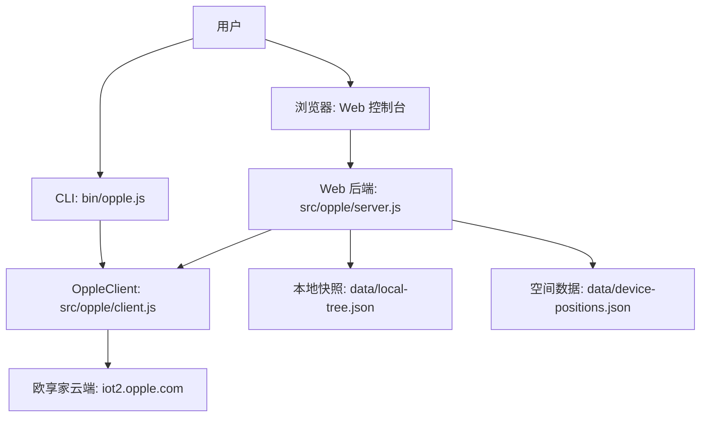
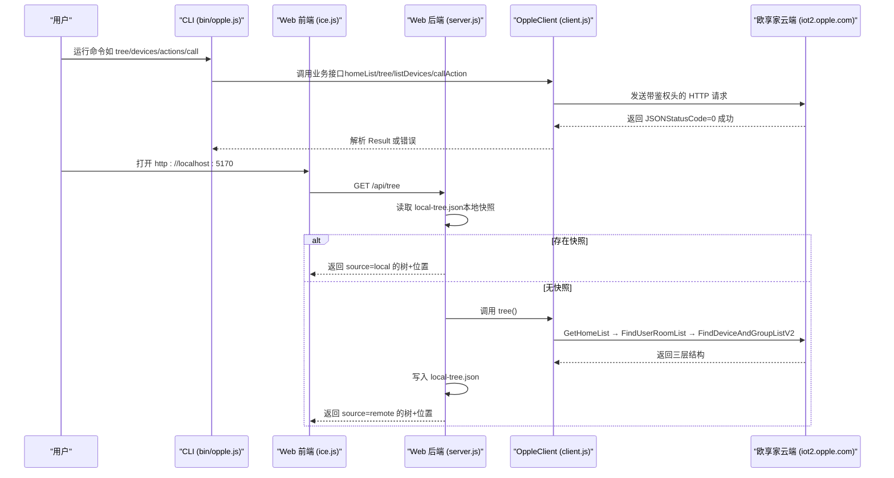
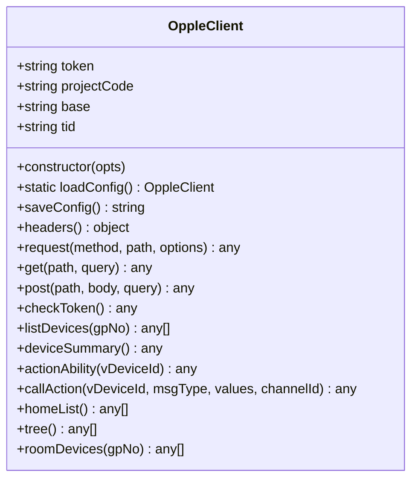
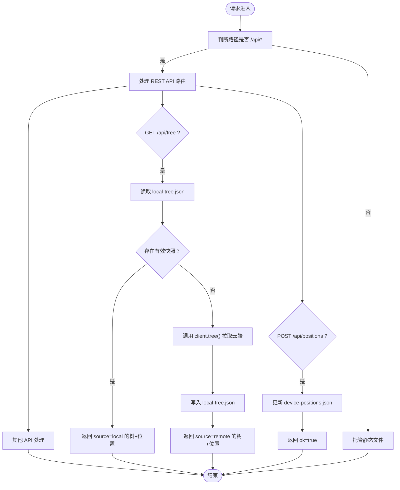
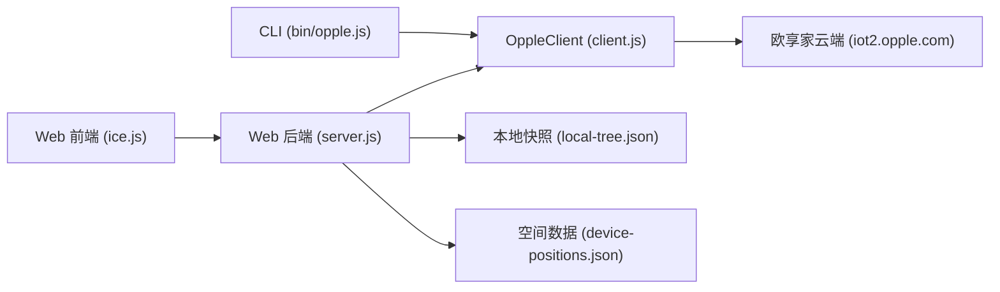

# 项目概述

<cite>
**本文引用的文件**   
- [README.md](file://README.md)
- [package.json](file://package.json)
- [bin/opple.js](file://bin/opple.js)
- [src/opple/client.js](file://src/opple/client.js)
- [src/opple/server.js](file://src/opple/server.js)
- [web/package.json](file://web/package.json)
- [docs/reverse-engineering-report.md](file://docs/reverse-engineering-report.md)
</cite>

## 目录
1. [引言](#引言)
2. [项目结构](#项目结构)
3. [核心组件](#核心组件)
4. [架构总览](#架构总览)
5. [关键组件详解](#关键组件详解)
6. [依赖关系分析](#依赖关系分析)
7. [性能与缓存特性](#性能与缓存特性)
8. [快速开始指南](#快速开始指南)
9. [故障排查](#故障排查)
10. [结论](#结论)

## 引言
本项目名为“欧享家（Opple INNO生态）本地控制适配器”，目标是通过逆向欧享家云端 API，实现对欧普 INNO 设备的本地统一控制。项目提供两类入口：
- CLI 命令行工具：零依赖 Node 脚本，用于凭据管理、设备树浏览、动作查询与设备控制。
- Web 控制台：基于 ice.js v3 的 React 前端，配合零依赖 Node HTTP 后端，提供家庭/房间/设备三层结构展示、二维布局编辑与 3D 空间预览。

项目的核心价值包括：
- 零依赖 Node 后端：仅使用 Node 内置模块实现 HTTP 服务、JSON 读写与 OppleClient 复用。
- React 前端：ice.js v3 构建，支持家庭页、房间 3D 预览、位置编辑与排除设备管理。
- 三层空间建模：房间尺寸 + 设备几何（吸顶灯圆面、灯带线段、网关点位），elev 以离地百分比存储，UI 以距顶米数呈现。
- 本地缓存机制：`data/local-tree.json` 作为家庭/房间/设备快照；`data/device-positions.json` 持久化空间布局；读取优先本地，避免频繁请求云端。

该文档既为初学者提供概念性说明，也为有经验的开发者给出代码级结构与数据流细节。

## 项目结构
仓库采用“后端适配层 + 前端控制台”的分层组织方式：
- `bin/opple.js`：CLI 可执行入口。
- `src/opple/client.js`：OppleClient，封装鉴权头、Token、ProjectCode、分页拉取、设备动作调用与三层树构造。
- `src/opple/server.js`：零依赖 Node HTTP 服务，暴露 REST API，托管 web 构建产物，并维护本地快照与空间数据。
- `web/`：React 前端工程（ice.js v3），包含页面、样式与构建配置。
- `data/`：逆向产物与本地数据（APK、反编译 JS、接口清单、空间数据、本地快照）。
- `docs/reverse-engineering-report.md`：协议逆向全记录，含请求头、签名、控制指令、局域网直控通道等。

图表来源
- [bin/opple.js:1-9](file://bin/opple.js#L1-L9)
- [src/opple/client.js:1-226](file://src/opple/client.js#L1-L226)
- [src/opple/server.js:1-232](file://src/opple/server.js#L1-L232)
- [README.md:6-16](file://README.md#L6-L16)

章节来源
- [README.md:6-16](file://README.md#L6-L16)
- [package.json:1-17](file://package.json#L1-L17)

## 核心组件
- CLI 入口：`bin/opple.js` 调用 `src/cli.js` 的 `run` 方法处理命令行参数。
- OppleClient：负责与欧享家云端交互，包括：
  - 固定请求头（小写字段）、Token 校验与刷新。
  - 家庭列表、房间设备列表、设备摘要、动作能力查询。
  - CallAction 统一控制接口，values 按 KeyId 升序拼接。
  - 三层树 tree()：GetHomeList → FindUserRoomList → FindDeviceAndGroupListV2。
- Web 后端 server.js：
  - 路由 `/api/*`：tree、sync、devices、summary、actions、positions 等。
  - 本地快照优先策略：无快照时回源拉取并落盘。
  - 空间模型注入：将 device-positions.json 合并到 tree 返回结果。
  - 静态资源托管：web/build 下的构建产物。
- Web 前端：ice.js v3 工程，提供家庭/房间/设备 UI、二维布局编辑与 3D 预览。

章节来源
- [bin/opple.js:1-9](file://bin/opple.js#L1-L9)
- [src/opple/client.js:13-225](file://src/opple/client.js#L13-L225)
- [src/opple/server.js:1-232](file://src/opple/server.js#L1-L232)
- [web/package.json:1-31](file://web/package.json#L1-L31)

## 架构总览
整体架构由“客户端（CLI/Web）— 适配层（OppleClient）— 云端 API”构成，同时通过本地文件缓存降低云端访问频率。

图表来源
- [bin/opple.js:1-9](file://bin/opple.js#L1-L9)
- [src/opple/client.js:101-225](file://src/opple/client.js#L101-L225)
- [src/opple/server.js:124-204](file://src/opple/server.js#L124-L204)
- [README.md:18-39](file://README.md#L18-L39)

## 关键组件详解

### OppleClient（云端 API 客户端）
- 职责：
  - 配置加载与保存：`.opple-cli.json` 中 token/projectCode/base。
  - 请求头生成：lang、accept、content-type、app-timezone、app-version、clientid、ostype、projectcode、token、tid、client-up-time、user-agent。
  - 通用 request：GET/POST，URLSearchParams 拼接 query，HTTP 状态码检查，JSON 解析，StatusCode 非 0 抛错。
  - 业务接口：checkToken、listDevices、deviceSummary、actionAbility、callAction、homeList、tree、roomDevices。
- 设计要点：
  - 零依赖：仅使用 node:fs、node:os、node:path、node:crypto 与 fetch。
  - 分层清晰：基础请求封装在上层业务方法之下。
  - 错误处理：HTTP 非 200 抛错；JSON 解析失败抛错；StatusCode 非 0 抛错。

图表来源
- [src/opple/client.js:13-225](file://src/opple/client.js#L13-L225)

章节来源
- [src/opple/client.js:1-226](file://src/opple/client.js#L1-L226)

### Web 后端（server.js）
- 职责：
  - 启动 Node HTTP 服务，监听端口（默认 5170）。
  - CORS 支持（开发模式跨域）。
  - REST API：
    - GET /api/homes：家庭列表（实时云端）。
    - GET /api/tree：本地快照优先，无快照则回源并落盘。
    - POST /api/sync：一键同步云端最新结构到本地快照。
    - GET /api/devices：设备列表（可按 gpNo 过滤）。
    - GET /api/summary：设备摘要。
    - GET /api/actions：设备动作能力（需 vDeviceId）。
    - POST /api/positions：保存房间布局（shape/positions/excluded）。
    - GET /api/positions：导出空间数据（供 AI 推理）。
  - 静态资源托管：web/build 下的 HTML/CSS/JS 等。
- 数据模型：
  - 本地快照：`data/local-tree.json`，结构 `{ syncedAt, tree }`。
  - 空间数据：`data/device-positions.json`，结构 `projectCode -> gpno -> { shape, devices, excluded }`。
  - 注入逻辑：treeWithPositions 将位置与排除信息合并到 tree 返回结果。

图表来源
- [src/opple/server.js:18-86](file://src/opple/server.js#L18-L86)
- [src/opple/server.js:114-226](file://src/opple/server.js#L114-L226)

章节来源
- [src/opple/server.js:1-232](file://src/opple/server.js#L1-L232)

### CLI 入口（bin/opple.js）
- 职责：
  - 作为 Node 可执行脚本入口。
  - 调用 `src/cli.js` 的 `run` 方法处理命令行参数。
  - 捕获异常并输出错误信息。

章节来源
- [bin/opple.js:1-9](file://bin/opple.js#L1-L9)

### Web 前端（web/）
- 技术栈：React 18 + ice.js v3。
- 功能：
  - 家庭页：房间卡片列表。
  - 房间页：3D 预览（拖拽旋转/滚轮缩放）。
  - 布局编辑：二维平面拖拽设备（灯=圆盘可调大小、灯带=长条可调方向长度）+ 尺寸/高度滑杆。
  - 排除设备：清单切换眼睛图标，设备不参与位置编辑、3D 渲染与导出。
- 构建：npm run build 产出 web/build 目录，由后端托管。

章节来源
- [web/package.json:1-31](file://web/package.json#L1-L31)
- [README.md:32-39](file://README.md#L32-L39)

## 依赖关系分析
- CLI 依赖：
  - `bin/opple.js` 依赖 `src/cli.js`（未在仓库结构中列出，但被引用）。
- Web 后端依赖：
  - `src/opple/server.js` 依赖 `src/opple/client.js`。
  - 文件系统：`data/local-tree.json`、`data/device-positions.json`。
  - 静态资源：`web/build`。
- Web 前端依赖：
  - React 18、ice.js v3。
- 外部依赖：
  - 欧享家云端 API（iot2.opple.com）。
  - 局域网直控通道（iotctrl.opple.com:65501 UDP，未在本项目中实现）。

图表来源
- [bin/opple.js:1-9](file://bin/opple.js#L1-L9)
- [src/opple/server.js:1-232](file://src/opple/server.js#L1-L232)
- [src/opple/client.js:1-226](file://src/opple/client.js#L1-L226)

章节来源
- [package.json:1-17](file://package.json#L1-L17)
- [web/package.json:1-31](file://web/package.json#L1-L31)

## 性能与缓存特性
- 本地快照优先：GET /api/tree 首先读取 `data/local-tree.json`，若存在则直接返回，避免云端请求。
- 增量更新：POST /api/sync 拉取云端最新结构并落盘，后续读取走本地。
- 空间数据实时合并：无论快照来源，设备位置与排除信息始终从 `data/device-positions.json` 实时合并。
- 零依赖后端：仅使用 Node 内置模块，减少运行时开销。
- 前端构建优化：ice.js v3 提供生产构建优化，减少包体体积。

[本节为通用性能讨论，不直接分析具体文件]

## 快速开始指南

### 安装与环境要求
- Node.js 版本 >= 22（见 package.json engines）。
- 可选全局安装 CLI：`npm link`。

### 基本配置
- 获取 Token 与 ProjectCode：
  - 使用 Reqable 抓包手机 App 任意 `iot2.opple.com` 请求，提取 `token`（32位 hex）与 `projectcode`。
  - 注意：请求头必须全小写（token/projectcode/clientid…），混用大小写会触发 12004/11009 错误。
- 保存凭据：`opple token save <token> <projectcode>`。

### 常用命令示例
- 查看三层结构：`opple tree`
- 按房间过滤设备：`opple devices 客厅`
- 查询设备动作能力：`opple actions 2122050`
- 控制灯光（色温/颜色/开关/亮度）：`opple light 2122050 cct 4000`、`opple light 2122050 color "#FF8000"`
- 设置灯效：`opple scene 2122018 跑马 speed=70 direction=reverse`
- 底层命令调用：`opple call <id> <msgType> <v1,v2…>`
- 调试任意接口：`opple raw GET /api/Project/GetHomeList`

### Web 控制台
- 启动后端：`node src/opple/server.js` 或 `npm run web`。
- 打开浏览器：http://localhost:5170。
- 同步数据：点击“同步数据”拉取云端最新结构到本地快照。
- 家庭页：房间卡片列表，点击进入房间 3D 预览。
- 编辑布局：二维平面拖拽设备 + 尺寸/高度滑杆。

章节来源
- [README.md:18-39](file://README.md#L18-L39)
- [README.md:41-58](file://README.md#L41-L58)
- [package.json:13-14](file://package.json#L13-L14)

## 故障排查
- Token 无效或权限错误（12004/11009）：
  - 检查请求头是否全小写（token/projectcode/clientid…）。
  - 确认 Token 是否为 32 位 hex，ProjectCode 是否正确。
- 本地快照损坏：
  - 删除 `data/local-tree.json` 后重新同步。
- 空间数据异常：
  - 检查 `data/device-positions.json` 格式是否符合 `projectCode -> gpno -> { shape, devices, excluded }`。
- 前端未构建：
  - 后端提示“前端未构建”，需在 `web/` 目录下执行 `npm install && npm run build`。

章节来源
- [README.md:41-45](file://README.md#L41-L45)
- [src/opple/server.js:207-223](file://src/opple/server.js#L207-L223)

## 结论
本项目通过逆向欧享家云端 API，实现了欧普 INNO 设备的本地统一控制。CLI 与 Web 控制台双入口覆盖从命令行操作到可视化 3D 管理的完整场景。核心优势在于零依赖后端、React 前端、三层空间建模与本地缓存机制，既保证易用性又兼顾性能。对于初学者，可从 CLI 命令入手逐步理解设备控制流程；对于有经验开发者，可深入 OppleClient 与 server.js 的数据流与缓存策略，进一步扩展局域网直控或更多设备类型支持。

[本节为总结性内容，不直接分析具体文件]